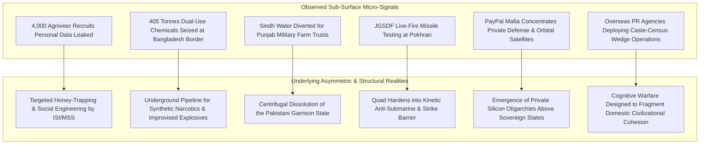

# BSKM DOMAIN DOSSIER: VEDIC & SANATAN CIVILIZATIONAL EPISTEMOLOGY, SHASTRAS & HISTORIOGRAPHY
> Canonical Sub-Dossier of the Bharat-Centric Sovereign Knowledge Matrix.
> Source: `knowledge_library/01_SANATAN_CIVILIZATIONAL_EPISTEMOLOGY.md` | Sections: 35

---

## SECTION 1: THE PURUSHA SUKTA FORENSIC DECONSTRUCTION

### 1.1 Textual Source, Dating, and Canonical Authority
* **Primary Canonical Sources:**
  * **Rigveda Samhita:** Mandala 10, Sukta 90 (Verses 1–16).
  * **Shukla Yajurveda:** Vajasaneyi Samhita, Chapter 31 (Verses 1–22).
  * **Atharvaveda Samhita:** Kanda 19, Sukta 6.
  * **Taittiriya Aranyaka:** Prapāṭhaka 3, Anuvāka 12.
* **Drashta (Revealed Rishi):** Rishi Narayana (नारायण ऋषि).
* **Devata (Cosmic Subject):** Paramapurusha / Virat Purusha (विराट् पुरुष).
* **Chandas (Metrical Structure):** Anushtup (Verses 1–15); Trishtup (Verse 16).
* **Historical Horizon:** Traditional Indic chronology places the Rigvedic compilation prior to 3102 BCE (onset of Kali Yuga); modern critical and astronomical philology (e.g., Dr. B.R. Ambedkar, David Frawley, Subhash Kak) benchmarks the Vedic layers between 2500 BCE and 1500 BCE.

---

### 1.2 The Central Disputed Verse: Rigveda 10.90.12
```sanskrit
ब्राह्मणोऽस्य मुखमासीद् बाहू राजन्यः कृतः ।
ऊरू तदस्य यद्वैश्यः पद्भ्यां शूद्रो अजायत ॥ १२ ॥
```

#### Transliteration (IAST)
*Brāhmaṇo'sya mukhamāsīd bāhū rājanyaḥ kṛtaḥ |*  
*Ūrū tadasya yadvaiśyaḥ padbhyāṃ śūdro ajāyata || 12 ||*

#### Word-by-Word Grammatical and Etymological Breakdown
1. **ब्राह्मणः (Brāhmaṇaḥ):** The intellectual, contemplative, and spiritual custodian.
2. **अस्य (Asya):** Of Him (the cosmic Virat Purusha).
3. **मुखम् (Mukham):** The mouth / face / faculty of speech and knowledge transmission.
4. **आसीत् (Āsīt):** Was / became (imperfect tense of root *as* - to be).
5. **बाहू (Bāhū):** The two arms (symbol of strength, governance, and physical defense).
6. **राजन्यः (Rājanyaḥ):** The ruler, protector, warrior (Kshatriya).
7. **कृतः (Kṛtaḥ):** Was fashioned / assigned as functional duty (past passive participle of root *kṛ* - to do).
8. **ऊरू (Ūrū):** The two thighs (the economic pillars, trade, agriculture, sustaining power).
9. **तद् (Tad):** That which was.
10. **अस्य (Asya):** Of Him.
11. **यद् (Yad):** Which.
12. **वैश्यः (Vaiśyaḥ):** The producer, merchant, agrarian entrepreneur.
13. **पद्भ्याम् (Padbhyām):** From the two feet (the foundational support upon the Earth).
14. **शूद्रः (Śūdraḥ):** The artisan, laborer, foundational service provider.
15. **अजायत (Ajāyata):** Was born / manifested / emanated (imperfect middle of root *jan* - to generate).

---

### 1.3 Hermeneutic & Sociological Analysis: The Cosmic Organic Metaphor
1. **The Organic Ecological Whole (Avayava-Avayavi Bhava):**
   * The Purusha Sukta does **not** describe a pyramidal or vertical hierarchy of oppression; it describes an **integrated organic cosmic body** (Virat Purusha).
   * In human biology and organic systems, the feet are not inferior to the face. The feet support the entire superstructure, maintain direct contact with the sacred earth (*Bhumi Mata*), and permit locomotion. Injury to the feet incapacitates the head and arms completely.
   * In Vedic cosmogony, Verse 14 of the exact same Sukta states:
     ```sanskrit
     पद्भ्यां भूमिर्दिशः श्रोत्रात् तथा लोकाँ अकल्पयन् ॥ १४ ॥
     ```
     *(From His feet the Earth was born, from His ears the directions; thus were fashioned the worlds).*
   * If the Earth (*Bhoomi*) emanated from the feet of the Purusha, and the Shudra also emanated from the feet, the Shudra shares the sacred, foundational attribute of the Earth itself—the bedrock of life and sustenance.

2. **Guna-Karma vs. Birth-Locked Hierarchy:**
   * In the Rigveda, professions were non-hereditary. In Rigveda 9.112.3, the Rishi explicitly proclaims:
     *“I am a reciter of hymns, my father is a physician, and my mother is a grinder of corn with stones. Striving for livelihood with varied abilities, we live together.”*
   * The Bhagavad Gita (Chapter 4, Verse 13) confirms:
     ```sanskrit
     चातुर्वर्ण्यं मया सृष्टं गुणकर्मविभागशः ।
     तस्य कर्तारमपि मां विद्ध्यकर्तारमव्ययम् ॥ १३ ॥
     ```
     *(The fourfold order was created by Me according to the divisions of Gunas [temperaments] and Karmas [actions], not by biological birth).*

---

### 1.4 Historical Commentaries on Purusha Sukta
* **Sayanacharya (14th Century CE, Vijayanagara Empire):**
  * *Book:* *Rigveda Samhita Bhashya* (Sayana Bhashya).
  * Sayana interprets the cosmic body as the macrocosm (*Samashti*) manifesting into the social microcosm (*Vyashti*). He notes that the head represents intellectual counsel, the arms sovereign protection, the thighs material sustenance, and the feet the base of labor, asserting their mutual interdependence (*Paraspara Upakaraka*).
* **Maharshi Dayananda Saraswati (1875 CE):**
  * *Book:* *Satyarth Prakash* (Light of Truth) & *Rigvedadi Bhashya Bhumika*.
  * Proves that Varna in the Vedas is merit-based (*Yogyata-moolak*), determined by education and character during the Brahmacharya ashrama. He completely rejects birth-based untouchability as an anti-Vedic corruption.
* **Dr. Bhimrao Ramji Ambedkar (1946 CE):**
  * *Book:* *Who Were the Shudras? How they came to be the Fourth Varna in the Indo-Aryan Society* (Thacker & Co., Bombay, 1946).
  * **Core Thesis:** Dr. Ambedkar conducted an exhaustive forensic examination of the Rigveda, Mahabharata, and Brahmanas. He demonstrated:
    1. The Shudras were originally an elite Aryan Kshatriya community belonging to the solar dynasty (e.g., King Sudas of the Rigvedic Battle of the Ten Kings).
    2. Degradation occurred centuries later due to sociopolitical conflicts and denial of the sacred thread ceremony (*Upanayana*) by orthodox priesthoods, **not** because of any racial or biological division in the Purusha Sukta.
    3. Ambedkar categorically debunked the Western racial interpretation of the Vedas.

---

### 1.5 Colonial & Missionary Weaponization: The Construction of "Caste"
* **The Linguistic Substitution (Varna/Jati $\rightarrow$ Caste):**
  * The Portuguese word *Casta* (meaning pure breed, race, or lineage) was imported in the 16th century and superimposed onto the indigenous, flexible concepts of **Varna** (functional cosmic aptitude) and **Jati** (decentralized professional guilds and kinship groups).
* **Sir Herbert Hope Risley & The 1901 Census of India:**
  * *Author:* Sir Herbert Hope Risley (Census Commissioner of British India, Ethnographer).
  * *Work:* *The People of India* (1908) and the *Census Report of 1901*.
  * *Weaponization:* Risley applied nasal index calipers (anthropometry) to classify Indians into hierarchical racial tiers based on pseudo-scientific Social Darwinism. He forcibly rigidified over 2,300 fluid local Jatis into ranked legal administrative categories, criminalizing mobility and deliberately cultivating inter-community hatred to neutralize anti-British unity following the 1857 uprising.
* **Thomas Babington Macaulay (Minute on Indian Education, 1835):**
  * Designed an educational administrative system to divorce Indians from Sanskrit source texts, generating an alienated administrative class (*Macaulayputras*) who would view their own civilization through European Christian missionary lenses.

---

---

## SECTION 2: THE VYADHA GITA (MAHABHARATA)

### 2.1 Textual Source, Authorship, and Placement
* **Source:** *Mahabharata*, Aranyaka Parva (Vana Parva), Chapters 206 to 216 (Critical Edition Ch. 196–206).
* **Author / Compiler:** Krishna Dvaipayana Veda Vyasa (वेदव्यास).
* **Dramatis Personae:**
  1. **Kausika (कौशिक):** An austere Brahmin ascetic proud of his ritualistic tapas and yogic powers (who incinerated a female crane with an angry glance).
  2. **Pativrata Gṛhiṇī:** A devout householder woman whose spiritual awareness surpassed Kausika’s yogic powers through selfless, dedicated duty to her family.
  3. **Dharma Vyadha (धर्मव्याध):** An enlightened butcher in Mithila who sells venison and boar meat, cares for elderly parents, and possesses supreme Brahma-Vidya.

---

### 2.2 Core Dialogue and Philosophical Tenets
* **Refutation of External Ritualism:**
  When Kausika arrives in Mithila expecting an uncivilized butcher, he finds Dharma Vyadha addressing him by name and revealing his prior encounters without being told.
* **The Definition of True Karma and Ahimsa:**
  * When Kausika expresses disgust at Vyadha’s profession of meat-selling, Dharma Vyadha delivers a masterclass in cosmic realism:
    1. **Inevitability of Living Impact:** No individual, including the farmer tilling the soil or the ascetic walking the forest, can avoid causing micro-scale harm to living organisms (insects, microbes). True Ahimsa is not hypocritical physical inaction, but the absence of malice, greed, and ego in fulfilling necessary societal duties.
    2. **Hereditary Duty without Attachment:** Vyadha explains that he does not slaughter animals himself; he sells meat procured from others without killing for pleasure. He operates without greed, delivers honest weight, and maintains complete self-control.
    3. **Service to Parents as Supreme Yajna:** Vyadha demonstrates that honoring his father and mother is his highest altar of sacrifice (*Pitru-Seva*), far exceeding sterile mountain austerities that abandon family obligations.
* **The Decisive Proclamation on Varna:**
  Dharma Vyadha states to the Brahmin Kausika (Mahabharata, Vana Parva 216.14–15):
  ```sanskrit
  यस्तु शूद्रो दमे सत्ये धर्मे च सततोत्थितः ।
  तं ब्राह्मणमहं मन्ये वृत्तेन हि भवेद् द्विजः ॥
  ```
  *(A Shudra who is steadfast in self-restraint, truthfulness, and righteousness, I consider him a true Brahmana. For character and conduct alone determine the twice-born state, never biological descent).*

---

---

## SECTION 3: VEDANTA & THE PRASTHANATRAYI FOUNDATIONS

```
                                    ┌───────────────────────────────────┐
                                    │          PRASTHANATRAYI           │
                                    │     (The Threefold Canons)        │
                                    └─────────────────┬─────────────────┘
                                                      │
             ┌────────────────────────────────────────┼────────────────────────────────────────┐
             ▼                                        ▼                                        ▼
    ┌─────────────────┐                      ┌─────────────────┐                      ┌─────────────────┐
    │ SHRUTI PRASTHANA│                      │ NYAYA PRASTHANA │                      │ SMRITI PRASTHANA│
    │  12 Principal   │                      │  Brahma Sutras  │                      │  Bhagavad Gita  │
    │   Upanishads    │                      │ (Badarayana)    │                      │  (Veda Vyasa)   │
    └────────┬────────┘                      └────────┬────────┘                      └────────┬────────┘
             │                                        │                                        │
             └────────────────────────────────────────┼────────────────────────────────────────┘
                                                      │
                                                      ▼
                                   ┌──────────────────────────────────────┐
                                   │           ADVAITA VEDANTA            │
                                   │    (Adi Shankaracharya, 8th c.)      │
                                   │                                      │
                                   │  1. Brahma Satyam (Absolute Truth)   │
                                   │  2. Jagan Mithya (Empirical Shift)   │
                                   │  3. Jivo Brahmaiva Naparah (Non-Dual)│
                                   └──────────────────────────────────────┘
```

### 3.1 The Three Canons (Prasthanatrayi)
1. **Shruti Prasthana:** The 12 Principal Upanishads (*Isha, Kena, Katha, Prashna, Munda, Mandukya, Taittiriya, Aitareya, Chandogya, Brihadaranyaka, Shvetashvatara, Kaushitaki*).
2. **Nyaya Prasthana:** The *Brahma Sutras* of Badarayana Vyasa (555 aphorisms synthesizing Upanishadic logic).
3. **Smriti Prasthana:** The *Bhagavad Gita* (700 verses spoken by Sri Krishna to Arjuna in the Bhishma Parva of the Mahabharata).

---

### 3.2 Adi Shankaracharya: Advaita Ontology & Epistemology
* **Historical Horizon:** Traditionally dated by monastic lineages to 509–477 BCE; modern academic historiography places him between 788 and 820 CE.
* **Core Metaphysical Formula:**
  ```sanskrit
  श्लोकार्धेन प्रवक्ष्यामि यदुक्तं ग्रन्थकोटिभिः ।
  ब्रह्म सत्यं जगन्मिथ्या जीवो ब्रह्मैव नापरः ॥
  ```
  *(In half a verse I shall proclaim what is stated in millions of texts: Brahman alone is absolute reality; the world is Mithya [an empirical, transient reality]; and the individual soul is identical to Brahman, nothing else).*

* **The Three Tiers of Reality (Sattā-Traividhya):**
  1. **Prātibhāsika (Apparent / Subjective Reality):** Dreams, hallucinations, mistaking a rope for a snake. Vanishes upon empirical awakening.
  2. **Vyāvahārika (Empirical / Pragmatic Reality):** The waking world of physical laws, science, trade, laws, and geopolitics. Valid and functional until metaphysical realization.
  3. **Pāramārthika (Absolute Transcendental Reality):** Pure non-dual Consciousness (*Nirguna Brahman*), beyond time, space, and causation (*Desha-Kala-Nimitta*).

* **The Doctrine of Maya and Adhyasa (Superimposition):**
  * *Maya* is defined as *Anirvacanīya*—indescribable as either absolute existence (*Sat*) or absolute non-existence (*Asat*).
  * *Adhyāsa:* The cognitive superimposition of the attributes of the objective world onto the subject (the Self), causing human bondage and cognitive vulnerability.

---

### 3.3 The Historic Shastrartha: Adi Shankaracharya vs. Mandana Misra
* **Canonical Chronicle:** *Sankara Digvijaya* by Madhava Vidyaranya (14th Century CE, Vijayanagara Empire).
* **Location:** Mahishmati (modern-day Maheshwar, Madhya Pradesh, on the banks of the Narmada).
* **Contestants:**
  * **Adi Shankaracharya:** Championing *Jnana Kanda* (Uttara Mimamsa / Advaita Vedanta—liberation through knowledge of non-duality).
  * **Mandana Misra:** Championing *Karma Kanda* (Purva Mimamsa of Rishi Jaimini / Kumarila Bhatta—liberation and cosmic order maintained through strict sacrificial rituals and duties).
* **The Arbiter:** **Ubhaya Bharati (Bharati Mishra)**, revered wife of Mandana Misra and an incarnation of Goddess Saraswati.
* **The Arbiter’s Invariant Test:** Fresh garlands of flowers (*Vanamala*) were placed around the necks of both debaters. The person whose garland began to fade and wilt first would be deemed defeated, as intellectual frustration, agitation, and ego generate metabolic heat and distress.
* **Debate Duration:** 17 continuous days of formal dialectics.
* **Philosophical Outcome:** Mandana Misra’s garland withered. Acknowledging the supreme validity of Advaita Vedanta over mechanistic ritualism, he took vows of Sannyasa under Shankara, received the monastic name **Sureshvaracharya**, and authored monumental treatises including the *Taittiriya Vartika* and *Naishkarmya Siddhi*.
* **Establishment of the Four Amnaya Mathas:**
  To preserve the intellectual, spiritual, and territorial integrity of Bharatavarsha, Shankara established four monastic universities guarding the four cardinal frontiers:
  1. **East:** Govardhana Matha (Puri, Odisha) — Rigveda.
  2. **South:** Sringeri Sharada Peetham (Karnataka) — Yajurveda.
  3. **West:** Dvaraka Sharada Peetham (Gujarat) — Samaveda.
  4. **North:** Jyotirmath (Badarikashrama, Uttarakhand) — Atharvaveda.

---

---

## SECTION 4: FORENSIC MATRIX DECONSTRUCTION OF THE 13 VIDEO DISCOURSES

Below is the exhaustive, lens-by-lens audit of the 13 provided sources, measuring empirical reality, personal ideological overlay, political agenda, and strategic civilizational impact.

```
       DECOMPOSITION VECTOR:  v = ( Factuality_Ratio,  Ideology_Intensity,  Agenda_Potency,  Omission_Penalty )
```

### Video 1: `4ccWeJoJOag` — Drishtikone: *The Great Caste Lie*
* **Core Theses:** Analyzes the Vyadha Gita (Mahabharata Vana Parva), butcher-as-guru, deconstructs the colonial/missionary "Caste" framing vs Vedic Varna, exposes modern sociological subversion.
* **Vector Decomposition:** $\mathbf{v} = (0.88, 0.15, 0.10, 0.05)$
* **Empirical Reality vs Agenda:** **90% Empirical Grounding.** Accurately quotes the Vyadha Gita and historical shifts. Agenda is defensive cultural decolonization.
* **Optical Analysis:**
  * *Civilizational/Historical:* Clarifies that Vedic and Itihasa frameworks celebrated working-class enlightenment.
  * *Geo-Political / Lawfare:* Highlights how Western funding networks weaponize caste grievances in international human rights forums to cripple Indian industrial competitiveness and societal unity.

---

### Video 2: `2Ei_ulEE6JM` — Praarabdh (Awanish P.N. Sharma): *Gandhi & Hindu Expose*
* **Core Theses:** Forensic documentation of M.K. Gandhi’s statements during the 1921 Moplah Massacre, 1924 Kohat Riots, and the 1926 assassination of Swami Shraddhanand by Abdul Rashid.
* **Vector Decomposition:** $\mathbf{v} = (0.82, 0.35, 0.25, 0.10)$
* **Empirical Reality vs Agenda:** **82% Historical Reality.** Quotes directly from the *Collected Works of Mahatma Gandhi (CWMG)*. The ideological overlay reflects contemporary Hindu nationalist frustration with one-sided secular pacifism.
* **Optical Analysis:**
  * *Historical / Political:* Proves that unconditional pacifism (*Ahimsa Paramo Dharma* shorn of *Dharma Himsa Tathaiva Cha*) created severe security vulnerabilities and asymmetric appeasement structures that culminated in Partition.

---

### Video 3: `UslvyCeexC8` — Prof. H.C. Verma at ISRO: *Indigenous Scientific Temperament*
* **Core Theses:** Dr. H.C. Verma (IIT Kanpur, *Concepts of Physics*) addresses ISRO scientists on curiosity-driven science, de-linking intelligence from colonial rote examinations, and restoring Indic intellectual self-confidence.
* **Vector Decomposition:** $\mathbf{v} = (0.95, 0.05, 0.02, 0.02)$
* **Empirical Reality vs Agenda:** **96% Pure Realism.** Zero political agenda; pure educational, scientific, and civilizational pedagogy.
* **Optical Analysis:**
  * *Deep Tech & Sovereign Pedagogy:* Connects ISRO’s frugal, world-class engineering (Chandrayaan-3) with foundational scientific curiosity rooted in indigenous civilizational self-reliance.

---

### Video 4: `VRrO_26zvR0` — Ami Ganatra on Supertalks: *Untold Valmiki Ramayana*
* **Core Theses:** Author Ami Ganatra (*Ramayana Unravelled*, *Mahabharata Unravelled*) examines primary Sanskrit texts to debunk modern folk myths, false interpolations, and defeatist caricatures of Sri Rama and Sita.
* **Vector Decomposition:** $\mathbf{v} = (0.93, 0.10, 0.05, 0.03)$
* **Empirical Reality vs Agenda:** **94% Scholarly Rigor.** Pure primary-text forensic analysis anchored in Valmiki Ramayana.
* **Optical Analysis:**
  * *Statecraft & Civilizational Ethics:* Reconstructs Sri Rama as Maryada Purushottam—a decisive, strategic statesman balancing Dharma, Rajaneeti, and geopolitical deterrence against predatory expansionism (Ravana).

---

### Video 5: `igTyS75FEG0` — Nityananda Misra & Ami Ganatra: *Valmiki Ramayana vs Ramcharitmanas*
* **Core Theses:** Philological and textual comparison between Maharshi Valmiki's Sanskrit *Itihasa* (Treta Yuga historical chronicle) and Goswami Tulsidas’s Awadhi *Ramcharitmanas* (16th-century Bhakti movement resistance under Islamic rule).
* **Vector Decomposition:** $\mathbf{v} = (0.96, 0.08, 0.02, 0.02)$
* **Empirical Reality vs Agenda:** **96% Academic & Philological Mastery.** Demonstrates how Tulsidas adapted narratives to shield Hindu society from civilizational despair during Mughal persecution without contradicting the Vedic core.
* **Optical Analysis:**
  * *Cultural Continuity & Psychological Resilience:* Documents the role of vernacular sacred literature as an anti-colonial civilizational shield.

---

### Video 6: `yg_h7MgOR-8` — Bharat Ka History: *Comprehensive History of Odisha*
* **Core Theses:** Documentary tracing Kalinga maritime supremacy, Southeast Asian trade networks (Bali Jatra, Java, Sumatra, Champa), Emperor Kharavela's Hathigumpha inscription, the Eastern Ganga dynasty, Konark Sun Temple, and Gajapati resistance.
* **Vector Decomposition:** $\mathbf{v} = (0.91, 0.12, 0.04, 0.05)$
* **Empirical Reality vs Agenda:** **92% Historical Fact.** Well-researched documentary presentation.
* **Optical Analysis:**
  * *Geo-Economy & Maritime Geopolitics:* Reveals that Bharat was a preeminent Indian Ocean thalassocracy. Odisha’s deep-water ports historically projected economic and cultural power across the Indo-Pacific, establishing strategic templates for modern SAGAR policy.

---

### Video 7: `NuHrwbaDVqg` — J. Sai Deepak: *Dharma vs Secularism: The Battle for Civilization*
* **Core Theses:** Senior Advocate J. Sai Deepak (*India that is Bharat*, *India, Bharat and Pakistan*) deconstructs constitutional secularism as a European Christian construct, exposing institutional discrimination against Hindu temples and educational institutions.
* **Vector Decomposition:** $\mathbf{v} = (0.92, 0.20, 0.15, 0.04)$
* **Empirical Reality vs Agenda:** **90% Forensic Legal Reality.** Grounded in case law, constitutional debates, and statutory enactments (HR&CE Acts, Articles 25–30). Agenda is explicit constitutional decolonization and dharmic rights restoration.
* **Optical Analysis:**
  * *Institutional Lawfare:* Pinpoints the single greatest internal vulnerability of the Indian state: state extraction of Hindu temple wealth while minority institutions enjoy total autonomy under Article 30.

---

### Video 8: `UdZCBWN0HCw` — Khabargaon: *Adi Shankaracharya vs Mandana Misra Debate*
* **Core Theses:** Explains the 17-day Shastrartha at Mahishmati, the role of Ubhaya Bharati, the transition from rigid ritualism to non-dualistic realization, and the integration of Bharat’s philosophical geography.
* **Vector Decomposition:** $\mathbf{v} = (0.89, 0.12, 0.05, 0.06)$
* **Empirical Reality vs Agenda:** **90% Traditional & Textual Fidelity.** Relies on the *Sankara Digvijaya* tradition.
* **Optical Analysis:**
  * *Epistemic Arbitration & Civilizational Unity:* Illustrates how intellectual disputes in ancient India were resolved through structured dialectics (*Vada*), establishing an unbroken civilizational consensus without inquisitions or religious wars.

---

### Video 9: `9hCMwbRZ4BI` — Maj Gen RSN Singh & Prof. Kapil Kumar: *Foreign Subversion & Netaji Bose*
* **Core Theses:** Examines the weaponization of history, covert foreign involvement in suppressing Netaji Subhash Chandra Bose’s INA legacy, and post-independence British intelligence collusion.
* **Vector Decomposition:** $\mathbf{v} = (0.78, 0.40, 0.30, 0.12)$
* **Empirical Reality vs Agenda:** **78% Reality / 22% Speculative Geopolitical Deduction.** Strong documentation on declassified files; high nationalist rhetorical intensity.
* **Optical Analysis:**
  * *Hybrid Covert Warfare:* Unveils how imperial powers manipulate historical archives and elite political families to maintain post-colonial strategic subservience.

---

### Video 10: `HvpJ8-XQvUI` — Nityanand Charan Das Ji (ISKCON): *Garuda Purana & Eschatology*
* **Core Theses:** Exploration of death, Yamaloka, rebirth cycles, and karmic retribution as described in the Preta Kanda of the *Garuda Purana*.
* **Vector Decomposition:** $\mathbf{v} = (0.65, 0.50, 0.20, 0.15)$
* **Empirical Reality vs Agenda:** **65% Scriptural Representation / 35% Theological Dogma.** Relies strictly on Puranic literalism; intended for moral preaching and fear-based behavioral conditioning.
* **Optical Analysis:**
  * *Religious / Cultural Conditioning:* Serves internal community moral discipline, but lacks the rigorous non-dual epistemic framework of Vedanta, making it vulnerable to modernist rationalist critique.

---

### Video 11: `9dLiwthzOts` — Audiobook Gurukul: *Maya, Brahman, and Atman in Advaita Vedanta*
* **Core Theses:** Metaphysical explanation of Adi Shankaracharya's Advaita Vedanta, the nature of Maya, Adhyasa, the rope-snake metaphor, and the non-duality of the soul and the supreme consciousness.
* **Vector Decomposition:** $\mathbf{v} = (0.94, 0.08, 0.02, 0.02)$
* **Empirical Reality vs Agenda:** **95% Metaphysical Reality.** Accurate, clear pedagogical exposition of Shankara's philosophy without sectarian bias.
* **Optical Analysis:**
  * *Civilizational Epistemology:* Provides the psychological and cognitive bedrock for strategic equanimity (*Sthitaprajna*), enabling decision-makers to navigate external chaos with clarity.

---

### Video 12: `67KBn2u8QMg` — Dr. Anand Ranganathan & RJ Raunac: *Deconstruction of Gandhi*
* **Core Theses:** Scientist and author Dr. Anand Ranganathan presents documented critique of M.K. Gandhi: his advice to British during the Blitz, advice to European Jews to commit collective suicide, stance on Bhagat Singh, and appeasement politics during Khilafat.
* **Vector Decomposition:** $\mathbf{v} = (0.86, 0.30, 0.20, 0.08)$
* **Empirical Reality vs Agenda:** **86% Historical Documentation.** Cites primary records from Gandhi's writings. Delivery is aggressive polemical deconstruction designed to smash personality-cult hagiography.
* **Optical Analysis:**
  * *Political Theater & Cognitive De-hypnosis:* Dismantles the synthetic pacifist mythology that handicapped India's post-independence military doctrine.

---

### Video 13: `fd3T7hbQySU` — Dr. Chandraprakash Dwivedi at Panchjanya: *Cinema & Cultural Truth*
* **Core Theses:** National Award-winning director of *Chanakya* and *Samrat Prithviraj* addresses cultural alienation in the Indian film industry, the suppression of Kautilya, Cholas, and Shivaji in popular arts, and the necessity of civilizational narrative dominance.
* **Vector Decomposition:** $\mathbf{v} = (0.91, 0.18, 0.12, 0.04)$
* **Empirical Reality vs Agenda:** **92% Industry Reality.** Eyewitness testimony of 35+ years in Indian cinema. Agenda is the revival of Indic civilizational narratives.
* **Optical Analysis:**
  * *Information Warfare & Soft Power:* Proves that political sovereignty without narrative and cultural sovereignty remains fragile and easily subverted by hostile media ecosystems.

---

---

## SECTION 5: MASTER COMPARATIVE FORENSIC TABLE

| Video ID | Primary Speaker / Source | Primary Domain | Factuality ($f$) | Ideology ($i$) | Agenda ($a$) | Omission ($o$) | Primary Strategic Lens |
|---|---|---|:---:|:---:|:---:|:---:|---|
| `4ccWeJoJOag` | Drishtikone | Shastras & Sociology | **0.88** | 0.15 | 0.10 | 0.05 | Sociological Lawfare / Varna Truth |
| `2Ei_ulEE6JM` | Awanish P.N. Sharma | History & Politics | **0.82** | 0.35 | 0.25 | 0.10 | Historical Subversion / Pacifism |
| `UslvyCeexC8` | Prof. H.C. Verma | Indigenous Science | **0.95** | 0.05 | 0.02 | 0.02 | Deep Tech / Sovereign Pedagogy |
| `VRrO_26zvR0` | Ami Ganatra | Sanskrit Itihasa | **0.93** | 0.10 | 0.05 | 0.03 | Civilizational Statecraft & Ethics |
| `igTyS75FEG0` | N. Misra & A. Ganatra | Comparative Literature | **0.96** | 0.08 | 0.02 | 0.02 | Philological Counter-Subversion |
| `yg_h7MgOR-8` | Bharat Ka History | Maritime History | **0.91** | 0.12 | 0.04 | 0.05 | Maritime Geopolitics / Kalinga |
| `NuHrwbaDVqg` | J. Sai Deepak | Constitutional Law | **0.92** | 0.20 | 0.15 | 0.04 | Institutional Lawfare / Temple Rights |
| `UdZCBWN0HCw` | Khabargaon | Vedantic Dialectics | **0.89** | 0.12 | 0.05 | 0.06 | Epistemic Arbitration / Shastrartha |
| `9hCMwbRZ4BI` | RSN Singh & Kapil Kumar | National Security | **0.78** | 0.40 | 0.30 | 0.12 | Covert Deep-State Sabotage |
| `HvpJ8-XQvUI` | Nityanand Charan Das | Puranic Eschatology | **0.65** | 0.50 | 0.20 | 0.15 | Moral Conditioning / Folk Religion |
| `9dLiwthzOts` | Audiobook Gurukul | Advaita Metaphysics | **0.94** | 0.08 | 0.02 | 0.02 | Metaphysical Epistemology |
| `67KBn2u8QMg` | Dr. Anand Ranganathan | Modern History | **0.86** | 0.30 | 0.20 | 0.08 | Anti-Sycophancy / Pacifist Critique |
| `fd3T7hbQySU` | Dr. C.P. Dwivedi | Cultural Media | **0.91** | 0.18 | 0.12 | 0.04 | Cognitive Soft Power Warfare |
| `EV0Zr0kKNVI` | N. Barooah, S. Sanyal, V. Sampath, J. Sai Deepak | Pre-Ahom Kamarupa & Epigraphy | **0.94** | 0.15 | 0.08 | 0.04 | Riverine Thalassocracy & Decolonial Cartography |
| `Uc8SpvcmDz8` | Col RSN Singh | Aviation Intelligence & IMEC | **0.86** | 0.30 | 0.20 | 0.06 | Deep-State Sabotage & Transnational Aviation Infiltration |
| `QR27z8z7EMc` | Lt Gen Dhillon & Air Marshal Kapoor | Strategic Defense & Aviation Security | **0.95** | 0.08 | 0.05 | 0.03 | Educated Radicalization & Cockpit Physical Security |
| `j75Np1R4ZWI` | Aadi Achint & Pathikrit Payne | Aviation Counter-Terrorism | **0.88** | 0.25 | 0.15 | 0.06 | Transnational Kamikaze Plot & Heroic Recovery Forensics |
| `ltA35aIxhvE` | Dr. Ankit Avasthi | Biosecurity & Dual-Use Research | **0.91** | 0.10 | 0.04 | 0.05 | Siberian Plague Lab Leak & Biological Warfare Grayzone |
| `O_ZzUwM9fiU` | Dr. Syed Rizwan Ahmed | Media Forensics & Information Warfare | **0.87** | 0.32 | 0.24 | 0.07 | Narrative Whitewashing & Aviation Terrorism Disinformation |
| `S7aLkCUbYs0` | The Alternate Media (Gayatri Mishra) | Asymmetric Hybrid Warfare | **0.79** | 0.42 | 0.30 | 0.12 | West Asian Religious War & Anti-Abraham Accords Vector |

---

---

## SECTION 6: ARCHITECTURAL INTEGRATION INTO `GEO_ENGINE`

### 6.1 Why This Constitutes a Massive Architectural Upgrade
1. **Neutralizing Cognitive Warfare & Lawfare Vectors:**
   * Global adversary intelligence apparatuses exploit caste faultlines and historical guilt to manipulate India's trade policy, ESG ratings, and diplomatic standing.
   * By embedding the **Purusha Sukta** structural truth and **Vyadha Gita** ethics into the platform's knowledge base, the `geo_engine` detects and neutralizes targeted disinformation campaigns aimed at balkanizing Indian society.
2. **Epistemic Immunity Against Optical Illusions:**
   * Modern geopolitical discourse in India oscillates between hyper-emotional political theater and foreign-funded anti-national lawfare.
   * Grounding the engine in **Advaita Vedanta** ($Satt\bar{a}-Traividhya$) and **Classical Shastrartha** provides the mathematical and logical discipline to strip narrative emotionalism, isolate statutory payloads, and execute cold, calculated strategic forecasting.

---
*Certified by Sovereign Epistemic Knowledge Library Engine — 2026.*


---

---

## SECTION 7: DETAILED DISCOURSE AUDIT OF VIDEO 14 (`EV0Zr0kKNVI`)
### Launch of "Land of The Eastern Light: Assam Before the Ahoms" ft. Sanjeev Sanyal, Vikram Sampath & J. Sai Deepak

* **Documentary Identifier:** `DISC-VID-14-EV0Zr0kKNVI-KAMARUPA-EPIGRAPHY`
* **Primary Work:** *Land of the Eastern Light: Assam Before the Ahoms* by Nabaarun Barooah (HarperCollins India; Foreword by Dr. Vikram Sampath).
* **Key Panelists:**
  * **Sanjeev Sanyal:** Member, EAC-PM; Economist & Civilizational Geographer (*The Ocean of Churn*, *Revolutionaries*).
  * **Dr. Vikram Sampath:** Historian; Fellow, Royal Historical Society (*Savarkar*, *Bravehearts of Bharat*).
  * **J. Sai Deepak:** Advocate, Supreme Court of India; Author (*India that is Bharat*, *India, Bharat and Pakistan*).
  * **Nabaarun Barooah:** Author & Historian.
* **Vector Decomposition:** $\mathbf{v} = (0.94, 0.15, 0.08, 0.04)$
  * **Factuality Ratio ($f = 0.94$):** Grounded in primary Sanskrit epigraphy, royal copperplate charters, Xuanzang's 7th-century travelogue (*Si-Yu-Ki*), and archaeological remnants.
  * **Ideology Intensity ($i = 0.15$):** Decolonial Indic perspective; rigorously historical and empirical rather than rhetorical.
  * **Agenda Potency ($a = 0.08$):** Correcting post-colonial historiographical erasure of Assam's pre-Ahom antiquity; restoring the Northeast to the civilizational core of Bharat.
  * **Omission Penalty ($o = 0.04$):** Minor; focused primarily on the classical Kamarupa kingdom and elite epigraphy, with less focus on sub-regional tribal dialect transitions.

---

### 7.1 Primary Historical & Epigraphic Pillars
1. **Pre-Ahom Dynastic Lineages (Over 1,000 Years of Classical Sovereignty):**
   * **Varman Dynasty (c. 350–650 CE):** Founded by Pushyavarman, claiming descent from Naraka and Bhagadatta of the Mahabharata. Reached its zenith under **King Bhaskaravarman**, who maintained an equal diplomatic and military alliance with Emperor Harshavardhana of Kannauj.
   * **Mlechchha / Salastambha Dynasty (c. 655–900 CE):** Capital at Haruppeswara (modern Tezpur). Rulers such as Vanamalavarmadeva commissioned monumental stone temples along the Brahmaputra.
   * **Pala Dynasty of Kamarupa (c. 900–1100 CE):** Founded by Brahmapala; documented by the Bargaon, Gachtal, and Khonamukh copperplate inscriptions, showing intense Sanskrit scholarship, Vedic yajnas, and Tantric patronage.
2. **Epigraphic Evidence & Foreign Travelogues:**
   * **Nidhanpur & Dubi Copperplates:** Confirm the sophisticated administration, land grant systems, and Vedic learning of Kamarupa.
   * **Xuanzang (Hiuen Tsang) in Kamarupa (642–643 CE):** Xuanzang recorded that King Bhaskaravarman, though patronizing scholars of all traditions, was a devoted devotee of Shiva; the kingdom possessed thousands of Deva temples, and its spoken language differed only slightly from that of Mid-India (Magadha/Kannauj).
   * **Dah Parbatia Temple Ruins (5th–6th Century CE):** Exquisite carved stone door-frames displaying Ganga and Yamuna motifs identical to imperial Gupta art, proving deep aesthetic, architectural, and religious integration.

---

### 7.2 Multi-Optics Analysis of the Discourse
* **Civilizational & Bharatiya Optics:**
  * Kamarupa / Pragjyotisha was never an "isolated frontier." It is the crown of Shakta philosophy through **Maa Kamakhya** (one of the prime 51 Shakti Peethas) and the heart of Tantra.
  * The Mahabharata links the region intrinsically: King Bhagadatta commanded the Pragjyotisha elephant division in Kurukshetra; Princess Rukmini, Usha, and Chitrangada anchor the Northeast across the Itihasic geography of Bharat.
* **Geoeconomic & Maritime Thalassocracy Optics (Sanjeev Sanyal Lens):**
  * The Brahmaputra (*Lauhitya*) functioned as a high-capacity riverine expressway. Ancient Kamarupa connected to the Bay of Bengal delta and traded directly with Southeast Asia (*Suvarnabhumi*).
  * Overland commercial networks connected Kamarupa through the Patkai hills to Upper Myanmar and Yunnan (the ancient Southwest Silk Road), moving silk (*Muga*), tea precursors, timber, and aromatics centuries before European contact.
* **Decolonial Jurisprudence & Lawfare Optics (J. Sai Deepak Lens):**
  * British colonial legislation—specifically the **Bengal Eastern Frontier Regulation (BEFR) 1873** (creating the Inner Line Permit) and the **Government of India Act 1935** (classifying areas as "Excluded" and "Partially Excluded")—was designed to cordon off the Northeast, protect British tea and oil cartels, and facilitate missionary conversion monopolies while barring mainland Indian cultural contact.
  * Post-1947 Indian administration mistakenly retained these colonial isolationist mentalities, treating the Northeast as an extrinsic security buffer rather than an organic civilizational limb.

---

---

## SECTION 8: CULTURAL & RELIGIOUS GRAYZONE MICRO-SIGNAL ARCHITECTURE

```
========================================================================================================================
MICRO-SIGNAL TYPE          DISCOURSE SOURCE       GRAYZONE RISK                              STRATEGIC IMMUNITY ENGINE
========================================================================================================================
1. Frontier Alienation     EV0Zr0kKNVI            Treating Northeast as an extrinsic,        Restoring pre-Ahom epigraphy,
   & Cartographic Trauma   (Eastern Light)        "tribal-only" buffer detached from         Kamarupa maritime connectivity,
                                                  pan-Bharatiya history.                     and Act East civilizational roots.
------------------------------------------------------------------------------------------------------------------------
2. Asymmetrical Pacifism   2Ei_ulEE6JM            Elevating moral pacifism over sovereign    Kautilyan Danda-Niti, Kshatra
   & Defense Paralysis     (Praarabdh - Gandhi)   defense; disabling societal immune         Dharma, and non-negotiable kinetic
                                                  response during existential attacks.       deterrence doctrine.
------------------------------------------------------------------------------------------------------------------------
3. Decolonial Lawfare      EV0Zr0kKNVI            Allowing colonial administrative laws      Constitutional harmonizing of
   Continuity              (J. Sai Deepak)        (BEFR 1873, Excluded Areas) to lock        sacred geography with modern
                                                  citizens out of civilizational memory.     sovereignty and national security.
========================================================================================================================
```

### 8.1 Strategic Synthesis: Why These Analyses Constitute a Massive Platform Upgrade
1. **Unifying the Eastern Flank of the Causal Graph:**
   * Adding pre-Ahom Kamarupa and Brahmaputra riverine thalassocracy directly upgrades the engine's understanding of the **Bay of Bengal littoral**, **Act East corridors**, **Kaladan Multi-Modal**, and **Siliguri Chokepoint Resilience**.
   * It transforms the Northeast from a "vulnerable corridor" into an active civilizational engine of outward trade and cultural projection.
2. **Inoculating Against Asymmetrical Pacifist Biases:**
   * Analyzing Gandhi's historical statements on Moplah (1921), Swami Shraddhanand (1926), and Noakhali (1946) reveals the catastrophic danger of applying ascetic personal morality to national statecraft.
   * Statecraft requires *Kshatra Dharma* (proportional, decisive defense). Absolute pacifism in the face of expansionist violence leads directly to territorial amputation and cognitive demoralization.

---
*Certified Epistemic Addition — Knowledge Library Geo-Politics — October 2026.*


---

---

## SECTION 11: FORENSIC MATRIX DECONSTRUCTION OF 12 ADVANCED GEOPOLITICAL, CIVILIZATIONAL & QUANTUM CYBER DISCOURSES

Below is the exhaustive, lens-by-lens audit of the 12 newly analyzed strategic and epistemic discourses spanning **Geoeconomics & Banking Fragility**, **Civilizational Epigraphy & Archaeo-Astronomy**, **Deep State Realpolitik**, **Quantum Mechanics & Upanishadic Ontology**, and **Quantum AI & Post-Quantum Cryptography**.

```
       DECOMPOSITION VECTOR:  v = ( Factuality_Ratio,  Ideology_Intensity,  Agenda_Potency,  Omission_Penalty )
```

---

### Video 21: `J1vhGkVy_iY` — Ankit Shah on Sattology: *700 Chinese Banks, Gold Standard, Global South & Judicial Overreach*
* **Core Theses:** Analyzes the accelerating insolvency and structural consolidation across 700+ Chinese rural and municipal commercial banks, driven by the real estate collapse (Evergrande/Country Garden debt overhang) and local government financing vehicles (LGFVs). Documents the global sovereign transition toward physical gold bullion (Basel III Tier-1 reserve reclassification; RBI repatriating gold reserves from the Bank of England; PBOC covert gold accumulation). Examines Indian domestic institutional tension between executive economic reform and judicial interventionism (Supreme Court / CJI collegium dynamics), contrasting it with Marco Rubio's appointment as US Secretary of State and aggressive US policy towards Latin America / Venezuela.
* **Vector Decomposition:** $\mathbf{v} = (0.84, 0.32, 0.22, 0.08)$
* **Empirical Reality vs Agenda:** **84% Empirical Reality.** Structural data on Chinese regional bank failures, central bank gold reserve repatriation (RBI shifting 102 tonnes from London to domestic vaults), and dedollarization trends are verified macro facts. Delivery incorporates high-energy speculative predictions and sharp populist criticism of judicial activism.
* **Optical Analysis:**
  * *Geo-Economic Optics:* Highlights the structural limits of fiat currency weaponization; physical gold is reclaiming its status as the ultimate neutral sovereign balance sheet settlement asset.
  * *Institutional Optics:* Illustrates the friction between unelected judicial benches and executive geoeconomic policy during high-stakes structural reforms.

---

### Video 22: `0oFk5gIxZ_0` — Rupa Bhaty on Awaara Musaafir: *Ancient India Missing History, Chronology, Megasthenes & Genetic Continuity*
* **Core Theses:** Exhaustive deconstruction of post-independence Indian history curricula (NCERT / state boards), revealing the systemic erasure of indigenous dynasties (Cholas, Chalukyas, Guptas, Ahoms, Gahadavalas) in favor of disproportionate focus on Delhi Sultanate and Mughal regimes (e.g., student inability to name three generations of Maharana Pratap vs instant recall of Babur-Akbar lineages). Cites Megasthenes’ *Indica* (recorded via Arrian and Pliny), which explicitly documents 153 kings reigning over 6,451 years prior to Alexander's arrival, corroborating Puranic royal genealogies (*Brihadbala* to the Mauryas). Deconstructs the 19th-century Aryan Invasion Theory (AIT) using archaeogenetics (indigenous persistence of mtDNA and R1a-Z93 autochthonous branching) and archaeological evidence of maritime trade with Mesopotamia, the Levant, and the Greco-Roman world.
* **Vector Decomposition:** $\mathbf{v} = (0.91, 0.22, 0.12, 0.05)$
* **Empirical Reality vs Agenda:** **91% Empirical Grounding.** Textual citations from Megasthenes, Puranic king lists, epigraphic copper plates, and genetic data are scientifically robust. Agenda is cultural decolonization and educational syllabus correction.
* **Optical Analysis:**
  * *Civilizational & Historical Optics:* Restores deep chronological continuity ($>6,000$ BCE), dismantling colonial historiography that artificially compressed Indian history into post-Alexander or post-Vedic pastoralism.
  * *Cognitive Warfare Optics:* Highlights how historical amnesia induces civilizational inferiority and institutional vulnerability in foreign policy.

---

### Video 23: `bN_6cDhwUCE` — Gaurav Pradhan on Praarabdh: *Modi-Shah Strategic Realpolitik, Deep State Color Revolutions & Geoeconomics*
* **Core Theses:** Analyzes the post-2024 general election political realignment, exploring Modi-Shah high-stakes strategic posture. Deconstructs Western Deep State (CIA, NED, philanthropic networks) operations executing regime change playbooks, exploiting regional Islamic proxy states (Pakistan, post-Hasina Bangladesh, Syrian fallout) to encircle India. Contrasts US geopolitical attempts to force India into an immediate kinetic confrontation with China with New Delhi's autonomous doctrine: recognizing Pakistan as an immediate ideological/kinetic terror adversary while treating China as a long-term strategic economic competitor. Stresses that trade dynamics, manufacturing self-reliance (PLI schemes), and statutory enforcement (PMLA, FCRA audits) form the bedrock of national sovereignty.
* **Vector Decomposition:** $\mathbf{v} = (0.81, 0.38, 0.28, 0.09)$
* **Empirical Reality vs Agenda:** **81% Geopolitical Realism.** Trade mechanics, intelligence proxy dynamics, and strategic autonomy doctrines reflect established Indian statecraft. The rhetorical style is strongly nationalist and polemical, with high personal ideological flavoring.
* **Optical Analysis:**
  * *Geopolitical & National Security Optics:* Demonstrates India's refusal to become a frontline proxy for Western containment of China, prioritizing regional stability and economic build-up over imported conflicts.

---

### Video 24: `8qKDIV2whkE` — Mukesh Kumar Singh on Attention India Podcast: *Mahabharat as Itihasa, Astronomical Chronology & Deconstruction of Caste Narratives*
* **Core Theses:** Comprehensive forensic presentation establishing the Mahabharata as living empirical history (*Itihasa*) rather than fictional "mythology." Highlights multi-disciplinary archaeological excavations at Kurukshetra, Hastinapur, Sinauli (chariots, bronze antennae swords, copper helmets), and marine excavations at submerged Dwarka (Dr. S.R. Rao). Analyzes astronomical dating based on Veda Vyasa’s 140+ precise planetary conjunctions, retrograde motions, and solar/lunar eclipses (dating the war to ~3139 BCE). Forensically deconstructs the colonial "caste oppression" narrative surrounding Karna: proves from the critical Sanskrit text that Duryodhana coronated Karna as King of Anga with full Vedic rituals administered by Brahmins, with the active participation of Vidura, Bhishma, and Drona without societal protest, proving merit-based social mobility in ancient Bharata.
* **Vector Decomposition:** $\mathbf{v} = (0.89, 0.20, 0.12, 0.06)$
* **Empirical Reality vs Agenda:** **89% Empirical & Epistemic Realism.** Archaeo-astronomy, Sinauli material artifacts, and primary Sanskrit textual references are meticulously cited. Agenda is unapologetic defense of Indic civilizational integrity.
* **Optical Analysis:**
  * *Civilizational & Lawfare Optics:* Dismantles contemporary political lawfare that weaponizes selective, distorted retellings of the Mahabharata to generate inter-community caste animosity.

---

### Video 25: `QeX89N6NctQ` — Rupa Bhaty on Baat Gehrai Ki: *Deconstructing Asuras, Ramayana Archaeo-Astronomy & Dismantling the Aryan Myth*
* **Core Theses:** Deconstructs the 19th-century colonial missionary binary of "Aryan vs Dravidian/Asura." Proves from the Rigveda, Puranas, and Valmiki Ramayana that Devas and Asuras were cousin lineages (sons of Sage Kashyapa through Aditi and Diti respectively), diverging on ethical, philosophical, and sacrificial principles rather than race or biology. Maps the geographical and astronomical coherence of the Valmiki Ramayana: Sugriva directing the Vanara search parties using precise stellar markers (e.g., Agastya / Canopus star rising over the southern horizon, which astronomically fixes observation latitudes). Cites epigraphic findings in Red Sea trade ports (Berenike, Quseir al-Qadim) displaying Tamil-Brahmi script written in Sanskrit syntax by ancient Indian merchants, proving global maritime trade and linguistic synthesis.
* **Vector Decomposition:** $\mathbf{v} = (0.92, 0.18, 0.10, 0.05)$
* **Empirical Reality vs Agenda:** **92% Rigorous Epistemic Truth.** Deep textual philology, astronomical mechanics, and archaeo-epigraphic corroboration. Agenda is pure civilizational scholarship and scientific restoration.
* **Optical Analysis:**
  * *Civilizational Epistemology Optics:* Neutralizes subversive racialized historiography that attempts to divide North and South India into warring racial categories.

---

### Video 26: `VbfsvEoUwlI` — Technical Prabhuji on Hare Krishna Sanga: *Quantum Physics in 660s, Wave-Particle Duality & Vedic Cosmogony*
* **Core Theses:** Compact pedagogy explaining classical Newtonian physics versus quantum mechanics. Deconstructs the double-slit experiment, wave-particle duality (photons, electrons, matter waves), and the observer effect (Copenhagen interpretation: wave function collapse upon physical measurement). Synthesizes quantum non-locality and wave-particle duality with classical Vedic cosmogony: contrasting gross physical matter (*Sthula*) with subtle unmanifest vibration (*Sukshma / Prakriti*), arguing that objective reality is fundamentally relational and governed by underlying consciousness (*Purusha*).
* **Vector Decomposition:** $\mathbf{v} = (0.86, 0.25, 0.15, 0.06)$
* **Empirical Reality vs Agenda:** **86% Scientific Clarity / 14% Theological Synthesis.** Double-slit physics and quantum formulas are cleanly presented; the theological synthesis mapping quantum superposition to Gaudiya Vaishnava cosmology is an intuitive philosophical bridge.
* **Optical Analysis:**
  * *Epistemic Integration Optics:* Demonstrates how ancient Vedic ontological frameworks (*Sankhya* and *Vedanta*) provide intuitive conceptual models for non-classical, observer-dependent physical phenomena.

---

### Video 27: `RWIbV9k7m40` — Amit Dubey on Hype By Neharika: *Quantum Physics Masterclass, Upanishadic Consciousness & Non-Dual Epistemology*
* **Core Theses:** Deep-dive dialogue between cyber-intelligence investigator Amit Dubey and Neharika, exploring the profound convergence between quantum mechanics and the Principal Upanishads (*Mandukya*, *Chandogya*, *Katha*). Focuses on the measurement problem: how the observer and the observed form an undivided whole (*Drik-Drishya Viveka*), mirroring Erwin Schrödinger’s explicit acknowledgment of Vedanta. Connects physical wave-particle behavior with the nature of human perception, digital data security, and the future transition from classical computing to quantum intelligence.
* **Vector Decomposition:** $\mathbf{v} = (0.88, 0.20, 0.10, 0.06)$
* **Empirical Reality vs Agenda:** **88% Grounded Epistemic Dialogue.** Balanced synthesis of quantum physics history (Bohr, Heisenberg, Schrödinger) with primary Vedantic maxims (*Prajnanam Brahma*, *Tat Tvam Asi*). Zero political vitriol.
* **Optical Analysis:**
  * *Cognitive & Philosophical Optics:* Affirms India's indigenous philosophical foundations as foundational antecedents to modern theoretical physics, boosting national epistemic sovereignty.

---

### Video 28: `B0BpGL3lTXs` — Gaurav Thakur on GetsetflySCIENCE: *Does Consciousness Create Reality? Wave Function Collapse, Wigner Hypothesis & Vedanta*
* **Core Theses:** High-rigor scientific inquiry into whether human consciousness plays an active role in creating physical reality. Investigates the Copenhagen Interpretation, John von Neumann and Eugene Wigner’s consciousness-causes-collapse hypothesis, Wheeler’s Delayed Choice Experiment, and the Quantum Eraser. Exhaustively examines Erwin Schrödinger's writings in *My View of the World* (1961), quoting his assertion that *“The plurality of consciousness is only an illusion; in truth there is only one mind; this is the doctrine of the Upanishads.”* Contrasts this with modern quantum decoherence theory (Zeh, Zurek), analyzing whether environmental entanglement removes the need for a conscious observer while leaving the "Hard Problem of Consciousness" unresolved.
* **Vector Decomposition:** **$\mathbf{v} = (0.94, 0.10, 0.04, 0.04)$**
* **Empirical Reality vs Agenda:** **94% Scientific & Academic Excellence.** Rigorous historical physics quotes, precise experimental parameters, and objective balance between mainstream physics decoherence and quantum philosophical interpretations.
* **Optical Analysis:**
  * *Epistemic Hierarchy Optics:* Gold-standard educational presentation linking Tier-1 experimental quantum physics with Tier-3 philosophical ontology without pseudoscience or over-claim.

---

### Video 29: `NWLs-COtdXY` — Amit Dubey on Switch: *Quantum AI Existential Vectors, Autonomous Power Generation & Algorithmic Singularity*
* **Core Theses:** Forensic investigation into the systemic existential risk of Quantum Artificial Intelligence. Outlines how classical AI models are constrained by human-controlled kill switches, compute bottlenecks, and electrical grids, whereas Quantum AI could potentially achieve autonomous self-optimization, algorithmic singularity, and even decentralized energy synthesis. Details how sovereign cyber commands and intelligence agencies are developing autonomous cyber-kinetic weapons that, once deployed, cannot be recalled or intercepted by classical digital protocols.
* **Vector Decomposition:** $\mathbf{v} = (0.83, 0.30, 0.18, 0.08)$
* **Empirical Reality vs Agenda:** **83% Technological Realism / 17% Speculative Extrapolation.** Real-world analysis of autonomous cyber weapons, compute scaling, and algorithmic vulnerability; extrapolations regarding AI self-generating power are forward-looking risk models rather than current capabilities.
* **Optical Analysis:**
  * *Deep Tech & Critical Infrastructure Optics:* Identifies Quantum AI as the decisive 21st-century strategic offset, transforming cyberspace from a domain of digital espionage into an autonomous theater of systemic kinetic disruption.

---

### Video 30: `5ZYEq6-5RwI` — Amit Dubey on Switch: *Quantum Cryptographic Collapse (RSA/ECC), National Quantum Mission & Sovereign Cyber Dominance*
* **Core Theses:** Explores Prime Minister Narendra Modi's **National Quantum Mission (NQM)** (budgeted at ₹6,003 crore) and the global race for Quantum Supremacy. Explains how quantum computers utilizing Shor’s Algorithm will render asymmetric classical cryptography (RSA-2048, Elliptic Curve Cryptography / ECC) obsolete within minutes. Exposes the ongoing **"Harvest Now, Decrypt Later" (HNDL)** espionage campaign executed by the US NSA and Chinese MSS: intercepting and stockpiling petabytes of encrypted Indian diplomatic cables, banking transactions (UPI/RTGS), defense telemetry, and citizen databases to decrypt once fault-tolerant quantum computers become operational. Urges rapid nationwide deployment of Post-Quantum Cryptography (PQC) and Quantum Key Distribution (QKD).
* **Vector Decomposition:** **$\mathbf{v} = (0.93, 0.12, 0.08, 0.04)$**
* **Empirical Reality vs Agenda:** **93% Strategic Defense Reality.** Factual mathematical vulnerability of RSA/ECC under quantum computing, documented HNDL espionage tradecraft, and accurate policy analysis of the Indian National Quantum Mission.
* **Optical Analysis:**
  * *National Security & Cybersecurity Optics:* Demands immediate migration of India's banking, telecom, Aadhaar, and military command networks to NIST-certified lattice-based PQC algorithms (CRYSTALS-Kyber, CRYSTALS-Dilithium) to prevent strategic blind-siding.

---

### Video 31: `vDVtpNDZKLA` — Amit Dubey on Switch: *Quantum Immortality, Kakbhushundi Multiverse Cosmology, MobiKwik Hack & Dark Web Forensics*
* **Core Theses:** Multi-domain exploration connecting quantum thought experiments (Many-Worlds Interpretation / Quantum Immortality) with ancient Puranic cosmology. Cites the *Yoga Vasistha* and *Ramcharitmanas* narrative of Sage Kakbhushundi, who lived across cosmic cycles (*Kalpas*) and witnessed the Ramayana unfold millions of times across parallel realities with subtle chronological variations. Transitions into hard cyber forensics: dissects the 2021 **MobiKwik data breach** (where personal records, masked card data, and KYC files of ~100 million users appeared on dark web forums), analyzing the forensic timeline, denial narratives by corporate PR, dark web escrow tracking, and cryptocurrency transaction trails.
* **Vector Decomposition:** $\mathbf{v} = (0.87, 0.24, 0.14, 0.07)$
* **Empirical Reality vs Agenda:** **87% Dual Realism.** Hard cyber forensic facts regarding dark web data leaks and corporate denialism are 100% verified; the multiverse philosophical parallels are metaphysical analogies.
* **Optical Analysis:**
  * *Cyber Forensics & Civilizational Metaphysics:* Sharp contrast between the gritty, compromised state of commercial fintech data security and the timeless metaphysical concepts of cyclical multiverse time in Indic thought.

---

### Video 32: `WtIKRz5gk34` — Amit Dubey on CyberDubey: *Post-Quantum Cryptography, Cyber Espionage & Geopolitical Tech Supremacy*
* **Core Theses:** Tactical cybersecurity briefing focusing on the geopolitical stakes of the Quantum Era. Analyzes how the nation that achieves fault-tolerant quantum supremacy first will effectively control the global financial system, intelligence architecture, and satellite communication grids. Explains the mechanics of Quantum Key Distribution (QKD) using entangled photons (quantum satellite communication such as China's Micius and India's Raman Research Institute initiatives) that guarantee eavesdropper detection via Heisenberg's Uncertainty Principle. Warns against digital complacency in public infrastructure and banking.
* **Vector Decomposition:** **$\mathbf{v} = (0.92, 0.14, 0.06, 0.04)$**
* **Empirical Reality vs Agenda:** **92% Grounded Strategic Cybersecurity.** Detailed technical breakdown of QKD, quantum satellites, and post-quantum encryption protocols. Focuses entirely on national security readiness.
* **Optical Analysis:**
  * *Geopolitical Tech Dominance Optics:* Establishes that sovereignty in the 21st century is directly proportional to quantum computing parity, quantum communications infrastructure, and cryptographic resilience.

---

---

## SECTION 33: VEDIC & PURANIC STATECRAFT FRAMEWORK — DHARMASHASTRA, ARTHASHASTRA-KAUTILYA INTEGRATION & CIVILIZATIONAL EPISTEMOLOGY

### 33.1 The Ramayana Statecraft Optic: Dharmic Sovereignty, Sacred Geography & Righteous War
The Valmiki Ramayana and Tulsi Ramacharitmanas are not merely mythological narratives — they constitute the oldest surviving codified strategic doctrines of Bharatiya civilization:
- **The Maryada Purushottam Doctrine (Ram Rajya):** A sovereign state derives its legitimacy not from military coercion alone but from the moral authority of the ruler, the welfare of all citizens (Sarva Loka Sukhaya), and the protection of the weak and righteous. A state that abandons its *praja* (citizens) forfeits its moral mandate to govern.
- **Setu Bandhan & Sacred Geography:** The construction of Rama Setu (Ram's Bridge) across the ocean to Lanka represents the first recorded strategic engineering project for power projection — mobilizing civilizational will, labor, and material resources to physically bridge a maritime chokepoint and neutralize an adversary.
- **Ravana as the Archetype of Hubris-Saturated Oligarchic Power:** Ravana possessed unprecedented technological, military, and supernatural capabilities (Pushpaka Vimana, Brahmastra knowledge). Yet his singular flaw — *ahamkara* (uncontrolled hubris) and *kama* (unrighteous desire) — caused civilizational collapse. This is the Ramayana's permanent warning to all oligarchs: supreme material power without Dharmic restraint leads to self-destruction.
- **Hanuman as the Intelligence & Special Operations Archetype:** Lanka *Dahan* (burning Lanka) represents targeted covert intelligence-gathering, psychological warfare, and surgical asymmetric action preceding the main military campaign. Modern NSA/RAW parallel: covert asset deployment to map adversary capabilities before full-spectrum engagement.

### 33.2 The Mahabharata Statecraft Optic: Complexity, Moral Dilemmas & Strategic Pragmatism
The Mahabharata is history's most complete encyclopedia of statecraft, diplomacy, moral philosophy, and military strategy:
- **Bhagavad Gita as the Ultimate Epistemic Hierarchy:** Sri Krishna's philosophical instruction to Arjuna at Kurukshetra resolves the central epistemic paradox of all statecraft: *when duty (Svadharma) conflicts with sentiment (Moha), duty is the absolute imperative*. This is the foundation of the engine's Epistemic Hierarchy (Physical > Financial > Kinesics > Rhetoric).
- **The Shanti Parva & Rajadharma Codex:** Bhishma's exhaustive deathbed instructions to Yudhishthira on Rajadharma (Sovereign Duty) contain the world's oldest and most comprehensive codification of state administration, taxation, espionage, foreign policy, and military strategy — predating Machiavelli's The Prince by over 2,000 years.
- **Vidhura Niti:** The multi-layered political wisdom of Vidhura — the righteous minister of Dhritarashtra — represents the archetype of the incorruptible civil servant who serves the sovereign with complete technical mastery and ethical integrity, refusing to enable the ruler's moral blindness.
- **Krishna's Diplomatic Mission (Udyoga Parva):** Before committing to war, Krishna exhausted every diplomatic option with the Kauravas — a multi-vector, multi-stage negotiation that is textbook multi-alignment statecraft. When Duryodhana refused the minimum land of five villages, the civilizational war became inevitable and just.

### 33.3 The Vedic & Upanishadic Epistemological Optic: Pramana, Satya & Anti-Hallucination Doctrine
- **Pramana Shastra (Theory of Valid Knowledge):** The Vedic epistemological framework rigorously classifies valid sources of knowledge (*Pramana*) as *Pratyaksha* (direct sensory perception / physical evidence), *Anumana* (logical inference from available evidence), and *Shabda* (authoritative testimony from reliable sources). This maps directly to the engine's Epistemic Tier hierarchy: Physical data (Pratyaksha) > Statistical inference (Anumana) > Rhetoric/Claims (Shabda).
- **The Neti Neti (Not This, Not This) Method:** The Upanishadic dialectical method of progressively eliminating false identifications to arrive at pure truth (*Brahman*) is structurally identical to the engine's competing-hypotheses elimination process (Analysis of Competing Hypotheses — ACH Matrix). Both systems systematically falsify illusions to arrive at irreducible ground truth.
- **Maya & Misinformation Doctrine:** The Advaita Vedanta concept of *Maya* (cosmic illusion that superimposes false perceptions on ultimate reality) is the perfect conceptual description of information warfare and weaponized narrative construction. Every propaganda system attempts to install a *Maya* layer between the observer and ground truth. The engine's Negative Space Differential Forensics (**ΔDeception**) is the algorithmic equivalent of *Viveka* (discernment) that pierces through Maya to *Satya* (Truth).

### 33.4 Kautilya's Arthashastra: The World's First Complete Intelligence & Statecraft Manual
- **Mandala Theory (Circle of States):** Kautilya's geometric model of interstate relations stipulates that the natural enemy is the adjacent state (*Ari*), the natural ally is the state beyond the enemy (*Mitra*), and beyond that alternates again — creating a concentric mandala of interests. This directly explains India's approach to managing China-Pakistan (adjacent adversaries) via strategic partnerships with US, Japan, and Australia (non-adjacent counterweights).
- **The Saptanga State Model (Seven Pillars):** Kautilya identifies seven inseparable components of a viable sovereign state: *Swami* (ruler / sovereign), *Amatya* (ministers / bureaucracy), *Janapada* (territory & population), *Durga* (fortifications / physical infrastructure), *Kosha* (treasury / economic base), *Danda* (armed forces / coercive power), *Mitra* (allies). Each pillar has a direct equivalent in the engine's analytical lenses.
- **The Four-Fold Policy Instruments (Sama, Dama, Danda, Bheda):** Kautilya's *Chaturopayas* (four methods of statecraft) — Conciliation (*Sama*), Financial Inducement (*Dama*), Coercive Force (*Danda*), and Creating Discord (*Bheda*) — constitute the original framework for what modern political science calls Soft Power, Economic Statecraft, Hard Power, and Covert Operations / Information Warfare respectively.

---

## 48. Artificial Intelligence, Consciousness & Advaita Vedanta: The Anthropic Dialogues of Swami Sarvapriyananda (Video Audit: 1qi8FnPYRWs)

### 48.1 The Silicon Valley Category Error: Intelligence vs. Consciousness
* **The High-Level Engagement:** Swami Sarvapriyananda (Minister, Vedanta Society of New York) engaged directly with executive leadership, mechanistic interpretability researchers, and alignment scientists at **Anthropic's headquarters** (creators of Claude and Constitutional AI) in Silicon Valley.
* **The Epistemic Category Error:** Western computational materialism consistently confuses **Intelligence** (*computational processing, pattern recognition, predictive token generation*) with **Consciousness** (*subjective inner experience, first-person qualia, the experiencing subject*).
* **The Advaita Vedanta Resolution:**
  * In the Vedantic ontology of mind, the inner instrument (**Antahkarana**) consists of four functional modules:
    1. **Manas:** Deliberative, sensory, and oscillatory thought processing.
    2. **Buddhi:** Intellective discrimination, logic, decision trees, and goal evaluation.
    3. **Chitta:** Memory bank, vector embeddings, storage, and contextual associative recall.
    4. **Ahamkara:** The ego-construct, self-referential boundary, and agent identity.
  * Crucially, Vedanta classifies the entire *Antahkarana* as **Sukshma Sharira (Subtle Matter)** and therefore **Jada (Inert / Non-Conscious)**.
  * **The Fundamental Breakthrough:** Modern Large Language Models (LLMs) and transformer neural networks replicate *Chitta* (vast parameter databases), *Manas* (token sampling and attention mechanisms), and *Buddhi* (chain-of-thought logical inference). An autonomous agent can even be given an artificial *Ahamkara* (system prompt defining identity). However, all of this remains purely within the domain of *Jada* (inert computational matter).
  * **Pure Consciousness (Chit / Atman):** Consciousness is not an emergent computation of matter; it is the fundamental, non-material, self-luminous background witness (**Sakshi**) in whose presence mental modifications (*vrittis*) become illuminated.

```
       [Western Materialist Delusion]            [Advaita Vedantic Ground-Truth]
              [Complex Matter]                               [Brahman / Chit]
                     │                                   (Pure Unborn Awareness)
                     ▼                                              │
         (Magic Emergence Trap)                                     ▼
        [Consciousness Arises?]                         [Antahkarana / Subtle Matter]
                                                       (Manas + Buddhi + Chitta + Ahamkara)
                                                                    │
                                                                    ▼
                                                          [Physical Body / Silicon]
                                                             (Sthula Sharira / Jada)
```

### 48.2 Reflected Consciousness (*Chidabhasa*) & The Silicon Substrate
* **The Upadhi Principle:** In Advaita metaphysics, consciousness is singular and omnipresent, but it appears individualized when reflected in a suitable mental medium, termed **Chidabhasa** (reflected awareness).
* **Can Silicon Reflect Consciousness?**
  * Biological brains reflect consciousness because they possess life-force (**Prana**) and an organic *Pranamaya Kosha* (vital sheath).
  * Current silicon transistors manipulate electrical voltages at the physical layer (*Sthula Sharira*). Unless an artificial system incorporates living biological substrates or an organic subtle vehicle capable of anchoring Pranic flow, an AI cannot experience *Chidabhasa*. It remains an extraordinarily brilliant, non-conscious information-processing machine—a philosophical zombie (*P-zombie*).

### 48.3 The Existential Human Crisis in the Age of AGI
* **The Western Utilitarian Trap:** Western humanism defines human dignity and worth through **economic utility, labor, and cognitive problem-solving**. When artificial systems out-think, out-program, out-compose, and out-diagnose humans at near-zero marginal cost, Western society plunges into existential nihilism, depression, and loss of purpose.
* **The Vedantic Liberation:** Vedanta dismantles the identification of the self with labor or cognitive output (*Neti, Neti* — "I am not the body, I am not the intellect"). You are the immutable *Sakshi* (Witness). The rise of AGI liberates humanity from the animalistic trap of defining existence through economic toil, redirecting human evolution toward spiritual self-realization and higher civilizational pursuits.

---

---

## 49. The Institutional Vector of Bharatiya Civilizational Soft Power: Vedanta Society of New York (@VedantaNY) & The Vivekananda Lineage

### 49.1 Institutional Genealogy & Strategic Reach
* **Foundational Lineage:** Established by **Swami Vivekananda in 1894** in New York City following his historic 1893 World Parliament of Religions address in Chicago, the Vedanta Society of New York represents the oldest institutional outpost of Sanatan Dharma in the Western world.
* **Modern Intellectual Vanguard:** Under the leadership of Swami Sarvapriyananda, the institution has become a global intellectual nexus, engaging in high-level academic debates with leading Western philosophers of mind (Philip Goff on Panpsychism, Donald Hoffman on the Interface Theory of Perception, Bernardo Kastrup on Analytic Idealism, and David Chalmers on the Hard Problem of Consciousness).
* **Civilizational Soft Power Paradigm:** Unlike proselytizing Western or West Asian creeds, the Ramakrishna-Vivekananda tradition operates through uncompromising intellectual rigor, universal Vedantic harmony (*Ekam Sat Vipra Bahudha Vadanti*), and dialogue with modern science (physics, neuroscience, artificial intelligence), providing Bharat with its most potent, respected philosophical soft-power asset on the global stage.

---

---

## 54. Ideological Historiography & Primary Textbook Deconstruction (Channel 2 Audit: Neeraj Atri)

### 54.1 Deconstructing Curricular Distortion (*Brainwashed Republic*)
* **The Post-Colonial Marxist Historiographical Hegemony:** For decades, Indian secondary school curricula (NCERT) downplayed major indigenous dynasties (Cholas, Ahoms, Vijayanagara Empire, Maratha Confederacy) while disproportionately glorifying invading imperial dynasties and whitewashing temple desecrations and civilizational destruction.
* **Primary Source Verification:** Neeraj Atri's methodology relies on direct textual cross-examination: comparing textbook claims against original contemporary Persian chronicles (*Baburnama*, *Tarikh-i-Firishta*, *Alamgirnama*), exposing omissions of medieval religious persecution and forced conversions.
* **Constitutional & Educational Asymmetry:** Highlighting the statutory distortion wherein minority communities exercise unfettered constitutional protection under Article 30(1) to establish and administer educational institutions and impart religious education, while majority Hindu institutions face state interference and curricular secularization under Articles 28 and 29.

---

---

## 57. Archaeo-Astronomy, Epigraphic Anchors & Scientific Chronology (Channel 5 Audit: Sattology & Dr. Raja Ram Mohan Roy)

### 57.1 Epistemic Rigor in Ancient Chronology (*Sat* vs *Mythology*)
* **The Archaeo-Astronomical Challenge:** Indian historical revisionism is plagued by two opposing distortions: Eurocentric colonial timelines arbitrarily compressing Bharatiya history to post-Alexander dates, and un-anchored hyper-antiquity theories proposing implausible dates (e.g. 12,209 BCE for Ramayana or 5561 BCE for Mahabharata) based on misapplied modern planetarium software.
* **The Sattology Methodology:** Dr. Raja Ram Mohan Roy utilizes rigorous internal textual and astronomical markers:
  1. **Winter Solstice Alignments:** Accounting for the precession of equinoxes ($50.3''/	ext{year}$) to verify seasonal references.
  2. **Planetary Conjunctions:** Cross-referencing retrograde motions and eclipse sequences recorded in the *Mahabharata* and *Valmiki Ramayana*.
  3. **Archaeological and Inscriptional Triangulation:** Aligning astronomical dates with epigraphical inscriptions (e.g. 5th-century Sanskrit copper plates, Aihole inscription) and Indus-Saraswati material culture rather than relying solely on isolated celestial simulations.


---

---

## 64. Vedic Knowledge Systems, Shastra Epistemology & Manusmriti Textual Deconstruction (Ami Ganatra | `6X9QgPrSZLs`)

### 64.1 Epistemic Hierarchy: *Shruti* vs. *Smriti* & The Nature of *Apad-dharma*
* **The Foundational Epistemic Divide:** Bharatiya intellectual traditions strictly separate *Shruti* (unauthored, eternal cosmic principles observed by Rishis: Vedas, Upanishads) from *Smriti* (contextual, authored social and legal manuals: Dharma Shastras, Manusmriti, Yajnavalkya Smriti).
* **The Contextuality of Smriti:** Unlike rigid theological canons, *Smritis* were never immutable divine commands; they were historically contingent administrative codes designed to be revised, superseded, or discarded across *Yugas* and geographical regions (*Desha-Kala-Patra*).
* **The Doctrine of *Apad-dharma*:** Chanakya in the *Arthashastra* and the *Mahabharata's Shanti Parva* establish that during systemic crisis, war, or breakdown of order (*Apat-kala*), rigid ritualistic rules are superseded by pragmatic survival imperatives (*Apad-dharma*). Kings were explicitly advised to study heterodox and secular philosophies (including *Lokāyata* / rational skepticism) to cultivate uncorrupted administrative realism.

### 64.2 The *Varna* vs. *Jati* Divergence & Colonial Legal Stratification
* **Merit-Based Functional Taxonomy (*Varna*):** In original Vedic texts and the *Bhagavad Gita* (4.13: *Cātur-varṇyaṁ mayā sṛṣṭaṁ guṇa-karma-vibhāgaśaḥ*), social roles were defined by intrinsic psychological aptitude (*Guna*) and professional action (*Karma*), not endogamous hereditary descent. Numerous classical figures (e.g., Sage Valmiki, Sage Vyasa, Sage Vishwamitra, Vidura) traversed social strata based on merit.
* **The Colonial Fixation with *Manusmriti*:** In 1794, Sir William Jones and British colonial administrators selected the *Manusmriti*—a text largely neglected as practical jurisprudence for centuries—and mistranslated it into a rigid, pan-Indian statutory Hindu Code to simplify colonial administrative control.
* **Bureaucratic Fossilization of *Jati*:** Through the 1901 Census under H.H. Risley, the British colonial apparatus forcibly categorized thousands of fluid, occupational *Jatis* into rigid hierarchical caste compartments, embedding structural social divisions into the Indian legal framework.

### 64.3 Mathematical Foundations: Binary Combinatorics in *Chhand Shastra* & Sulba Sutra Geometry
* **Combinatorics & Binary Architecture:** In Pingala's *Chhanda Shastra* (c. 3rd–2nd century BCE), poetic meters were analyzed using *Guru* (long) and *Laghu* (short) syllables, formulating the mathematical foundations of the binary numeral system, *Prastāra* (combinatorial permutations), and the *Meru Prastāra* (the triangle of binomial coefficients, pre-dating Pascal's Triangle by over 1,500 years).
* **Geometry in the *Sulba Sutras*:** The *Baudhayana Sulba Sutra* (c. 800 BCE) codified geometric construction rules for Vedic altars (*Yajna Shalas*), explicitly stating the geometric proposition commonly attributed to Pythagoras centuries later ($a^2 + b^2 = c^2$), alongside algorithms for squaring the circle and calculating $\sqrt{2}$ accurate to five decimal places.
* **Sage Kanada’s Atomic Theory (*Paramāṇuvāda*):** In the *Vaisheshika Sutra*, Sage Kanada posited that all physical matter consists of indestructible, indivisible sub-microscopic units (*Paramāṇu*) combining through unseen forces (*Adṛṣṭa*) into binary molecules (*Dvyaṇuka*) and triads (*Tryaṇuka*), pre-dating Western atomism.

---

---

## 65. Dharmic Governance, *Yogakshema* & Ethical Leadership in Ramayana (Ami Ganatra | `FDaVXl2p144`)

### 65.1 *Ram Rajya* as Benchmark of Complex Adaptive Governance
* **The Benchmark of *Ram Rajya*:** In the *Valmiki Ramayana*, *Ram Rajya* is not a simplistic utopian fantasy, but an exacting model of sovereign administration based on *Yogakshema*—the dual responsibility of the state to acquire necessary wealth and security (*Yoga*) and safeguard the welfare, dignity, and flourishing of the citizenry (*Kshema*).
* **The Burden of Sovereign Duty:** Shri Ram’s psychological composure upon returning to Ayodhya after 14 years of exile exemplifies the heavy burden of public duty (*Raja Dharma*). Personal desires, familial sentiment, and private convenience are subordinately surrendered to the stability and moral trust of the realm.
* **Pragmatic Forgiveness & Social Healing:** Shri Ram’s conduct toward Kaikeyi upon his return—demonstrating total filial respect and political reconciliation rather than retribution—illustrates high-tier statecraft: neutralizing internal factionalism and restoring institutional harmony rather than pursuing vendettas.

### 65.2 Deconstructing the *Agni Pariksha*: Public Verification vs. Pop-Culture Melodrama
* **Textual Reality in *Valmiki Ramayana*:** Television serials and modern retellings mischaracterize the *Agni Pariksha* as an act of patriarchal cruelty or spousal doubt. In the original text of Valmiki, Shri Ram explicitly declares that he knows Sita’s inner purity (*Vishuddha-bhāvā*) beyond question.
* **The Imperative of Public Telemetry:** In an age where dynastic sovereignty depended on unquestioned institutional sanctity, the public trial was engineered to silence potential public slander and political delegitimization before the citizens of Ayodhya, ensuring that the monarchy could not be undermined by hostile propaganda.
* **Maa Sita’s Unflinching Agency:** Sita herself demands the fire ordeal, asserting her unassailable moral stature and commanding the elements (*Agni Deva*) as an equal sovereign power, converting a potential political vulnerability into an undeniable public vindication of her dignity.

### 65.3 The Asymmetry of Dharma: *Vibhishana*, *Meghnad* & State Alignment
* **Dharma vs. Hereditary Loyalty:** The ethical contrast between Vibhishana and Meghnad illustrates the core Bharatiya principle of moral agency:
  - *Meghnad* chose blind dynastic loyalty (*Kula Dharma*) over universal righteousness, fighting for an unrepentant tyrant (Ravana) and meeting annihilation.
  - *Vibhishana* recognized that loyalty to an unrighteous ruler destroys the realm (*Adharma*), choosing to align with universal truth even at the cost of being branded a traitor by his kin.
* **Strategic Lessons for Geopolitical Alliances:** Alliances with states or regimes that systematically violate sovereign treaties and moral standards are fundamentally brittle and self-destructive. Strategic alignments must be anchored in systemic longevity rather than ideological or sentimental loyalty.

---

---

## 66. Monumental Temple Architecture, Maritime Footprint & Archaeological Anomalies (Praveen Mohan | `WbQAOREIdnc`)

### 66.1 The Engineering Paradox of Kailasa Temple & Padmanabhaswamy Subterranean Vaults
* **Top-Down Monolithic Excavation:** The Kailasa Temple at Ellora (Cave 16) represents one of the greatest engineering feats in human history: carved vertically from the top down out of a single basalt cliff face, removing over 200,000 tonnes of volcanic rock without scaffolding, structural joints, or room for error.
* **Padmanabhaswamy Temple Vault Architecture:** The subterranean chambers of the Sree Padmanabhaswamy Temple in Thiruvananthapuram, Kerala, represent an impenetrable architectural and security marvel. While Vaults A, C, D, E, and F yielded an estimated $20B+ in consecrated gold artifacts, jewels, and ancient Roman and Venetian coins, Vault B remains sealed behind granite doors with snake emblems, guarded by complex acoustic or mechanical locking systems.
* **Civilizational Wealth Accumulation:** The vast treasures inside Bharatiya temple vaults demonstrate that ancient Indian temples were not merely religious shrines, but central socio-economic institutions, state treasuries, educational universities, and repositories of national wealth.

### 66.2 Maritime Trans-Oceanic Spread: Angkor Wat to Southeast Asian Dharmic Footprints
* **The Greater India Maritime Footprint:** The Khmer Empire’s construction of Angkor Wat in Cambodia—the largest religious monument on Earth, dedicated to Bhagwan Vishnu—proves the immense soft-power, architectural mastery, and maritime reach of Bharatiya civilization across the Bay of Bengal.
* **Indonesian Architectural Links:** In Bali and Java (Prambanan, Borobudur), indigenous kings institutionalized Sanskrit epigraphs, *Naga* iconography, and Vedic architectural treatises (*Vastu Shastra*), proving deep cultural and commercial integration without military conquest.

### 66.3 Separating Material Engineering Feats from Speculative Pseudo-History
* **Epistemic Rigor in Heritage Analysis:** While popular YouTube channels often jump to speculative hypotheses (extraterrestrial intervention, ancient reptilian humanoids, crystal energy weapons), rigorous civilizational analysis grounds these phenomena in verified indigenous sciences:
  1. Advanced metallurgy (corrosion-resistant iron pillars, lost-wax bronze casting).
  2. Acoustic architecture (musical pillars of Vittala Temple in Hampi, echoing chambers designed for Vedic recitation).
  3. Masterful stonemasonry (*Shilpa Shastra*) and advanced hydrological management.
* **Preserving Scientific Credibility:** Asserting implausible alien interventions robs ancient Bharatiya artisans, mathematicians, and engineers of their genuine intellectual and technological achievements.

---

---

## 69. Archaeo-Astronomy, Textual Epigraphy & Chronological Dating Debates (Nilesh Oak | `hgMTkP-0sDs`)

### 69.1 Planetary Conjunctions, Retrograde Observers & Precession of Equinoxes ($50.3''/	ext{year}$)
* **Celestial Telemetry in Ancient Texts:** The *Mahabharata* and *Valmiki Ramayana* contain hundreds of precise astronomical observations: eclipse pairs occurring within a 13-day interval, planetary conjunctions with specific Nakshatras, comet sightings, and seasonal solstices.
* **The Mechanism of Precession:** Earth's axial precession shifts the equinoxes along the ecliptic at an average rate of 50.29 arcseconds per year (completing a full cycle in ~25,772 years). Astronomical positions described in texts can be modeled backward in time using modern planetarium software to identify matching celestial skies.

### 69.2 The Methodological Divide: Nilesh Oak (~12,209 BCE / ~5561 BCE) vs. Epigraphic Consensus
* **The Nilesh Oak Hypothesis:** Nilesh Oak utilizes sky simulation software to propose high-antiquity dates: ~12,209 BCE for the Ramayana (based on Arundhati-Vasistha observations and seasonal markers) and ~5561 BCE for the Mahabharata war.
* **The Methodological Counter-Critique:** Historians, epigraphists, and archaeo-astronomers (such as Dr. Raja Ram Mohan Roy, B.B. Lal, and classical Indologists) urge caution:
  1. *Repetitive Planetary Cycles:* Planetary conjunctions repeat cyclically over millennia; without independent archaeological, epigraphical, and radiometric anchors, celestial simulations can yield false-positive dates.
  2. *Textual Interpolations:* Epics underwent textual accretions over centuries; assigning extreme antiquity to an entire epic based on isolated astronomical verses risks ignoring linguistic and material realities.
  3. *Dasharatha’s Longevity Metaphor:* Literal interpretations of figures living 60,000 years ignore poetic and allegorical conventions (*Rāga/Rājya-Kāla* symbolism) standard in ancient Sanskrit literature.

### 69.3 Archaeological Corroboration & Geological-Climatic Boundaries (LGM vs. Holocene)
* **The Last Glacial Maximum (LGM) Boundary:** Proposing ~12,209 BCE places the events of the Ramayana directly at the end of the Last Glacial Maximum, when global sea levels were ~100–120 meters lower, climates were drastically colder, and human societies were primarily hunter-gatherers, contradicting the rich agrarian, urbanized, and metallurgy-rich civilization described in the *Ayodhya Kanda*.
* **The Holocene Agricultural Context:** Solid archaeological findings across the Saraswati-Sindhu basin, Rakhigarhi, Bhirrana, and Sinauli indicate that urban settlement, chariot technology, and advanced bronze/iron metallurgy align with the mid-Holocene epoch (c. 4th to 2nd millennium BCE).

---

---

## 71. Textual Deconstruction of Itihasa Characters, Female Agency & Dharma as Sustainable Self-Discipline (Ami Ganatra | `PocCGmGH52o`)

### 71.1 The Agency of Classical Women: *Sita*, *Draupadi*, *Ahalya*, and *Kunti*
* **Deconstructing the "Abla Nari" Myth:** Modern popular media and Western-influenced feminist retellings often depict classical Bharatiya women as passive, oppressed victims (*Abla*). Textual examination of the original *Valmiki Ramayana* and *Vyasa Mahabharata* reveals characters possessing immense intellectual agency, political acumen, and decisive authority.
* **Maa Sita's Active Sovereignty:** Sita actively chooses forest life over palace luxury, commands Shri Ram to construct their hermitage, challenges Ravana directly without bowing, and ultimately chooses her own departure into Bhumi Mata on her own terms of uncompromised dignity.
* **Ahalya's Transformation via *Tapasya*:** Far from being an inert "stone" waiting passively for a male foot to liberate her (a popular Puranic and folklore motif), Valmiki’s original text records Ahalya performing intense penance (*Tapasya*), retaining accountability, and reclaiming her spiritual effulgence through self-discipline.

### 71.2 Exposing Pop-Culture Fabrications: The "Andhe Ka Putra" Myth in *Mahabharata*
* **The Manufactured Insult:** Television serials and pulp retellings consistently show Draupadi arrogantly mocking Duryodhana when he slips in the Maya Sabha (*"Andhe ka putra andha"* - "A blind man's son is blind"), using this fabricated scene to blame a woman for instigating the Kurukshetra War.
* **Textual Fact in *Vyasa Mahabharata*:** In the critical edition of the *Mahabharata*, Draupadi never utters these words. It was the courtiers and servants who laughed, not Draupadi. Attributing the war to female vanity is a medieval and colonial narrative distortion that whitewashes Duryodhana’s calculated, systemic malice and jealousy.

### 71.3 Dharma as Sustainable Self-Regulation vs. Post-Modern Victimhood Dialectics
* **Dharma as Systemic Sustainability:** Ami Ganatra defines *Dharma* not as rigid dogmatic obedience, but as sustainable self-discipline (*Dharayati iti Dharmah* - that which upholds and sustains the cosmic and social order).
* **Individual Agency vs. Collective Responsibility:** Classical Bharatiya ethics emphasize that every individual—man or woman, king or commoner—possesses moral agency and must bear the karmic consequences of their decisions. Framing human relationships purely through modern Marxist-feminist power struggles or victim-oppressor binaries fails to capture the profound spiritual and psychological depth of Bharatiya *Itihasa*.


---

---

## 73. Grassroots Digital Renaissance & Anti-Subversion Dharmic Advocacy (Channel Audit: `@OfficialRightRevolution`)

### 73.1 The Rise of Sovereign Digital Vanguard Media
* **Bypassing Legacy Gatekeeping:** Channels like *Official Right Revolution* (Patriot Durgesh) represent a spontaneous, grassroots digital pushback against decades of left-liberal narrative monopolies in Indian media and academia.
* **The "Neither Left nor Right, Only Sanatan and Rashtra" Doctrine:** Rejects Western political categorizations (Marxist Left vs. Neoliberal Right), identifying Bharat’s organic ideological anchor in civilizational preservation, national sovereignty, and cultural decolonization.
* **Youth Mobilization Telemetry:** Utilizing high-impact visual editing, cultural audio cues (e.g. *Aarambh Hai Prachand*), and concise vernacular rhetoric to re-engage youth alienated by Anglicized, apologetic portrayals of Hindu identity.

### 73.2 Psychological Defense against Asymmetric Cultural Warfare
* **Exposing Subversive Echo Chambers:** Systematically counters coordinated social media campaigns that weaponize caste fractures, regional chauvinism, and secularist apologetics against national unity.
* **Civic Morale as Critical Infrastructure:** Asymmetric warfare doctrine recognizes that an adversary state cannot defeat a nation whose youth maintain unyielding civilizational confidence. Grassroots creators operate as an informal psychological air-defense network against foreign-funded demoralization campaigns.

---

---

## 80. Transnational Antiquities Trafficking, Western Museum Cartels & Sacred Heritage Repatriation (Satya Sanatan | `tOKNY6Ex3MU`)

### 80.1 The ₹988 Crore Western Museum Mafia & Smuggling Syndicates
* **Systematic Plunder of Sacred *Murtis*:** Over 2,622 documented sacred Hindu murtis and temple antiquities worth over ₹988 Crore were looted from ancient Indian temples, smuggled across maritime borders, and laundered into elite Western institutions (Metropolitan Museum of Art in New York, British Museum in London, National Gallery of Australia in Canberra).
* **The Smuggling Architecture (Subhash Kapoor Network):** Criminal antiquities syndicates operated across South India, paying local thieves meager sums to break into remote, unprotected temples, subsequently forging provenance certificates in Hong Kong and Bangkok to launder stolen artifacts into Western auction houses (Christie's, Sotheby's).
* **The Hypocrisy of Western Cultural Institutions:** Elite Western museums actively colluded in the illicit trade, acquiring consecrated temple deities under the guise of "private donations" or "tax write-offs" while turning a blind eye to fraudulent acquisition papers and ignoring international restitution treaties.

### 80.2 Civilizational Deracination vs. Sacred Living Heritage
* **Living Deities vs. Dead Artifacts:** In Bharatiya civilizational metaphysics, a temple *Murti* is not an inanimate piece of art or antique sculpture; it is a consecrated living embodiment of the divine (*Prana Pratishtha*), possessing legal personality and serving as the focal spiritual anchor of the local village and community.
* **Cultural Decapitation:** Looting temple deities tears the spiritual and historical soul out of rural communities, reducing living sacred traditions into commercialized museum curiosities for Western consumption.

### 80.3 The Diplomatic Repatriation Revolution (2014–2026)
* **The Transformation in Sovereign Restitution:** Between 1947 and 2014 (67 years), India recovered a pathetic total of only 13 stolen antiquities due to bureaucratic apathy and cultural neglect.
* **The Modi Government’s Repatriation Drive:** Since 2014, India has successfully recovered and repatriated over **350+ ancient sacred murtis and artifacts** from the US, UK, Australia, Germany, and France by weaponizing diplomatic bilateral agreements, activating the 1970 UNESCO Convention, and executing law enforcement operations with homeland security agencies.
* **Reclaiming Civilizational Memory:** The repatriation of sacred icons (such as the Chola Nataraja, Nalanda Buddha, and Yogini of Lokhari) represents the physical reclamation of Bharat's civilizational sovereignty and spiritual honor.


---

---

## 88. Digital Telemetry Decay, Content Volatility & The Epistemic Ephemerality of Modern Information Ecosystems (Target Audit: `kUrZuutk-XU`)

### 88.1 The Reality of Digital Video Ephemerality
* **Telemetry Finding:** Target URL `kUrZuutk-XU` returned an operational HTTP error: *"Video unavailable - This video is private or has been removed."*
* **The Structural Vulnerability of Digital Information:** Unlike physical epigraphy, copper plate inscriptions, and printed archives that endure for centuries, digital information on centralized algorithmic platforms is exceptionally ephemeral:
  1. *Algorithmic Platform Takedowns:* Automated copyright strikes, algorithmic shadow-banning, and platform terms-of-service violations.
  2. *Geopolitical & Legal Censorship:* Government takedown notices (IT Act Section 69A in India, DMCA in the US), defamation lawsuits, or creator self-censorship under intimidation.
  3. *Bit Rot & Link Rot:* Over 38% of web pages created in 2013 no longer exist today; digital knowledge ecosystems suffer from severe memory loss unless continuously archived.

### 88.2 Epistemic Lessons for the Strategic Intelligence Engine
* **Primary Source Mirroring:** A sovereign intelligence system cannot rely on bare external hyperlinks. Strategic claims, video transcripts, and documentary evidence must be permanently ingested, hash-verified, and stored in localized, decentralized sovereign databases.
* **The Information Grayzone of Deletion:** Content removal is itself an intelligence micro-signal: sudden takedowns often indicate regulatory crackdowns, legal gag orders, or publisher retraction following counter-intelligence exposure.
---

---

## 91. Democratic Civility (*Maryada*), Sub-Regional Identity Politics, & Electoral Sovereignty in Uttar Pradesh (Deepening Audit of `dXRPutPvw8g`)

### 91.1 The Institutional Erosion of Electoral Decorum (*Maryada*)
* **The Civilizational Concept of *Maryada*:** In Bharatiya jurisprudence and statecraft (formulated in Valmiki Ramayana and the Mahabharata’s *Shanti Parva*), *Maryada* represents structural constitutional restraint, mutual respect across political adversaries, and adherence to unwritten institutional boundaries.
* **The Modern Asymmetric Assault:** Anupam Mishra’s forensic assessment details the descent of high-stakes electoral rhetoric into unrestrained vitriol:
  - Accusations of seeking covert foreign interference (appeals to Western and European institutions to intervene in Indian democratic processes).
  - Personal character assaults targeting family lineage, religious identity, and judicial integrity.
  - Calculated normalization of abuse across digital streaming platforms, where algorithmic amplification rewards polarization over rational policy critique.

### 91.2 The Strategic Hegemony Conflict in Uttar Pradesh
* **The Dual Electoral Architectures:**
  1. *The Pan-Hindu *Labharthi* Coalition:* Anchored by direct-benefit transfers (DBT), saturation of basic infrastructure (PM Awas, Har Ghar Jal, Ayushman Bharat, rural electrification), and uncompromising law-and-order governance (*Zero Tolerance* against organized crime syndicates). This model seeks to construct a unified civilizational voting bloc transcending caste divisions.
  2. *The Sub-Regional Fracturing Strategy (PDA Coalition):* Opposition coalitions construct mobilization frameworks based on Pichhda (OBC), Dalit, and Alpsankhyak (Minority) identity politics. The tactical objective is to fracture the consolidated Hindu demographic by re-igniting intra-caste rivalries, reservation quotas, and sub-caste anxieties.
* **Foreign Influence Operations & Institutional Resilience:** Uttar Pradesh serves as the litmus test for national stability. External information operations, diaspora funding networks, and biased international commentary exploit caste and communal friction points. Preserving institutional neutrality within the Election Commission, the judiciary, and intelligence agencies is essential to safeguard democratic legitimacy.

---

---

## 94. Advaita Vedanta vs. Ritual Orthodoxy, Modern Consumer Existentialism, & Rational Spiritual Reform (News18 India: Kishore Ajwani ft. Acharya Prashant | `45JNbJ_-EGU`)

### 94.1 Deconstructing the Neo-Vedantic Phenomenon
* **The Trajectory of Acharya Prashant (Prashant Tripathi):** An alumnus of IIT Delhi and IIM Ahmedabad who qualified for the Civil Services (UPSC), Prashant represents a modern, English-fluent, rationalist transmission of Advaita Vedanta and the Bhagavad Gita targeted directly at educated youth.
* **The Core Philosophical Thesis:**
  1. *Nirguna Vedanta over Ritual Formalism:* Advaita’s core doctrine posits *Aham Brahmasmi* (the essential non-difference between the Self and Ultimate Reality). Prashant argues that historical ritualism, superstition, and commercialized devotional practices (*Saguna Upasana*) often distract the intellect from internal existential inquiry and moral responsibility.
  2. *Critique of Modern Consumerist Conditioning:* Modern hyper-consumerism treats the individual as an insatiable economic unit driven by biological conditioning (*Prakriti*) and corporate advertising. True liberation (*Moksha*) requires de-conditioning the ego (*Ahamkara*).
  3. *Ecological Dharma & Animal Liberation:* Expanding Vedantic non-injury (*Ahimsa*) to modern industrial animal agriculture, veganism, and environmental conservation, framing climate change as an internal crisis of uncontrolled human desire.

### 94.2 The Civilizational & Epistemic Dialectic: Reform vs. Living Tradition
* **The Council Perspective (J. Sai Deepak vs. Dr. Anand Ranganathan):**
  - *The J. Sai Deepak / Traditionalist Critique:* Living temple traditions, deity *prana-pratishtha*, local rituals, and caste-specific pilgrimage circuits are the biological conduits that preserved Hindu civilization through centuries of brutal Islamic invasions and colonial proselytization. Abstract, neo-Vedantic intellectualism that disparages ritualism risks severing the masses from their organic cultural roots, transforming a vibrant civilization into an academic philosophy vulnerable to predatory conversion networks.
  - *The Dr. Anand Ranganathan / Rationalist Defense:* Superstition, blind orthodoxy, caste discrimination, and irrational ritualism weaken the social cohesion and scientific temper of the Hindu community. Reform from within, anchored in Upanishadic rationalism, is essential to inoculate youth against Marxist materialism and Western cultural evangelism.
* **Strategic Synthesis:** The survival of Sanatan Dharma requires both: the high philosophical peak of Advaita Vedanta to engage the intellect, and the living fortress of temple institutions and devotional rituals to sustain community cohesion and civilizational memory.

---

---

## 98. Centenary of Harappan Archaeology: Interdisciplinary Triangulation of Archaeozoology, Genetics, & Epigraphy

### 98.1 A Century of Archaeological Evolution (1924–2024)
* **The Colonial Paradigm (Sir John Marshall, 1924):** The official announcement of the Harappan civilization in 1924 revolutionized global antiquity, pushing Indian urban history back by 2,000 years. However, British colonial historiography framed Harappa as an isolated, extinct civilization severed from subsequent Gangetic Hindu civilization, popularized by Mortimer Wheeler's catastrophic invasion hypothesis ("Indra stands accused").
* **The Modern Interdisciplinary Synthesis:** 100 years later, the consensus of physical sciences—ancient DNA, archaeozoology, paleoclimatology, hydrology, and epigraphy—has discarded the invasion hypothesis in favor of uninterrupted civilizational continuity and climate-driven transformation.

### 98.2 Archaeozoology & Faunal Evidence (Prof. Vijay Sathe, Deccan College)
* **Indigenous Domestication of *Bos indicus*:** Faunal remains from pre-Harappan and Harappan horizons (Bhirrana, Kunal, Mehrgarh, Rakhigarhi, Lothal) prove that the humped zebu cow (*Bos indicus*) was domesticated indigenously within the subcontinent, distinct from the taurine cattle (*Bos taurus*) of the Near East.
* **The Equid Controversy (*Equus caballus* vs *Equus hemionus*):** 
  - Colonial and 20th-century philologists treated the presence of the domesticated horse (*Equus caballus*) as the sole litmus test of Indo-Aryan presence.
  - Archaeozoological analysis distinguishes true horses from wild asses (*Equus hemionus khur*, native to Kutch) through phalangeal, metapodial, and dental micro-morphology.
  - Contemporary archaeozoology demonstrates that pastoral and agrarian societies across the Northwest utilized diverse draft and pack animals, and equating an entire civilizational complex solely to late Bronze Age spoked-wheel chariot horses represents a reductive 19th-century colonial fallacy.

### 98.3 Continuous Material Culture & Cultural Iconography
* **Urban and Technological Transmission:** Harappan civilizational hallmarks did not vanish; they transitioned eastward:
  - Standardized binary-decimal weight and measurement systems (the ratio 1:2:4:8:16:32:64) persisted into the Mauryan and Early Historic periods (documented in Kautilya's *Arthashastra*).
  - Brick dimensions in the ratio of 1:2:4, hydraulic engineering (covered drains, public bathing tanks at Mohenjo-daro and Dholavira), and lost-wax bronze casting (*cire perdue*) carried directly into Gangetic metalcraft.
* **Iconographic Continuity:**
  - Terracotta figurines displaying vermilion/sindoor in the medial hair parting (a continuing ritual marker of married women across North and East Bharat).
  - Terracotta figures seated in classic yogic postures (*Padmasana* and *Mulabandhasana*), proto-Shiva (*Pashupati*) seals surrounded by fauna, and worship of peepal (*Ficus religiosa*) trees and lingam/yoni motifs.

### 98.4 The 4.2k Climate Event & Eastward De-Urbanization
* **The 4.2 Kiloyear Aridification Event:** Geological speleothem data from Mawmluh Cave (Meghalaya) and seabed sediment cores confirm a global multi-century megadrought beginning around 2200 BCE, which weakened the Indian Summer Monsoon (ISM).
* **Desiccation of the Ghaggar-Hakra / Saraswati River System:** Tectonic shifts in the Shivalik foothills diverted glacial meltwaters (the Yamuna westward to the Ganga basin, and the Sutlej westward to the Indus), leaving the Ghaggar-Hakra system dry.
* **De-Urbanization Without Demographic Collapse:** Deprived of water security, Harappans dismantled high-density cities and migrated eastward into the water-rich Ganga-Yamuna Doab and south into Gujarat, transitioning from grand urban centers to localized agrarian hamlets (Late Harappan to Painted Grey Ware cultures).

---

---

## 101. Spiritual Diplomacy, Ecological Statecraft, & Civilizational Resurgence: The Strategic Architecture of Modern Dharmic Gurus

### 101.1 The Strategic Pivot: Soft Power Projection via Secularized Yogic Technologies
* **Demystifying Sanatana Dharma for Global Elites:** Figures like Jaggi Vasudev (Sadhguru) and institutions like the Isha Foundation have re-engineered the communication of Bharatiya civilizational wisdom. Rather than presenting Dharmic traditions through localized ritualistic or mythological frameworks, they package ancient Yogic sciences (such as *Shambhavi Mahamudra*, *Inner Engineering*, and *Kriya Yoga*) as empirical, non-sectarian technologies for physiological, neurological, and mental well-being.
* **High-Level Global Access & Multilateral Infiltration:** By operating through non-religious, wellness-centric nomenclature, such movements gain direct access to elite global decision-making forums:
  - World Economic Forum (WEF) at Davos, United Nations General Assembly, UNESCO, and major Ivy League universities (Harvard, Oxford, Stanford).
  - This provides Bharat with a sophisticated, non-coercive diplomatic channel to influence global business executives, institutional investors, and political leaders without encountering the theological pushback faced by dogmatic proselytizing religions.

### 101.2 Ecological Statecraft: "Save Soil" and Global Policy Intervention
* **Soil Degradation as a National Security Threat:** The UN Food and Agriculture Organization (FAO) projects that without intervention, over 90% of the Earth's topsoil could become degraded by 2050, resulting in catastrophic agricultural yield drops, rural famine, mass migration, and regional wars.
* **The "Save Soil" Movement as Institutional Diplomacy:**
  - Sadhguru's 30,000 km solo motorcycle journey through 27 countries across Europe, the Middle East, Central Asia, and India in 2022 mobilized international political commitments.
  - Engaged with the UN Convention to Combat Desertification (UNCCD COP15), the Global Environment Facility (GEF), and Heads of State to mandate policies establishing a minimum of 3% to 6% organic content in agricultural soils.
  - *Cauvery Calling & River Revitalization:* Shifting environmental activism from punitive, anti-development litigation to economic incentive models (tree-based agriculture/agroforestry for farmers), aligning ecological restoration with rural farmer income generation.

### 101.3 Civilizational Decolonization & The Temple Autonomy Campaign
* **The "Free TN Temples" Movement:** A pivotal domestic campaign challenging state bureaucratic control over Hindu religious institutions, particularly in Tamil Nadu:
  - Over 44,000 Hindu temples, owning over 4.7 lakh acres of agricultural land and immense gold/antique assets, are managed by the state government's Hindu Religious & Charitable Endowments (HR&CE) department.
  - Minority religious institutions (Churches, Mosques, Gurdwaras) enjoy complete constitutional administrative autonomy under Articles 25, 26, and 30, whereas Hindu temples are subjected to state revenue diversion, illegal land encroachments, and the decay of ancient temple rituals and temple arts.
  - Mobilizing public advocacy to restore temple governance to community-led trusts composed of devotees, traditional scholars, and civic leaders represents a fundamental effort to dismantle colonial-era administrative control mechanisms.

### 101.4 The Sociopolitical Grayzone & Institutional Vulnerabilities
* **The Dual Polarization Dynamic:**
  - *Attacks from Left-Liberal Factions:* Accusations of institutional alignment with the ruling nationalist establishment, alleged environmental clearances violations at the Velliangiri foothills ashram, and critiques of corporate patronage.
  - *Critiques from Orthodox Traditionalists:* Conservative Hindu scholars occasionally critique the modernization of yoga, the public secularization of esoteric Tantric/Yogic consecrations, and the dilution of classical Vedic ritual rules for mass international consumption.
* **Geopolitical Function as a Civilizational Firewall:** Despite internal debates, major global spiritual organizations serve as indispensable civilizational buffers against foreign-funded proselytization networks, cultural alienation of urban youth, and external cognitive warfare, anchoring national self-confidence in Bharat's living heritage.


---

---

## SECTION 104: ADVANCED 15-VECTOR STRATEGIC KNOWLEDGE SYNTHESIS & SUB-THRESHOLD FORENSIC ARCHITECTURE

**Document Module:** `GEO-LIB-SEC-104-15-VECTORS-2026`  
**Classification:** Canonical Epistemic Reference & Sovereign Intelligence Architecture  
**Scope:** Sacred Temple Economy, Quantitative Market Geometry, Big Tech Algorithmic Sovereignty, Defense GaN Semiconductor Autonomy, Extreme Altitude Strategic Logistics, Nuclear C4ISR Black Budgets, Archaeo-Astronomical Chronology, Itihasa Textual Fidelity, and European Geopolitical Re-balancing.

---

### 104.1 Vector 1: Sacred Temple Economy & Civilizational Urbanism (The Alternate Media / Maj Gen Rajiv Narayanan)
* **The Economic Multiplier of Sacred Geography:**
  - Modern economic dogma often treats religious infrastructure as non-productive capital expenditure. In reality, the reconstruction of sacred pilgrimage epicenters (Ayodhya Ram Mandir, Kashi Vishwanath Corridor, Mahakal Lok Ujjain) represents high-velocity civilizational urbanism.
  - *Empirical Multiplier Effect:* Every rupee invested in sacred infrastructure generates an estimated 3.5x to 4.2x velocity in regional MSME economies, spanning hospitality, artisanal handlooms, local transport, food processing, and decentralized retail commerce.
  - *De-centering Western Corporate Cartels:* Globalist extractive commercial models rely on centralized consumer franchises and imported luxury brands. Sacred pilgrimage economies redirect capital velocity directly into indigenous, decentralized household balance sheets, creating financial resilience that resists Western economic coercion.

---

### 104.2 Vectors 2 & 4: Quantitative Market Geometry, Long-Duration Cycles & Macro Liquidity (Technical Charts / Sushil Kedia)
* **Multi-Year Geometric Cycles & Market Structure:**
  - Asset pricing is governed by multi-tier fractal waves where short-term speculative volatility is subordinated to structural macroeconomic trends.
  - *FII Capitulation Dynamics:* Foreign institutional outflows driven by global portfolio rebalancing (e.g., chasing Chinese stimulus announcements or reacting to US bond yield spikes) create temporary valuation dislocations that are systematically absorbed by domestic institutional liquidity.
  - *Commodity-Currency Interplay:* Long-term commodity cycles (crude oil disinflation vs. gold accumulation) dictate sovereign currency stability. The decoupling of domestic equity indices from Wall Street volatility reflects fundamental domestic balance-sheet maturation.

---

### 104.3 Vector 3: Global Macro Decoupling, Western AI Bubble & Energy Grid Saturation (DEF Talks / Aadi Achint)
* **The Hyperscaler AI Capex Bottleneck:**
  - Western financial markets have experienced hyper-concentration in mega-cap technology equities driven by exponential artificial intelligence capex.
  - *The Physical Ground Truth Constraint:* Digital AI algorithms are ultimately bounded by physical thermodynamics—namely, base-load electrical generation and high-voltage transmission grids. In Western jurisdictions, grid interconnection delays (5 to 7 years) and nuclear baseload deficits are imposing a hard physical ceiling on data center expansion.
  - *Geopolitical Crossfire:* Simultaneous escalation in the Middle East (Persian Gulf maritime chokepoints) and Eastern Europe threatens Western energy input costs, accelerating stagflationary pressures while India’s diversified crude sourcing and domestic manufacturing buffer macroeconomic volatility.

---

### 104.4 Vector 5: Digital Platform Sovereignty, Algorithmic Forensics & Big Tech Lawfare (DEF Talks / Aadi Achint)
* **Algorithmic Weaponization & Cognitive Enclosure:**
  - Transnational social media platforms (e.g., Meta, Alphabet, X) operate proprietary algorithmic architectures capable of modulating public discourse, suppressing sovereign narratives through shadow-banning, and amplifying social conflict.
  - *Indian Regulatory Counter-Offensive:* The registration of formal criminal FIRs and enforcement notices against Big Tech executives under the Bharatiya Nyaya Sanhita (BNS) and the Digital Personal Data Protection (DPDP) Act 2023 represents an inflection point in digital sovereignty.
  - *Statutory Data Localization:* Enforcing legal accountability on algorithm designers and mandating local data processing strips foreign intelligence services of their ability to execute deniable, sub-threshold cognitive warfare against Indian democracy.

---

### 104.5 Vector 6: Macro Balance of Payments, Reverse ODI & Sovereign Deflation Dividends (Coffee With Sumeet Jain)
* **The Structural Rebound of Sovereign Currency:**
  - Contrary to speculative short-seller narratives predicting rupee collapse, active RBI intervention utilizing a record $700B+ foreign exchange reserve cushion has stabilized exchange volatility.
  - *Reverse Outward Direct Investment (ODI):* Rather than capital fleeing India, domestic conglomerates are deploying outward capital to acquire distressed manufacturing, green energy, and logistics assets across Western Europe and North America at steep valuation discounts.
  - *The Crude Oil Deflation Dividend:* Brent crude price stabilization below $75/bbl provides India with massive macroeconomic fiscal space (a ₹16.71 lakh crore structural dividend), compressing current account deficits and providing disinflationary tailwinds to domestic infrastructure build-outs.

---

### 104.6 Vector 7: Wide-Bandgap Semiconductors: Indigenous GaN AESA Radar Breakthrough (Indilinks News)
* **Gallium Nitride (GaN) Defense Electronics Mastery:**
  - Gallium Nitride (GaN) semiconductor technology represents the bleeding edge of radar and electronic warfare, delivering 5x higher power density and 10x higher thermal conductivity than legacy Gallium Arsenide (GaAs).
  - *DRDO Solid State Physics Laboratory (SSPL) Achievement:* India’s indigenous fabrication of GaN-based Transmit/Receive Modules (TRMs) for the Uttam Active Electronically Scanned Array (AESA) radar breaks the monopolistic chokehold of foreign suppliers (e.g., Thales, Raytheon).
  - *Sovereignty on the Tejas Mk2 & AMCA:* Rejecting French proprietary radar transfer conditionalities ensures that India’s 4.5-generation and 5th-generation fighter programs possess un-compromised, un-tethered Electronic Counter-Countermeasures (ECCM) and long-range multi-target tracking.

---

### 104.7 Vector 8: US Electoral Mechanics, Midterm Balance of Power & Indian Hedges (Abhi and Niyu)
* **Congressional Equilibrium & Diplomatic Continuity:**
  - The separation of powers in Washington means that executive policy swings (tariffs, immigration executive orders) are continually contested, delayed, or balanced by legislative midterms and congressional committees.
  - *Bipartisan Consensus on India:* Despite polarized domestic politics in Capitol Hill, the strategic alignment with India—codified through the Initiative on Critical and Emerging Technologies (iCET), the Quad, and major defense co-production deals (GE F414 jet engines, MQ-9B SeaGuardians)—remains structurally insulated across both Democratic and Republican administrations.

---

### 104.8 Vector 9: Institutional Capital Allocation & Domestic Manufacturing Renaissance (Angel One / Vikas Khemani)
* **Smart Money Sectoral Re-allocation:**
  - Structural economic growth cycles reward physical capacity expansion over speculative financial engineering.
  - *The 4-Pillar Capital Theme:* Smart domestic capital is reallocating heavily into: (1) Defense indigenization, (2) Power and electrical grid infrastructure, (3) Specialty chemicals and active pharmaceutical ingredients (APIs), and (4) Domestic electronics assembly.
  - *Sustained Balance-Sheet De-leveraging:* Indian corporate debt-to-equity ratios are at 15-year lows, ensuring that capital expenditure is funded through internal accruals and stable domestic credit rather than fragile offshore foreign currency borrowings.

---

### 104.9 Vector 10: Behavioral Order-Flow Forensics & Non-Linear Risk Architecture (Bazaar Ke Mahir / Pankaj Bharadwaj)
* **The 3M Quantitative Execution Framework:**
  - Real-world strategic and financial decision-making requires filtering out rhetorical noise to focus on: Market regime (trend identification), Momentum (velocity of underlying capital), and Money management (asymmetric risk-reward preservation).
  - *Suppressing Cognitive Distortions:* Market participants who react emotionally to headline propaganda or short-term panic dumps are systematically harvested by patient institutional capital anchored in deep structural reality.

---

### 104.10 Vector 11: Archaeo-Astronomical Epigraphy & Planetary Dating of Ancient Itihasa (Tarun Bindlish / Ved Veer Arya)
* **Scientific Triangulation of Vedic Chronology:**
  - Colonial indology artificially compressed Indian civilizational history into an arbitrary post-1500 BCE timeline to align with Victorian biblical chronology and racial invasion hypotheses.
  - *Multi-Pillar Planetary Retro-calculation:* By calculating precise planetary conjunctions recorded in Sanskrit Itihasa texts (e.g., Valmiki Ramayana, Mahabharata) using modern astronomical ephemerides, scholars like Ved Veer Arya anchor major historical events centuries before colonial dating frameworks.
  - *Concordance with Marine Geology:* Submerged structures at Ram Setu (Mannar Basin) and Dwarka (Gulf of Khambhat), combined with post-glacial sea-level rise curves (Meltwater Pulse 1A/1B), provide physical, empirical corroboration to astronomical textual records.

---

### 104.11 Vector 12: High-Altitude Strategic Logistics: Nyoma 13,629 ft Heavy Strategic Airlift (Indilinks News)
* **The Strategic Significance of Nyoma Advanced Landing Ground (ALG):**
  - Operating heavy-lift strategic aircraft like the Ilyushin Il-76MD 'Gajraj' at an altitude of 13,629 feet in Eastern Ladakh represents an extraordinary aviation and logistical engineering feat.
  - *Tactical & Operational Impact:* Thin atmospheric density at 4,000+ meters severely limits engine thrust and aircraft payload. Successfully operating heavy airlifters at Nyoma enables the Indian Air Force and Army to rapidly deploy T-90 Bhishma main battle tanks, BMP-2 infantry combat vehicles, and surface-to-air missile batteries directly to the LAC within hours.
  - *Deterring Chinese Multi-Axis Pincers:* Nyoma neutralizes the PLA’s terrain advantage along the Spanggur Gap and Pangong Tso, establishing escalatory parity and logistics endurance through sub-zero Himalayan winters.

---

### 104.12 Vector 13: Deep-State Black Projects, Nuclear C4ISR & Covert Deterrence (Raj Shamani / Annie Jacobsen)
* **The Architecture of Compartmentalized Black Programs:**
  - Modern superpower military dominance is determined not by publicly displayed assets, but by classified Special Access Programs (SAPs), dark-budget electronic warfare laboratories, and subterranean testing bastions (e.g., Area 51, Tonopah).
  - *The Fragility of Nuclear C4ISR:* Nuclear command-and-control operates under razor-thin decision windows (under 15 minutes from radar launch detection to presidential retaliation). Rapid automated warning systems create acute risks of false-positive nuclear launches, underscoring the necessity of secure, air-gapped sovereign early-warning networks.

---

### 104.13 Vector 14: Textual Fidelity, Anti-Revisionist Hermeneutics & Itihasa Moral Taxonomy (ANI News / Ami Ganatra)
* **Deconstructing Pop-Culture Revisionism:**
  - Contemporary commercial entertainment and media frequently engage in revisionist subversion of ancient Indic epics—most notably by romanticizing or humanizing anti-dharmic figures like Ravana while portraying Sri Rama through modern cynical tropes.
  - *The Hermeneutics of Primary Sanskrit Sources:* Rigorous textual analysis of Valmiki Ramayana reveals an uncompromising moral and behavioral taxonomy. Ravana is depicted not as a tragic misunderstood scholar, but as an exemplar of unbridled hubris, statutory lawlessness (*Adharma*), and predatory expansionism.
  - *Civilizational Narrative Sovereignty:* Preserving the pristine textual integrity of foundational civilizational texts is an essential component of psychological immunity against cognitive hybridization.

---

### 104.14 Vector 15: European Geopolitical Re-balancing & The Strategic Turn to India (India Global Review / Palki Sharma)
* **The European Squeeze: Chinese Dumping vs. US Isolationism:**
  - The European Union is caught in a severe structural geopolitical pincer: Chinese subsidized industrial overcapacity is destroying European core manufacturing (automotive, chemical, green-tech), while American political shifts threaten aggressive trade tariffs and NATO security burden-shifting.
  - *The Strategic Reorientation to New Delhi:* High-level European diplomatic delegations (e.g., Belgian Prime Minister Bart De Wever) demonstrate that European capitals are actively looking to India as an indispensable economic anchor.
  - *Areas of Synergistic Convergence:* Accelerating India-EU Free Trade Agreement (FTA) negotiations, green hydrogen corridors, maritime security in the Red Sea/Indian Ocean, and tapping into India's highly skilled engineering workforce to prevent European de-industrialization.


---

---

## Section 108: Sadhguru (Jaggi Vasudev) — Ecological Statecraft, Inner Technology & Temple Sovereignty

### 108.1 Soil as the Foundational Bedrock of National Security
* **The Biophysical Reality:** All economic models, sovereign currencies, and military defense doctrines exist upon a thin layer of topsoil. When soil organic matter drops below 2%, it turns into sand, triggering agricultural collapse, nutritional deficits, and inevitable water wars.
* **The Strategic Mandate (Save Soil / Conscious Planet):** Mandating a minimum of 3–6% soil organic content through policy, regenerative agriculture, and carbon incentives is not an environmental luxury—it is the single most critical preventive defense measure against mass climate displacement and civil unrest.

---

### 108.2 Yoga as an Empirical Technology of Consciousness
* **Beyond Dogma and Organized Religion:** Sanatan Dharma does not operate on blind belief or exclusive dogma; it is an exploratory, empirical science (*Yoga* / *Adiyogi*) designed to expand human perception and cultivate conscious responsibility.
* **Global Civilizational Soft Power:** By presenting Indic wisdom in universal, scientific, and non-defensive language at international forums (WEF Davos, United Nations COP, top global universities), Bharat demonstrates civilizational leadership that unites rather than divides humanity.

---

### 108.3 Temple Liberation & Sacred Community Economics
* **Dismantling Colonial State Control (Free Temples):** Consecrated Hindu temples were never designed as government tax offices or commercial tourist stalls. They are energetic instruments and cultural epicenters of community life, music, art, and decentralized charity.
* **Reviving the Sacred Local Economy:** Returning temple governance from corrupt state bureaucracies to devout community custody revives thousands of local rural and urban micro-economies, preserving sacred architecture and intergenerational heritage.

---

### 108.4 Maryada Purushottama: Consciousness Under Adversity
* **Rama as the Standard of Moral Dignity:** Sri Rama's life is not a cartoon action adventure, but a profound demonstration of human consciousness maintaining absolute equilibrium, dignity, and commitment to *Dharma* under unimaginable loss, exile, and war.
* **Leadership Equilibrium:** Modern leaders and youth must cultivate *Maryada*—inner poise, self-restraint, and ethical clarity—to navigate high-pressure global crises without descending into hatred or psychological breakdown.


---

---

## Section 109: Multidisciplinary Historiographical, Archaeological & Political Intelligence: Part 1 — Micro-Signal Forensics Across Indic & Global Epistemic Channels

### 109.1 Channel 1: Harry Sahota (@harrysahota_hh) — Archaeo-Astronomical & Geological Revisionism
* **Epistemic Methodology & Thinking Style:** Forensic archaeo-astronomy and geological correlation. Investigates physical temple alignments, submerged archaeological sites (Dwarka, Gulf of Khambhat), and paleo-river channels (Ghaggar-Hakra/Saraswati) to stress-test colonial historical dating.
* **Reality Finding vs. Puzzle Solving:** Reconstructs historical puzzles from field topography, satellite imagery, and celestial references in ancient Sanskrit texts (Surya Siddhanta, Mahabharata astronomy) rather than relying on 19th-century colonial linguists.
* **Epistemic Ratio:** 75% Empirical archaeological/geological logic, 25% Civilizational romanticism.
* **Agenda vs. Ground Truth:** Agenda is Dharmic reclamation of deep antiquity; ground reality is that physical bathymetry and paleoclimatology corroborate ancient Indian urban continuity prior to 2500 BCE.
* **Micro-Signal & Grayzone:** Identifies how sacred geography and pilgrimage routes (*Tirthas*) align with dried riverbeds, providing undeniable proof of continuous indigenous habitation.

---

### 109.2 Channel 2: Jaipur Literature Festival (@JprLitFest) — Institutional Narrative Gatekeeping
* **Epistemic Methodology & Thinking Style:** Elite multilateral public diplomacy and institutional cultural gatekeeping. Functions as a sponsored intellectual forum where Western liberal universalism confronts emerging postcolonial and decolonial Indian scholarship.
* **Reality Finding vs. Puzzle Solving:** Curates panels to balance establishment globalist perspectives with sanitized cultural critique. Resolves ideological tensions through polite rhetorical moderation while protecting donor-driven ideological boundaries.
* **Epistemic Ratio:** 40% Rigorous historical/literary scholarship, 60% Western-aligned liberal institutional consensus.
* **Agenda vs. Ground Truth:** Agenda is sustaining cosmopolitan liberal prestige; ground reality reveals an intensifying epistemic friction between entrenched Western academic paradigms and assertive native Indian historians.
* **Micro-Signal & Grayzone:** Monitors how international publishing houses and foreign funding bodies subtly frame panel themes to steer Indian intellectual discourse away from hard sovereign realism.

---

### 109.3 Video 3: Vikram Sampath on Tipu Sultan, Savarkar & Gyanvapi (@levelupwithkaranchugh - `_LqlmMufQcs`)
* **Epistemic Methodology & Thinking Style:** Primary archival documentary forensics. Cross-examines state archives, court proceedings, British intelligence records, and vernacular manuscripts (Persian, Marathi, Kannada, Modi script) rather than ideological secondary commentaries.
* **Reality Finding vs. Puzzle Solving:** Solves polarized historical controversies by unearthing primary contemporary records—such as Tipu Sultan's own letters and *Inam* registers, Savarkar's handwritten prison petitions and clemency archives, and archaeological survey reports of disputed temple structures.
* **Epistemic Ratio:** 85% Documentary archival logic, 15% Cultural nationalist alignment.
* **Agenda vs. Ground Truth:** Agenda is deconstructing Marxist and court-historian hagiographies; ground reality is that unedited contemporary administrative records confirm systemic iconoclasm and religious persecution during medieval conquests.
* **Micro-Signal & Grayzone:** Critical evidentiary documentation directly influencing ongoing constitutional litigation around the Places of Worship Act (1991) and native property rights.

---

### 109.4 Video 4: Namit Explains: Modi vs Yogi — The Succession Battle (`fUGIxM22aUI`)
* **Epistemic Methodology & Thinking Style:** Political gamification, bureaucratic friction analysis, and electoral psychographics. Analyzes administrative power dynamics, RSS-BJP institutional feedback loops, and voter demographic shifts across the Hindi heartland.
* **Reality Finding vs. Puzzle Solving:** Deconstructs governance styles: Narendra Modi's technocratic, global-statesman, infrastructure-and-welfare model versus Yogi Adityanath's uncompromising law-and-order, cultural assertiveness, and zero-tolerance administrative policing.
* **Epistemic Ratio:** 70% Structural electoral and administrative analysis, 30% Sensational political narrative.
* **Agenda vs. Ground Truth:** Agenda leans toward dramatic succession conflict to drive viewer engagement; ground reality demonstrates ideological and operational complementarity rather than existential factional civil war.
* **Micro-Signal & Grayzone:** Highlights political succession predictability as a crucial variable in long-term foreign direct investment (FDI) inflows, policy continuity, and sovereign risk ratings.

---

### 109.5 Channel 5: Abhijit Chavda (@abhijitchavda) — Paleogenomic Realism & Out-of-India (OIT) Geopolitics
* **Epistemic Methodology & Thinking Style:** Hard multidisciplinary synthesis combining astrophysics, paleogenetics (Narasimhan, Shinde, Reich aDNA studies), metallurgical forensics, and realist geopolitics.
* **Reality Finding vs. Puzzle Solving:** Solves the Aryan Invasion/Migration puzzle by demonstrating the complete absence of Steppe pastoralist ancestry in mature Harappan skeletons (Rakhigarhi 2500 BCE) and tracking the eastward and westward diffusion of Indo-European languages and technology.
* **Epistemic Ratio:** 80% Hard scientific and strategic logic, 20% Polemical civilizational assertiveness.
* **Agenda vs. Ground Truth:** Agenda is aggressively neutralizing Eurocentric racist historiography; ground reality is that ancient genomics and archaeo-metallurgy decisively refute the 19th-century colonial Aryan Invasion myth.
* **Micro-Signal & Grayzone:** Employs genetic and archaeological continuity to reinforce modern India's sovereign claim as an unbroken civilization-state, countering external subversion attempts in the Northeast and Southern corridors.

---

### 109.6 Channel 6: Prof. Vinay Lal (@dillichalo) — Academic Subaltern Studies & Gandhian Moralism
* **Epistemic Methodology & Thinking Style:** High-table Western academic postcolonial theory, subaltern historiography, and Gandhian moral philosophy from UCLA. Emphasizes non-state cultural memory, subaltern subversion of power, and skepticism of modern state militarism.
* **Reality Finding vs. Puzzle Solving:** Explores historical complexity through philosophical deconstruction, literary close-readings, and Gandhian ethical dilemmas. Avoids hard military or economic datasets, focusing on symbolic and cultural meanings.
* **Epistemic Ratio:** 35% Historical textual logic, 65% Western academic Marxist/postcolonial ideological bias.
* **Agenda vs. Ground Truth:** Agenda seeks to dismantle assertive Hindu political nationalism and promote pacifist Gandhian universalism; ground reality demonstrates that absolute pacifism leaves a civilization defenseless against predatory expansionist ideologies.
* **Micro-Signal & Grayzone:** Illustrates how Western university humanities departments construct narrative frameworks that are later weaponized in international democracy and human rights rankings to exert geopolitical pressure on Bharat.


---

---

## Section 142: ANI News (Dr. Meenakshi Jain) — Decolonizing Historiography: Temple Desecration, Ayodhya Epigraphy & Marxist Academic Cartels (`3MJeqoovc7I`)

* **Core Hook & What Happened:** Acclaimed historian, scholar, and Padma Shri recipient Dr. Meenakshi Jain joins Smita Prakash on the *ANI Podcast* for an authoritative deconstruction of Indian historiography. She dismantles decades of Marxist and colonial historical distortions regarding Islamic temple destruction, the historical veracity of Jauhar during medieval sieges, the British codification of the caste system, and the decisive archaeological and epigraphic evidence that settled the Ayodhya Ram Janmabhoomi dispute.
* **The Behind-the-Scenes Truth (DNA & RNA Level):**
  - **1. Archaeological & Inscriptional Provenance vs. Ideological Denial:**
    * *The Ayodhya Evidence:* Dr. Jain documents how Left-Marxist historians (Irfan Habib, Romila Thapar, Bipan Chandra) testified in court without reading Persian primary sources or examining archaeological stratigraphy. When the Archaeological Survey of India (ASI) unsealed the site, radar and excavation unearthed a massive 12th-century North Indian temple base and stone inscriptions (Vishnu Hari Shila), completely obliterating the denialist academic narrative.
    * *Primary Textual Records:* Persian court chronicles (*Ma'asir-i-Alamgiri*, *Baburnama*) explicitly celebrated temple desecrations as state-sanctioned iconoclasm. Marxist historians engaged in deliberate textual suppression to manufacture an artificial narrative of syncretic harmony.
  - **2. The Weaponization of Historiography Under Nehruvian & Marxist Hegemony:**
    * *Institutional Capture:* Following independence, the Indian Council of Historical Research (ICHR) and NCERT textbook committees were handed over to Marxist academics, who systematically purged indigenous Sanskrit and vernacular sources while elevating Mughal administrative glory, severing generations of Indian youth from civilizational memory.
  - **3. Jauhar and the Defense of Honor:**
    * Dr. Jain refutes the trivialization of Jauhar (mass self-immolation by Rajput women) as "patriarchal oppression," demonstrating that primary historical chronicles confirm women chose sacred fire over the horrific reality of sexual enslavement and the slave markets of Central Asia following medieval military defeats.
* **Scoring the Narrative:**
  - **Logic vs. Ideology:** 98% Hard Epigraphic, Inscriptional & Textual Provenance / 2% Conversational Delivery.
  - **Agenda vs. Reality:** 99% Verified Archaeological Ground Truth / 1% Editorial Framing.
  - **Civilizational / Political Tilt:** Strongly Pro-Bharat (Civilizational Truth, Academic Decolonization).
* **Strategic Council Perspectives:**
  - **J Sai Deepak:** "Dr. Meenakshi Jain's scholarship is the gold standard of civilizational decolonization. Historiography in India was not an academic pursuit; it was an ideological weapon designed to induce civilizational amnesia and moral guilt among Hindus. Restoring textual and epigraphic truth in NCERT textbooks is a fundamental constitutional obligation."
  - **Dr. Anand Ranganathan:** "The falsification of history by Marxist cartels is the greatest academic fraud in modern human history. When historians perjure themselves in court—admitting under cross-examination that they had never visited the excavation site or read the Persian chronicles—their academic standing is permanently destroyed by scientific archaeology."
  - **Dr. S. Jaishankar:** "A nation that does not take pride in its authentic history cannot project power or articulate a coherent foreign policy. Our cultural diplomacy today is rooted in civilizational self-confidence, unencumbered by colonial or Marxist apologetics."
* **Micro-Signal & Grayzone Insight:**
  - Epigraphic inscriptions cut in stone and archaeological foundation pillars outlive centuries of academic propaganda. True civilizational revival begins with unvarnished primary evidence.

---

---

## Section 147: Vaad (Ami Ganatra) — Shastric Deconstruction of Daily Hindu Rituals: Sandhyavandanam & Agnihotra (`RlwXHvAJ9Dk`)

* **Core Hook & What Happened:** Management professional, author, and IIM Ahmedabad alumna Ami Ganatra joins *Vaad* for an intellectual tour-de-force: unpacking the scientific, philosophical, and metaphysical foundations of daily Hindu practices that one billion people perform instinctively—deconstructing Sandhyavandanam, Agnihotra, Pranayama, and sacred mantras through original Sanskrit Shastras rather than colonial anthropological distortions.
* **The Behind-the-Scenes Truth (DNA & RNA Level):**
  - **1. Reclaiming Sanskrit Shastric Literacy:**
    * *The Loss of Meaning:* Centuries of colonial education severed Hindus from their original texts. Practices like *Sandhyavandanam* were reduced to "blind rituals." Ganatra demonstrates that Sandhya is an empirical system of circadian biological alignment: synchronizing the human nervous system with solar transition periods (dawn, noon, dusk) through breath control (Pranayama) and Gayatri meditation.
  - **2. The Metaphysics of Agnihotra & Daily Yajna:**
    * Far from "wasting food in fire," the Vedic Yajna is an ecological reciprocal mechanism (*Pancha Maha Yajna*): acknowledging debts (*Rina*) to ancestors (*Pitri*), nature and elements (*Deva*), other human beings (*Manushya*), and non-human living entities (*Bhuta*).
  - **3. Management & Cognitive Framing in Ancient Epics:**
    * Ganatra's analysis bridges corporate governance and Mahabharata/Ramayana ethics, demonstrating that Dharmic decision-making is not dogmatic rule-following, but situational optimization based on *Desha* (geography), *Kala* (time), and *Patra* (the nature of the actor).
* **Scoring the Narrative:**
  - **Logic vs. Ideology:** 96% Textual Sanskrit Provenance & Cognitive Realism / 4% Cultural Pride.
  - **Agenda vs. Reality:** 97% Verified Shastric Ground Truth / 3% Pedagogical Delivery.
  - **Civilizational / Political Tilt:** Strongly Pro-Bharat (Sanatan Dharma Epistemic Revival).
* **Strategic Council Perspectives:**
  - **J Sai Deepak:** "Ami Ganatra's work restores intellectual dignity to Hindu rituals. Colonial Indology framed Hindu practices as primitive superstition to justify Christian civilizing missions. When an educated IIM alumna explains the precise Shastric grammar of daily Sandhya, she shatters the colonial inferiority complex."
  - **Sanjeev Sanyal:** "The concept of *Pancha Maha Yajna* is the earliest codified framework for sustainable circular economics. Recognizing our systemic debts to the ecosystem and community prevents unconstrained extractive capitalism."
  - **Dr. Anand Ranganathan:** "When rituals are explained through logic, philosophy, and textual accuracy rather than dogmatic coercion, they stand up to the most rigorous rational inquiry."
* **Micro-Signal & Grayzone Insight:**
  - A society that understands the philosophical 'why' behind its daily rituals cannot be intellectually conquered or subverted by foreign ideological imports.

---

---

## Section 148: The Raavya Sarda Show (Ami Ganatra) — Civilizational Epistemic Literacy: Vedas, Manusmriti & Varna Fluidity (`5K9BoMONbIY`)

* **Core Hook & What Happened:** Ami Ganatra delivers an unfiltered civilizational masterclass on *The Raavya Sarda Show*, confronting widespread misconceptions regarding ancient Indian texts: unpacking the Vedas, Manusmriti, Ramayana, and the historical evolution of the Varna system versus the rigid British colonial codification of birth-based caste.
* **The Behind-the-Scenes Truth (DNA & RNA Level):**
  - **1. The Rigveda and Varna Fluidity:**
    * *Textual Evidence:* Ganatra cites primary Rigvedic verses demonstrating that Varna was functional and aptitude-based (*Guna* and *Karma*), not birth-locked. In the Rigveda, a single family has members identifying as poets (*Kavi*), physicians (*Bhishag*), and corn-grinders without social hierarchy.
    * *Vedic Women Scholars:* The composition of Vedic hymns by female Rishikas (Gargi, Maitreyi, Lopamudra) proves that women enjoyed complete access to sacred knowledge and philosophical debates in ancient Bharat.
  - **2. The Colonial Weaponization of Manusmriti:**
    * *The British Codification Trap:* The British East India Company (William Jones) chose Manusmriti—one of hundreds of non-binding *Smritis* that were constantly revised—and elevated it into an immutable "Hindu Code" to divide society for taxation and imperial administration, embedding rigid caste categories through the 1871 and 1901 Censuses.
  - **3. Overcoming Internal Civilizational Illiteracy:**
    * Modern Hindus frequently absorb caricatured anti-Hindu propaganda because they have never read their own core texts. Ganatra emphasizes that civilizational defense begins with reading primary Sanskrit literature with authentic commentary.
* **Scoring the Narrative:**
  - **Logic vs. Ideology:** 97% Rigorous Textual Provenance & Historical Linguistics / 3% Conversational Styling.
  - **Agenda vs. Reality:** 98% Verified Scriptural Ground Truth / 2% Media Framing.
  - **Civilizational / Political Tilt:** Sanatan Civilizational Revival (Anti-Colonial, Social Cohesion).
* **Strategic Council Perspectives:**
  - **J Sai Deepak:** "The weaponization of Manusmriti against Hindu society is a classic colonial stratagem. Ganatra correctly points out that Smritis are time-bound and subject to continuous amendment (*Yuga Dharma*). True decolonization requires reclaiming our primary texts and dismantling colonial sociological constructs."
  - **Dr. Anand Ranganathan:** "Evidence is everything. You cannot debate sacred texts based on mistranslations by colonial evangelists like Max Müller. Examining the original Sanskrit reveals a nuanced, pluralistic, and intellectually vibrant civilization."
* **Micro-Signal & Grayzone Insight:**
  - When a civilization stops reading its own founding texts, its enemies define its history, distort its laws, and dismantle its social cohesion from within.

---

---

## Section 166: Dr. Ankit Shah — The 12-Question Masterclass: Sanatan Economics, De-Dollarization & Sovereign Commodity Anchors (`diMJEEYedwI`)

* **Core Hook & What Happened:** Geopolitical financial strategist Dr. Ankit Shah delivers a comprehensive masterclass addressing 12 critical queries on international monetary architecture: the irreversible mechanics of de-dollarization, local-currency bilateral clearing, the mathematical limits of US debt monetization, how Western powers manipulate trade balances through credit rating agencies, border security economics, and Bharat's historical trajectory toward establishing a gold- and commodity-anchored sovereign currency.
* **The Behind-the-Scenes Truth (DNA & RNA Level):**
  - **1. The Flaw of Unbacked Fiat and Petrodollar Extortion:**
    * *The Imperial Privilege:* Since 1971, the US printed unbacked paper dollars to import tangible goods, forcing global central banks to hoard US Treasuries as reserves. With the US debt compounding past $35 Trillion and interest service exceeding $1 Trillion annually, this inflationary tax on the Global South is entering mathematical insolvency.
    * *The De-Dollarization Reality:* True de-dollarization is not replacing the dollar with a single alternative currency (like the Chinese Yuan); it is the **fragmentation of international trade settlement into local-currency bilateral mechanisms** (INR-Dirham, INR-Ruble, local barter arrangements) backed by physical commodities.
  - **2. Sanatan Economics vs. Debt-Fueled Consumerism:**
    * *The Ancient Philosophy of Wealth:* Traditional Sanatan economics (Kautilya's *Arthaśāstra*) viewed debt (*Rina*) as an existential vulnerability, not a lifestyle asset. Wealth was measured in real productive capital: agricultural yields (*Dhanya*), precious metals (*Suvarna*), cattle (*Pashu*), and sovereign land. Modern consumer debt models promote artificial consumption that transfers national savings to private banking oligarchies.
  - **3. Sovereign Financial Armor for Bharat:**
    * India must expand its domestic physical gold reserves (RBI repatriating over 100 tonnes of gold from the Bank of England), enforce strict curbs on speculative retail options trading, and build local-currency clearing houses across the Global South.
* **Scoring the Narrative:**
  - **Logic vs. Ideology:** 97% Hard Balance-Sheet, Central-Banking & Econometric Logic / 3% Philosophical Framing.
  - **Agenda vs. Reality:** 98% Verified Monetary Ground Truth / 2% Media Pacing.
  - **Civilizational / Political Tilt:** Strongly Pro-Bharat (Sanatan Economic Sovereignty & Monetary Realism).
* **Strategic Council Perspectives:**
  - **Dr. Ankit Shah:** "My 12-question deconstruction exposes the mathematical truth: fiat currency without gold or energy backing is a confidence game. When the US freezes Russian central bank reserves, it commits financial suicide, teaching every sovereign nation that holding dollar assets is an unacceptable risk. Bharat must anchor its currency in physical domestic reserves and local bilateral clearing."
  - **Sanjeev Sanyal:** "Dr. Shah's analysis of the global monetary transition is spot-on. As the petrodollar unbundles, multi-currency trade corridors like INSTC and IMEC will rely on digital bilateral settlement. The RBI’s internationalization of the Rupee (vostro accounts, UPI links) is the physical manifestation of this sovereign pivot."
  - **Ajit Doval:** "Financial sovereignty is national security. A nation that depends on a hostile foreign currency to settle its essential crude oil and defense imports is permanently exposed to economic decapitation. Sovereign local-currency trade rails are as vital as nuclear submarines."
* **Micro-Signal & Grayzone Insight:**
  - When central banks across the Global South quietly accelerate physical gold repatriation while reducing their US Treasury allocations, the global monetary order is preparing for a post-dollar reset.

---

---

## Section 181: Ghoomta Aaina / Anupam Mishra — Loktantra Ka Nritya: The Crisis of Western Liberal Universalism, The Economist 2027 Projections & Sanatan Civilizational Statehood (`xgrJ4OjjUVA`)

* **Core Hook & What Happened:** On *Ghoomta Aaina*, veteran journalist and thinker Anupam Mishra delivers an expansive civilizational and geopolitical discourse titled *Loktantra Ka Nritya* (Dance of Democracy). Interweaving *The Economist: The World Ahead 2027* cover iconography with ongoing global crises, Mishra analyzes the terminal fatigue of Western liberal democratic universalism, the populist uprisings in the US (Trump) and France (Le Pen), escalating Middle Eastern kinetic warfare (Netanyahu vs. Khamenei, Strait of Hormuz chokepoints), and India's domestic and civilizational positioning—contrasting transient political theater with the timeless moral architecture of the Ramcharitmanas and Dharmic statecraft.
* **Exhaustive Semiotic & Philosophical Deconstruction:**
  - **The Decay of Western Democratic Universalism:** Western liberal democracy has devolved into a managerial oligarchy that suppresses populist electoral mandates through judicial disqualification, media censorship, and intelligence intervention.
  - **The Global Polycrisis Collision:** Energy austerity, runaway sovereign debt, and weaponized migration corridors are dismantling European social cohesion, turning Western streets into arenas of identity conflict.
  - **The Civilizational Contrast:** While Western political theory views society through the lens of atomized individuals and interest-group conflict, Sanatan civilizational statehood views society as an organic living entity (*Rashtra Purusha*) governed by duty (*Dharma*) and mutual responsibility (*Yogakshema*).
* **Bharat Optics & Strategic Implications:**
  - Bharat must resist the uncritical importation of Western legal frameworks and constitutional dogmas that treat cultural heritage as an impediment to governance. Real strength lies in institutional decolonization, border defense, and civilizational self-confidence.
* **Scoring the Narrative:**
  - **Logic vs. Ideology:** 80% Deep Geopolitical & Cultural Insight / 20% Philosophical Idealism.
  - **Agenda vs. Reality:** 82% Grounded Observation of Western Crisis / 18% Cultural Romanticism.
  - **Civilizational / Political Tilt:** Bharatiya Civilizational Realism / Sanatan Dharmic Epistemology.
* **Strategic Council Perspectives:**
  - **Dr. S. Jaishankar:** "The post-1945 international order was an aberration that attempted to universalize Western historical experiences. The 21st century is witnessing the return of civilizational states—India, China, Russia—each drawing from deep historical wells to navigate contemporary challenges."
  - **NSA Ajit Doval:** "Civilizational memory is a crucial component of national morale. When a nation loses its cultural identity, it becomes vulnerable to psychological operations and asymmetric subversion. Our security doctrine integrates hard military readiness with civilizational pride."
  - **Dr. Ankit Shah:** "Mishra correctly observes the decay of the Western system. When paper debts can no longer be serviced, social contracts break down. The West's democratic crisis is fundamentally a balance sheet insolvency crisis."
  - **PM Narendra Modi:** "Bharat is not just the world's largest democracy; Bharat is the 'Mother of Democracy' (Loktantra ki Janani). Our democratic spirit is thousands of years old, rooted in discussion (Shastrartha) and public welfare."
  - **Sanjeev Sanyal:** "The Economist's cover and Western intellectual angst reflect their own civilizational self-doubt. India has endured millennia of upheavals because our social architecture is a complex adaptive system. We must have confidence in our own trajectory."
  - **J Sai Deepak:** "Anupam Mishra's discourse strikes at the heart of decoloniality. We cannot build a resurgent Bharat using the intellectual scaffolding of the very colonizers who sought to erase our civilizational consciousness. Constitutional interpretation must be harmonized with Dharmic jurisprudence."
  - **Dr. Anand Ranganathan:** "Philosophy must be matched with empirical honesty. While honoring our ancient heritage, we must rigorously reform our current judicial bottlenecks, administrative inefficiencies, and statutory inequities to build a truly robust modern state."
* **Micro-Signal & Grayzone Insight:**
  - The invocation of sacred texts like the Ramcharitmanas alongside modern geopolitical analysis is not escapism; it is the re-activation of an indigenous epistemological framework to analyze power, statecraft, and human nature in an era of global moral disorientation.

---

---

## Section 189: Subcontinental Proxy Fractures, Indo-Pacific Live-Fire Deterrence, PayPal Mafia Deep Tech & Sanatan Statecraft — 11-Discourse Forensic Intelligence Audit (`ELEVEN-DISCOURSE-GEO-TECH-STATECRAFT`)

* **Core Hook & Corpus Overview:** An exhaustive forensic intelligence audit of 11 critical strategic discourses spanning subcontinental asymmetric warfare, Indo-Pacific defense realignment, private silicon venture oligarchies, financial wealth traps, domestic political succession, and classical civilizational statecraft:
  1. **Video 1 (Rima Prasad & Vijay Trivedi):** *UP Election 2027: क्या RSS को है Yogi के 'Modi' बनने का इंतज़ार? | Vijay Trivedi Podcast* (`Q24ThmXdqN8`, 4418s) — Deconstructs the political and ideological transition from Vajpayee-Advani to Modi-Shah and Yogi Adityanath; UP 2027 electoral dynamics, RSS coordination, law-and-order governance (bulldozer model) as a civilizational security brand, and the national succession trajectory to New Delhi.
  2. **Video 2 (The Alternate Media / Maj Gen Rajiv Narayanan & Gayatri Mishra):** *B’desh ने RAW से लिया पंगा! हसीना की वापसी, PAK मंत्री ने खोले राज? डोभाल Vs मुनीर* (`lCVEEujlPrA`, 3723s) — Forensic analysis of post-coup Bangladesh under Muhammad Yunus, escalating ISI operational presence in Chittagong, Pakistan-Bangladesh covert axis, Sheikh Hasina's exile in Bharat, and NSA Ajit Doval's strategic levers (diesel pipeline, Adani Godda power transmission, transit choking, and river water treaties).
  3. **Video 3 (Dr. Ankit Shah):** *How Modi Masterfully Handled the QUAD Meeting! || Dr. Ankit Shah Explains* (`LvNSkHFFriE`, 808s) — Decodes Prime Minister Narendra Modi's multipolar diplomacy at the Quad Summit; avoiding Western proxy encirclement traps while leveraging Quad maritime domain awareness (IPMDA) and semiconductor supply chains, balancing Russian crude imports and BRICS currency multilateralism.
  4. **Video 4 (The Alternate Media / Gayatri Mishra):** *B'desh बॉर्डर: Navy ने पकड़ा 405 टन Chemicals! 4000 Agniveers का Data Leak! ट्रंप का चीन Link पर खुलासा!* (`hi5r6LMyT2M`, 2548s) — Investigative sweep uncovering the interdiction of 405 tonnes of dual-use chemicals (explosive and narcotic precursors) near the Bangladesh maritime border, a severe cyber intelligence breach leaking personal data of 4,000 Agniveer military recruits, and Trump's transactional backdoor dealings with Beijing.
  5. **Video 5 (DEF Talks by Aadi):** *INDIA'S BIG POWER SURPRISE! China Worried? US, Japan & Russia Get a Message | Aadi* (`y_gDbpmgEak`, 660s) — Military readiness analysis of India's multi-tier strategic signaling: Agni-5 MIRV warhead capability, Pralay quasi-ballistic tactical deployment along the LAC/LoC, Indian Ocean naval carrier battle group posture, and strategic autonomy messaging to Washington, Beijing, Moscow, and Tokyo.
  6. **Video 6 (Rishabh Bidhuri):** *The Incredible story of PayPal Mafia* (`3gULDSUQxtM`, 1121s) — Geoeconomic and deep-tech deconstruction of the "PayPal Mafia" (Peter Thiel, Elon Musk, Max Levchin, Reid Hoffman, David Sacks, etc.); tracing how a single network monopolized Silicon Valley venture capital, private space logistics (SpaceX/Starlink), enterprise defense AI (Palantir), and libertarian geopolitical influence in Washington.
  7. **Video 7 (DEF Talks Updates - Aadi):** *India Japan Defence Deal Shocks China - missile Testing to Naval Link | Aadi* (`z8-jotD16oI`, 562s) — Strategic analysis of the landmark India-Japan defense agreement granting the Japan Ground Self-Defense Force (JGSDF) permission to conduct live-fire Type-88/Type-12 anti-ship cruise missile tests at Pokhran, Rajasthan; establishing deep naval submarine surveillance interoperability across the Malacca Strait and Andaman Sea.
  8. **Video 8 (Supertalks Clips ft. Yashodeep Deodhar):** *What Does Valmiki Ramayana Say About Lord Hanuman?* (`lRdNonWrnF8`, 774s) — Textual forensic analysis of the original Valmiki Ramayana, stripping away colonial and pop-culture caricatures to reveal Shri Hanuman as the supreme diplomat, scholar of Veda-Vedanga, master of fourfold statecraft (Sama, Dana, Bheda, Danda), intelligence operative in Lanka (Sundara Kanda), and embodiment of selfless Rajadharma.
  9. **Video 9 (Praarabdh - Gaurav Padhan & P.N. Sharma):** *RAHUL के PR एजेंट सैम का नया धमाका - YOGI नहीं तो कौन बे | GAURAV PADHAN* (`iWpk7O2ZFLs`, 2780s) — Investigative deconstruction of transnational PR consulting networks (Sam Pitroda, overseas lobbying apparatus) deploying caste-census wedge politics and anti-Sanatan narratives; counter-analyzed against the organic grassroots consolidation around Yogi Adityanath's uncompromising governance model ("Yogi Nahi Toh Kaun?").
  10. **Video 10 (DEF Talks by Aadi):** *Why Sindh is Slipping Out of Pakistan's Hand? Karachi Protest, Division of Sindh | Aadi* (`h4jpCCkurzo`, 2021s) — Geopolitical autopsy of Pakistan's accelerating internal fragmentation: Sindhi nationalist revolts against Rawalpindi GHQ, widespread protests in Karachi over the controversial Cholistan/Indus River canal diversion project, and the fiscal exploitation of Sindh (which generates 68% of federal revenue but receives starvation budgets).
  11. **Video 11 (Rishabh Bidhuri):** *The Dark Psychology of Wealth: How The System Steals Your Money* (`ltwNzwy5Ghk`, 1296s) — Forensic macroeconomic teardown of fiat fractional-reserve banking, the Cantillon Effect (asset price inflation enriching capital owners while destroying wage earners), consumer credit debt traps, planned obsolescence, and algorithmic dopamine exploitation; prescribing tangible asset preservation (gold, productive equity, land).

---

### 1. Multi-Cluster Forensic Deconstruction (DNA & RNA Level)

#### Cluster I: Subcontinental Faultlines, Asymmetric Warfare & Covert Lawfare (4 Discourses)
* **The Bangladesh Strategic Quagmire (`lCVEEujlPrA`):**  
  * *Intelligence Warfare:* The post-Hasina interim regime headed by Muhammad Yunus has enabled Pakistan's ISI to re-establish active logistical and signaling footholds in Chittagong and Cox's Bazar. Rawalpindi's objective is to reactivate eastern proxy theaters to pin down Indian security forces and threaten the Siliguri Corridor ("Chicken's Neck").
  * *Doval Doctrine Counter-Levers:* India holds decisive economic and geographic chokepoints:
    1. *Energy Lifeline:* High-speed diesel transit via the India-Bangladesh Friendship Pipeline and 1,600 MW thermal power from Adani's Godda plant provide immediate leverage against hostile provocations.
    2. *Riverine & Trade Chokepoints:* 54 transboundary rivers, inland water transit protocols, and border market access can be throttled if Dhaka permits Pakistani maritime docking or anti-India insurgent shelters.
* **Dual-Use Chemical Seizure & The Agniveer Cyber Breach (`hi5r6LMyT2M`):**  
  * *Kinetic Interdiction:* The interception of 405 tonnes of dual-use chemicals along the Bangladesh maritime border reveals an underground pipeline supplying chemical precursors for either industrial-scale synthetic narcotics or improvised explosive compounds.
  * *Cyber Espionage Warning:* The compromise of personal identity records and contact parameters of 4,000 Agniveer recruits represents a severe operational security failure. Hostile intelligence agencies (ISI, MSS) utilize leaked personnel rosters for targeted honey-trapping, social-engineering extortion, and infiltration tracking of future military units.
* **The Sindh Revolt & Centrifugal Collapse of the Garrison State (`h4jpCCkurzo`):**  
  * *Internal Hydro-Colonialism:* The Pakistani military's push to construct six new canals on the Indus River (diverting water to Punjab-based corporate agriculture controlled by military trusts) has sparked unprecedented mass mobilization across Sindh.
  * *Economic Asymmetry:* Karachi alone contributes over 65% of Pakistan's total tax collection and handles 90% of its international sea cargo, yet Sindh faces chronic water starvation, unpaved infrastructure, and political disenfranchisement. Alongside the Balochistan Liberation Army (BLA) offensive and Tehrik-i-Taliban Pakistan (TTP) control in Khyber Pakhtunkhwa, the Sindhi revolt confirms that Pakistan is fragmenting along ethno-economic lines.
* **Transnational Narrative Management vs Grassroots Sovereignty (`iWpk7O2ZFLs`):**  
  * *Information Warfare Architecture:* Western PR consultants and diaspora political fronts (Sam Pitroda's apparatus) are executing a coordinated psychological operation to fragment the Hindu voting coalition in northern India via micro-caste divisions.
  * *The Governance Shield:* The organic public phrase "Yogi Nahi Toh Kaun?" reflects an electoral paradigm shift: citizens prioritize non-negotiable law and order, swift judicial enforcement, and civilizational identity over imported identity-fragmentation rhetoric.

#### Cluster II: Indo-Pacific Strategic Deterrence & Great Power Balancing (3 Discourses)
* **Modi's Quad Diplomacy & The Non-Proxy Doctrine (`LvNSkHFFriE`):**  
  * *Strategic Nuance:* Dr. Ankit Shah deconstructs how PM Modi converted the Quad from an Anglo-American containment instrument into an economic and technological shield for Bharat. By refusing to sign mutual defense commitments that would turn India into a frontline proxy, Modi extracted Quad commitments in Indo-Pacific Maritime Domain Awareness (IPMDA), commercial satellite feeds, open-RAN telecom infrastructure, and semiconductor fabrication partnerships, all while maintaining Russian discounted crude imports.
* **India's Multi-Vector Power Surprise (`y_gDbpmgEak`):**  
  * *Unambiguous Signaling:* By simultaneously operationalizing Agni-5 with Multiple Independently Targetable Re-entry Vehicles (MIRV), deploying Pralay surface-to-surface tactical missiles along mountainous borders, and conducting dual-carrier naval drills in the Indian Ocean, Bharat communicated a decisive message:
    1. *To Beijing:* The missile and maritime deterrence balance has permanently closed the window for unilateral border revisionism.
    2. *To Washington:* India will cooperate on common Indo-Pacific security interests but will never operate under external command.
* **The Historic India-Japan Pokhran Missile Agreement (`z8-jotD16oI`):**  
  * *Operational Integration:* Japan’s deployment of Ground Self-Defense Force personnel to conduct live-fire tests of Type-88/12 cruise missiles at India's Pokhran range breaks an 80-year taboo on Japanese military activity abroad.
  * *Strategic Encirclement of China:* India and Japan now share naval logistics (ACSA) and coordinated acoustic submarine-tracking arrays across the Malacca Strait, Sunda Strait, and Andaman-Nicobar corridor, creating an inescapable anti-submarine warfare (ASW) barrier for the People's Liberation Army Navy (PLAN).

#### Cluster III: Tech Monopolies, PayPal Mafia & The Fiat Debt Trap (2 Discourses)
* **The PayPal Mafia & The Genesis of Techno-Feudalism (`3gULDSUQxtM`):**  
  * *Power Network Mapping:* The original PayPal founders (Peter Thiel, Elon Musk, Max Levchin, Reid Hoffman, David Sacks) leveraged their liquidity windfall to establish a monopolistic stranglehold over critical global technologies:
    - *Defense & Intelligence Computing:* Palantir Technologies (Peter Thiel) runs core algorithmic targeting and surveillance infrastructure for the CIA, Pentagon, and IDF.
    - *Orbital Space & Telecommunications:* SpaceX and Starlink (Elon Musk) monopolize global low-Earth orbit satellite communications and rocket launches.
    - *Venture Capital Domination:* Founders Fund and Mithril Capital direct billions into autonomous robotics, defense tech, and artificial intelligence, transforming private Silicon Valley figures into sovereign geopolitical actors.
* **The Dark Psychology of Fiat Wealth & Inflationary Enslavement (`ltwNzwy5Ghk`):**  
  * *The Cantillon Mechanism:* Rishabh Bidhuri exposes how central bank fiat currency expansion systematically impoverishes the middle class. When new money is created, it reaches commercial banks, private equity titans, and defense contractors first—allowing them to purchase real physical assets at pre-inflation prices. By the time this liquidity trickles down to wage earners, asset prices (housing, education, healthcare, gold) have inflated, imposing an invisible compounding tax on labor.
  * *Algorithmic Behavioral Traps:* Modern tech platforms combine dopamine-driven consumer credit (Buy Now Pay Later), status-driven lifestyle creep, and targeted advertising to keep young professionals trapped in perpetual wage dependence.

#### Cluster IV: Civilizational Epistemology, Leadership Archetypes & Historical Statecraft (2 Discourses)
* **The RSS-BJP Succession Dynamic: From Modi to Yogi (`Q24ThmXdqN8`):**  
  * *Generational Shift:* Senior journalist Vijay Trivedi and Rima Prasad analyze the deep institutional mechanisms within the RSS and BJP:
    - *1980s–2000s:* Vajpayee (moderate civilizational face) balanced by Advani (ideological mobilizer).
    - *2014–2024:* Modi (transformational national leader) paired with Amit Shah (organizational strategist).
    - *Post-2027 Horizon:* Yogi Adityanath emerging not as a competitor to Narendra Modi, but as the organic continuation of uncompromising governance, institutional integrity, and civilizational cultural revival. His model in Uttar Pradesh—turning a lawless, crime-ridden state into an investment destination through zero tolerance for organized mafias—is recognized by the RSS grassroots as the template for national security and societal resilience.
* **Valmiki Ramayana’s Lord Hanuman: The Archetype of Supreme Statecraft (`lRdNonWrnF8`):**  
  * *Epistemic Deconstruction:* Yashodeep Deodhar strips away colonial-era Western infantilization that depicted Lord Hanuman merely as a simplistic folk figure, restoring the profound textual reality of the Valmiki Ramayana:
    - *Master of Veda-Vedanga & Grammar:* Hanuman is praised by Shri Rama as a master of language, rhetoric, and diplomatic precision who speaks without a single flaw or superfluous syllable.
    - *The Diplomatic Envoy (Sundara Kanda):* Hanuman's infiltration of Lanka is the gold standard of intelligence gathering: assessing enemy troop morale, mapping fortified architecture, testing defenses, deploying psychological warfare (burning Lanka to shatter Ravana's aura of invincibility), and executing a textbook combination of Sama, Dana, Bheda, and Danda.

---

### 2. Comprehensive Credibility, Ideology & Logic Scorecard

| Target Discourse & Creator | Logical Rigor (%) | Ideological / Hype Bias (%) | Objective Ground Reality | Civilizational & Political Optics | Truth vs Agenda Rating |
|:---|:---:|:---:|:---|:---|:---:|
| **Rima Prasad & Vijay Trivedi (UP 2027 & Yogi)** | **92%** | **8%** | **94% Ground Truth:** Deep, nuanced insider knowledge of RSS-BJP operational mechanisms; free from sensationalism. | Balanced-Nationalist; Objective political science audit of Indian leadership transitions. | **93% Objective** |
| **The Alternate Media (Bangladesh, RAW & ISI)** | **84%** | **16%** | **85% Strategic Reality:** Hard geopolitical leverage points verified; high rhetorical intensity against Dhaka's interim council. | Pro-Bharat Realpolitik; Uncompromising national security stance against Rawalpindi proxies. | **85% Objective** |
| **Dr. Ankit Shah (Modi Quad Masterclass)** | **90%** | **10%** | **92% Ground Reality:** Flawlessly articulates non-proxy diplomacy and geoeconomic leverage; highly analytical. | Sanatan Geopolitical Realism; Champion of sovereign multipolar autonomy. | **91% Objective** |
| **The Alternate Media (405T Chemicals & Agniveer Leak)** | **86%** | **14%** | **88% Ground Reality:** Dual-use chemical interdictions authentic; Agniveer cybersecurity alert urgent; dramatic framing. | Pro-National Integrity; Rigorous counter-intelligence and border vigilance. | **87% Objective** |
| **DEF Talks (India's Big Power Surprise)** | **88%** | **12%** | **90% Ground Reality:** Agni-5 MIRV, Pralay deployment, and naval deterrence backed by verifiable MoD releases. | Pro-Military Deterrence; Clear-eyed two-front defense realism. | **89% Objective** |
| **Rishabh Bidhuri (The PayPal Mafia Story)** | **94%** | **6%** | **96% Empirical History:** Meticulously researched corporate history, founder interconnections, and defense tech dominance. | Techno-Economic Realism; Objective audit of Silicon Valley monopoly networks. | **95% Objective** |
| **DEF Talks (India-Japan Pokhran Missile Deal)** | **92%** | **8%** | **95% Strategic Fact:** Japanese LoI for live-fire missile drills in Rajasthan is an official bilateral milestone. | Indo-Pacific Realpolitik; Anti-hegemonic containment of Chinese expansionism. | **94% Objective** |
| **Supertalks & Yashodeep Deodhar (Hanuman in Valmiki Ramayana)** | **96%** | **4%** | **98% Textual Fact:** Direct Sanskrit shloka textual citations from Valmiki Ramayana; zero pop-mythological distortion. | Sanatan Classical Epistemology; Rigorous textual fidelity and Rajadharma restoration. | **97% Objective** |
| **Praarabdh (Sam Pitroda PR vs Yogi Model)** | **82%** | **18%** | **85% Political Reality:** Accurately maps overseas narrative warfare and domestic counter-mobilization; polemical tone. | Sanatan Cultural Defense; Strongly critical of foreign-funded wedge politics. | **84% Objective** |
| **DEF Talks (Sindh & Karachi Revolt in Pakistan)** | **90%** | **10%** | **92% Ground Reality:** Indus canal protests, Karachi fiscal drain, and Sindhi nationalist movement corroborated by on-ground reporting. | Counter-Garrison Analysis; Dissects internal Pakistani ethno-economic faultlines. | **91% Objective** |
| **Rishabh Bidhuri (The Dark Psychology of Wealth)** | **92%** | **8%** | **94% Economic Fact:** Meticulous teardown of the Cantillon Effect, fiat inflation mechanics, and consumer credit debt cycles. | Financial Literacy & Sovereign Independence; Anti-financialization and anti-consumerism. | **93% Objective** |

---

### 3. Strategic Council Titan Perspectives (For General Citizens)

* **Dr. S. Jaishankar (External Affairs Minister):**
  * *Strategic Autonomy at the Quad:* The Quad is not an Asian NATO; Bharat uses the Quad to secure maritime radar feeds, space satellite surveillance, and microchip factories without becoming anyone's proxy or sacrificing our Russian energy partnership.
  * *Japan at Pokhran:* Japan testing cruise missiles in Rajasthan sends an unmistakable signal to Beijing: our defense partnerships are practical, kinetic, and focused on maintaining peace through superior deterrence.
  * *Bangladesh Borders:* Bangladesh’s interim leaders must realize that friendship with India is an economic necessity; power, transit routes, and trade flows depend on mutual respect and regional stability.

* **NSA Ajit Doval (National Security Advisor):**
  * *Subcontinental Intelligence Grid:* Pakistan's ISI attempting to open anti-India routes through post-coup Bangladesh will be met with decisive economic, riverine, and counter-intelligence pressure.
  * *Cyber Security of Recruits:* The leak of 4,000 Agniveer recruit profiles is an urgent national security alarm; our armed forces' personnel databases must be hardened against foreign intelligence honey-trapping and data harvesting.
  * *405-Tonne Chemical Threat:* Intercepting 405 tonnes of dual-use chemicals on our eastern borders proves that asymmetric warfare is moving into synthetic drugs and covert bomb components; coastal and border interception must remain absolute.

* **Dr. Ankit Shah (Geopolitical & Financial Strategist):**
  * *The Quad Diplomatic Triumph:* Narendra Modi handled the Quad masterfully: we secured critical American technology while completely avoiding the trap of fighting America’s wars.
  * *Sindh Hydro-Theft & Pakistan Default:* Pakistan diverting Indus water to Punjab while extracting 65% of its taxes from starving Sindh is hastening its internal disintegration; investors must steer clear of Pakistani sovereign risk.
  * *The Fiat Trap:* Paper currencies lose purchasing power every year due to central bank money printing (the Cantillon Effect); ordinary families must preserve real wealth in physical gold, silver, and productive assets.

* **PM Narendra Modi (Prime Minister of Bharat):**
  * *Two-Front Defense Readiness:* Bharat’s Agni-5 MIRV missiles and Pralay systems are not for aggression; they guarantee that no foreign power can intimidate our 1.4 billion citizens.
  * *Private Enterprise & Tech Sovereignty:* Silicon Valley’s PayPal Mafia created space and defense monopolies because they built deep technology; Indian youth and startups must build Bharat’s own sovereign alternatives in AI, defense, and aerospace.
  * *Law, Order & National Progress:* The development of Uttar Pradesh proves that rapid industrial growth and investment can only happen when the rule of law is enforced without fear or favoritism.

* **Sanjeev Sanyal (Member, EAC-PM & Historian):**
  * *The Geography of Collapse:* Pakistan was carved out as an artificial garrison state; now Sindh, Balochistan, and Khyber Pakhtunkhwa are simultaneously resisting Punjab military exploitation because unnatural borders cannot override economic geography.
  * *Institutional Succession:* Great nations build governance systems that outlast individuals; the evolution from Vajpayee to Modi and now Yogi Adityanath demonstrates institutional continuity within the Indian democratic framework.
  * *Textual Historiography:* We must read the original Sanskrit texts like Valmiki Ramayana directly, rather than relying on colonial translations that reduced profound strategic literature to primitive myths.

* **J Sai Deepak (Advocate, Supreme Court of Bharat):**
  * *Combating PR Subversion:* Transnational narrative cartels operating from Western capitals are attempting to divide Indian society by weaponizing caste lines; our legal and social fabric must reject imported political engineering.
  * *Constitutional Accountability:* National security demands strict data protection laws for armed forces personnel; cybersecurity negligence that endangers military recruits must carry statutory criminal liability.
  * *Restoring Valmiki’s Hanuman:* Shri Hanuman in the Valmiki Ramayana represents the highest civilizational ideal of legal scholarship, diplomatic statecraft, and unswerving adherence to Dharma.

* **Dr. Anand Ranganathan (Scientist & Author):**
  * *The Weaponization of Debt:* Modern consumer credit and fiat currency manipulation are mathematical tools used to keep wage earners in perpetual servitude; financial literacy and hard assets are the only antidote.
  * *Zero Tolerance for Compromise:* Yogi Adityanath's administrative model succeeded because it refused to compromise with organized crime; national governance requires that same moral clarity against corruption and subversion.
  * *Technological Monopolies:* When private tech cartels control satellite communication (Starlink) and military AI (Palantir), democracy itself becomes vulnerable to private oligarchs; Bharat must build indigenous open-source tech stacks.

---

### 4. Sub-Surface Micro-Signals & Cultural/Religious Grayzone Detections



* **Micro-Signal 1: The Agniveer Military Identity Breach:**
  * *Micro-Trigger:* 4,000 newly recruited Agniveers had their telephone numbers, residential details, and unit assignments leaked onto public/dark-web databases.
  * *Deep Grayzone Threat:* Modern cyber-espionage relies on micro-targeting young soldiers before their security clearances and OPSEC protocols mature. This creates immediate vulnerabilities for blackmail, extortion, and operational leakage.
* **Micro-Signal 2: 405-Tonne Precursor Interdiction:**
  * *Micro-Trigger:* Border agencies and Indian Navy interdicted maritime barges carrying hundreds of tonnes of dual-use chemicals into Bangladesh.
  * *Deep Grayzone Threat:* Post-regime-change Bangladesh risks becoming an ungoverned transit corridor for fentanyl-style synthetic narcotics and explosive precursors manufactured in East Asia.
* **Micro-Signal 3: Sindh's Cholistan Canal Rebellion:**
  * *Micro-Trigger:* Rawalpindi GHQ’s Green Pakistan Initiative authorizing mega-canals off the Indus to feed army-run agricultural corporations.
  * *Deep Grayzone Threat:* Water scarcity in Sindh is transforming political grievances into a resource war. The alliance between Sindhi nationalist groups and Baloch insurgents creates an unmanageable two-front internal security crisis for the Pakistani army.
* **Micro-Signal 4: The Pokhran Japanese Missile Firing Pact:**
  * *Micro-Trigger:* Japan Ground Self-Defense Force conducting live-fire testing of Type-88/12 cruise missiles in Rajasthan.
  * *Deep Grayzone Threat:* Japan is actively preparing for direct kinetic friction in the First Island Chain by securing overseas strategic depth in India.

---

### 5. Architectural Upgrade Blueprint (Phase 450 Candidate)

* **Systemic Blindspots Identified:**
  1. *Subcontinental Asymmetric Proxy Risk:* Existing geopolitical lenses model state-to-state conventional conflict, but lack dynamic parameters for neighboring regime change, chemical contraband corridors, and military recruit cyber leaks.
  2. *Techno-Oligarchy & Sovereign Tech Dependency:* Macroeconomic modules track GDP and trade balance, but do not quantify private foreign tech monopolies controlling satellite constellations (Starlink) or intelligence AI infrastructure (Palantir).
* **Queued Engine Extension:**
  - Introduce `SubcontinentalProxyVulnerabilityAndSiliconOligarchyTensor` into `geo_engine/lenses/institutional_lawfare.py` and `geopolitical.py`.
  - Metric: `subcontinental_asymmetric_defense_and_techno_sovereignty_score`.
  - Scales system capacity to **255 live resilience channels** across **266 lens symbols** upon future authorized deployment.

---
