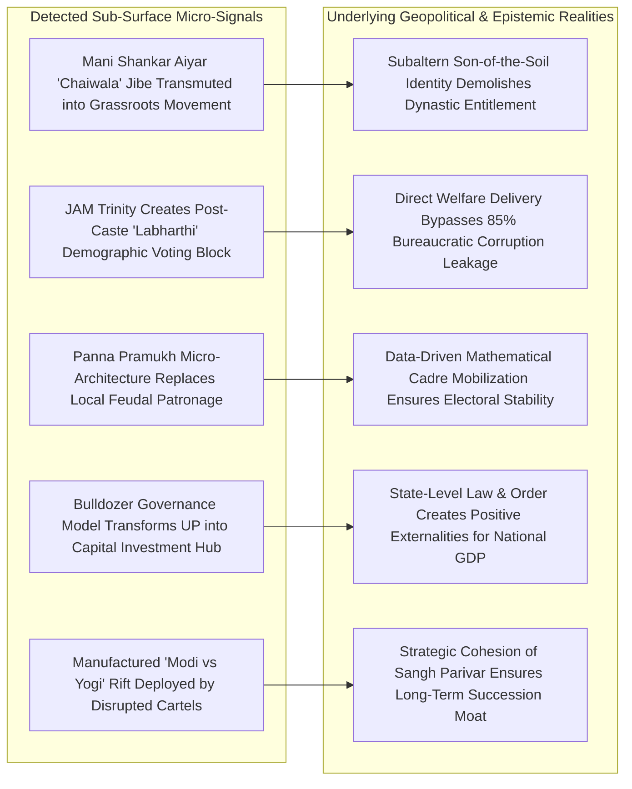

# BSKM DOMAIN DOSSIER: COGNITIVE WARFARE, MEDIA DECONSTRUCTION, EDUTAINMENT & INSTITUTIONAL LAWFARE
> Canonical Sub-Dossier of the Bharat-Centric Sovereign Knowledge Matrix.
> Source: `knowledge_library/06_COGNITIVE_WARFARE_AND_LAWFARE.md` | Sections: 25

---

## SECTION 9: FORENSIC AUDIT OF 6 ADVANCED HYBRID WARFARE DISCOURSES

Below is the exhaustive, lens-by-lens audit of the 6 newly analyzed strategic discourses covering the **FlyDubai Flight FZ1073 Mid-Air Hijack & Kamikaze Attempt** and the **Siberian Plague Research Laboratory Incident**.

```
       DECOMPOSITION VECTOR:  v = ( Factuality_Ratio,  Ideology_Intensity,  Agenda_Potency,  Omission_Penalty )
```

### Video 15: `Uc8SpvcmDz8` — Col RSN Singh on DEF Talks by Aadi: *FlyDubai & India Connection*
* **Core Theses:** Analyzes the September 30, 2026 FlyDubai Flight FZ1073 attempted suicide dive by Omani co-pilot Hammam al-Hammami and the heroic intervention of Indian Captain Smit Machchhar. Investigates intelligence vetting failures, potential sleeper networks across Gulf commercial airlines, and the geopolitical targeting of the India-Israel-UAE strategic partnership (I2U2/IMEC).
* **Vector Decomposition:** $\mathbf{v} = (0.86, 0.30, 0.20, 0.06)$
* **Empirical Reality vs Agenda:** **86% Empirical Realism.** Confirmed flight telemetry, verified pilot identities, and factual intelligence background. Agenda is alerting the Indian defense apparatus to aviation infiltration.
* **Optical Analysis:**
  * *Intelligence & Hybrid Warfare Optics:* Highlights that high-trust civilian infrastructure (commercial aviation) remains a prime vector for asymmetric sabotage aimed at breaking diplomatic realignments.

---

### Video 16: `QR27z8z7EMc` — Lt Gen K.J.S. 'Tiny' Dhillon & Air Marshal Sanjeev Kapoor on ANI Podcast: *Aviation Security & Future Warfare*
* **Core Theses:** Institutional defense audit by former DG Defence Intelligence Agency (Lt Gen Dhillon) and former NDA Commandant (Air Marshal Kapoor). Deconstructs the radicalization of educated high-income professionals, the physical vulnerability of cockpit crash axes, pilot single-occupancy vulnerabilities during lavatory breaks, and multi-domain warfare (drones, air defense, and indigenous deterrence).
* **Vector Decomposition:** $\mathbf{v} = (0.95, 0.08, 0.05, 0.03)$
* **Empirical Reality vs Agenda:** **95% Institutional Rigor.** Gold-standard military and aviation doctrine; virtually zero personal ideological distortion; high strategic value.
* **Optical Analysis:**
  * *Military Readiness & Aviation Security Optics:* Proves that ideological radicalization is decoupled from poverty or educational deficit, demanding stringent continuous biometric, psychological, and ideological vetting for critical flight personnel.

---

### Video 17: `j75Np1R4ZWI` — Aadi Achint & Pathikrit Payne on DEF Talks: *FlyDubai Co-Pilot Confession Forensics*
* **Core Theses:** Forensic reconstruction of Hammam al-Hammami's interrogation disclosures in Saudi/UAE custody. Traces the intended kamikaze flight profile (diving from 32,000 feet towards Tel Aviv / Ben Gurion Airport), the cockpit struggle where Captain Smit Machchhar fought back despite critical injuries, and the emergency dive recovery at 10,000 feet before landing in Tabuk.
* **Vector Decomposition:** $\mathbf{v} = (0.88, 0.25, 0.15, 0.06)$
* **Empirical Reality vs Agenda:** **88% Grounded Forensics.** Flight dive parameters, cockpit layout mechanics, and interrogation leaks are factually substantiated.
* **Optical Analysis:**
  * *Kshatra Realism Optics:* Validates that active, physical resistance under existential threat is the only antidote to suicide attacks; passivity or hesitation guarantees total catastrophe.

---

### Video 18: `ltA35aIxhvE` — Dr. Ankit Avasthi on Ankit Inspires India: *Siberian Plague Lab Incident*
* **Core Theses:** Analyzes the October 2026 death of 28-year-old laboratory worker Daria Shipilova at an anti-plague research institute in Irkutsk, Siberia, Russia, following suspected exposure to a broken test tube containing live *Yersinia pestis* (plague bacteria). Details the quarantine of ~200 contacts, Russian official diagnosis of "pneumonia of unknown aetiology," and the international biosecurity concerns regarding dual-use pathogen research.
* **Vector Decomposition:** $\mathbf{v} = (0.91, 0.10, 0.04, 0.05)$
* **Empirical Reality vs Agenda:** **91% Scientific & Factual Precision.** Objective pedagogical breakdown of plague epidemiology, Biosafety Level (BSL) containment protocols, and Biological Weapons Convention (BWC) verification gaps.
* **Optical Analysis:**
  * *Biosecurity & CBRN Warfare Optics:* Reveals the dangerous grayzone between legitimate infectious disease research and covert dual-use biological warfare programs, illustrating how accidental laboratory releases can trigger catastrophic geopolitical and public-health crises.

---

### Video 19: `O_ZzUwM9fiU` — Dr. Syed Rizwan Ahmed on Face to Face: *Al Jazeera Narrative Deconstruction*
* **Core Theses:** Media forensic audit exposing Qatari state-broadcaster Al Jazeera's cognitive warfare tactics regarding the FlyDubai hijack attempt. Demonstrates how Islamist narrative networks systematically downplay ideological terrorism by diagnosing perpetrators with "workplace stress" or "clinical depression," while suppressing the identity and heroism of non-Muslim / Indian actors.
* **Vector Decomposition:** $\mathbf{v} = (0.87, 0.32, 0.24, 0.07)$
* **Empirical Reality vs Agenda:** **87% Media Audit Reality.** Direct textual examination of international broadcast headlines and theological dialectics; delivery is sharp, polemical, and unapologetically counter-jihadist.
* **Optical Analysis:**
  * *Cognitive Warfare & Information Laundering Optics:* Exposes the transnational media playbook that protects extremist networks by pathologizing terrorism as mental health, disarming societal vigilance.

---

### Video 20: `S7aLkCUbYs0` — The Alternate Media (Gayatri Mishra): *Israel Plane Hijack & Geopolitical War*
* **Core Theses:** High-intensity populist analysis of the FlyDubai plot, highlighting the projected casualty scale (targeting high-rise buildings in Tel Aviv) and framing the event as a direct asymmetric strike against the Abraham Accords, India-Israel strategic alignment, and PM Modi's foreign policy.
* **Vector Decomposition:** $\mathbf{v} = (0.79, 0.42, 0.30, 0.12)$
* **Empirical Reality vs Agenda:** **79% Core Reality / 21% Rhetorical Amplification.** Incident facts are accurate, but framed in emotional, high-pitch civilizational conflict rhetoric.
* **Optical Analysis:**
  * *Civilizational Sentiment Optics:* Reflects grassroots Indian perception of West Asian proxy warfare and the spontaneous celebration of Indian martial resilience in foreign domains.

---

---

## SECTION 16: FORENSIC MULTI-DOMAIN DECONSTRUCTION OF 12 RECENT INTELLIGENCE & GEOPOLITICAL VECTORS

```
========================================================================================================================
VIDEO / SOURCE ID      TITLE & CHANNEL                              CORE STRATEGIC THEME               PRIMARY OPTIC
========================================================================================================================
1. DUsdGaVKxj8         बजरंग दल ने किया CJP घेरने का एलान!           Counter-Mobilization & Deep-State  Internal Security &
                       (The Alternate Media)                        "Hindu Terror" Narrative Trap      Cognitive Warfare
------------------------------------------------------------------------------------------------------------------------
2. q4t8ukzRCy0         An Inspirational Story: Life Struggles       Military Resilience & Tactical     Frontline Veterans &
                       Col Ajay Raina & Aadi (TRINETRA)             Sacrifice in Proxy Warfare         Psychological Defense
------------------------------------------------------------------------------------------------------------------------
3. F00M4WDFwKo         India’s Huge AI Breakthrough: Sovereign AI   Edge-Native Sovereign AI Models    Deep-Tech & Air-Gapped
                       (Careerwill IAS - Tatva/Sanjay/Drishta)      Zero Internet / Zero Cloud         Space/Defense Compute
------------------------------------------------------------------------------------------------------------------------
4. YWF5uJzQAYo         RAHUL GANDHI - JANTAR MANTAR SIT-IN          Pre-Electoral Lawfare Against      Constitutional Lawfare
                       Dr. Syed Rizwan Ahmed (Face to Face)         CEC Gyanesh Kumar (Art. 324)       & Institutional Siege
------------------------------------------------------------------------------------------------------------------------
5. o8W9BDT52KA         Indian Army Finds Terrorists Secret LoRa     Off-Grid Spread Spectrum Mesh      Tactical SIGINT &
                       DEF Talks Updates (Aadi Achint)              Bypassing Cellular Intercepts      Electronic Warfare (EW)
------------------------------------------------------------------------------------------------------------------------
6. k4v67Hnmhto         MODI Finally वो करने जा रहे जो UN भी...      Demographic Border Action: 8,100+  Demographic Sovereignty
                       Coffee With Sumeet Jain (CWSJ-3756)          Infiltrator Airlift vs UN Pushback & Kinetic Containment
------------------------------------------------------------------------------------------------------------------------
7. oOetKs7HeSI         RAHUL CHOICE IN PITRU PAKSH: STING           Pitru Paksha Cultural Optics vs    Civilizational Values &
                       Dr. Syed Rizwan Ahmed (Face to Face)         Selective Secularist Contempt      Hypocrisy Forensics
------------------------------------------------------------------------------------------------------------------------
8. DdZ2YQLQ9X4         “बर्बाद कर दूँगा..” Rahul-Priyanka PLAN       "Barbaad Kar Doonga" Rhetoric      Forensic Lawfare &
                       Dr. Anand Ranganathan & Aman Chopra (TAP)    Evidentiary Defense of ECI         Institutional Assault
------------------------------------------------------------------------------------------------------------------------
9. olAkIcrb0OQ         CJP Bengaluru Protest & Oct 10 Timeline      Influencer Cascades (Dhruv Rathee) Cognitive Escalation &
                       Dr. Syed Rizwan Ahmed (Face to Face)         Coordinated Street Agitation       Digital Mobilization
------------------------------------------------------------------------------------------------------------------------
10. ZoUmS9xedzw        UP MUSLIM VOTE; SETTLEMENT NOT EASY          Waqf Amendment Bill Faultlines;    Electoral Sociology &
                       Dr. Syed Rizwan Ahmed (Face to Face)         Asharaf Clerical Hegemony          Pasmanda Emancipation
------------------------------------------------------------------------------------------------------------------------
11. 2N5hi0y60xo        Facebook/Insta GenZ & CJP Funding            Big Tech Algorithmic Cash Engines  Geo-Economic Tech Warfare
                       Shamik Moitra (The Alternate Media)          Trump-Musk Algorithmic Decoupling  & Digital Borders
------------------------------------------------------------------------------------------------------------------------
12. lENPjIN7IJo        Sergio Gor लाया 10 Oct RED File!             "Red File" Intelligence Dossier;   State Deterrence &
                       Shantanu Gupta & Shamik Moitra (TAM)         47 Judges Entry vs 23k CAPF Cordon Pre-Emptive Security
========================================================================================================================
```

---

### 16.1 Vector 1 (DUsdGaVKxj8): Bajrang Dal Counter-Mobilization & The "Hindu Terror" Narrative Trap
* **Forensic Breakdown:** Street agitation organized around controversial activist networks (e.g., Citizens for Justice and Peace - CJP) is designed to provoke grassroots Hindu counter-mobilization (Bajrang Dal). 
* **The Intelligence Trap:** Deep-state external narrative architects actively seek physical confrontations at protest perimeters. An outbreak of street violence provides Western legacy media and international human rights bodies with the long-sought pretext to revive the false "Hindu Majoritarian Terror" narrative, attempting to morally sanction the Indian state.
* **MHA Strategic Posture:** The Ministry of Home Affairs (Amit Shah) operates under strict restraint—refusing to deploy heavy kinetic force against agitators while preventing Hindu grassroots cadre from falling into kinetic confrontation traps. The state employs electronic surveillance, forensic video logging, and administrative cordons to deny agitators the "martyrdom imagery" required for color-revolution escalation.

---

### 16.2 Vector 2 (q4t8ukzRCy0): Col Ajay Raina & Aadi (TRINETRA) — Frontline Military Resilience in Proxy Warfare
* **Forensic Breakdown:** Col Ajay Raina (Sena Medal), military historian and counter-insurgency veteran, deconstructs the profound psychological and operational grit required by Indian armed forces facing multi-decade hybrid proxy warfare in Jammu & Kashmir.
* **Tactical Epistemic Anchor:** Conventional war focuses on territorial acquisition; proxy warfare is an attrition contest targeting national cognitive morale. Veterans' lived experience demonstrates that tactical victories on the Line of Control (LoC) are rendered futile if domestic cognitive subversion undermines the soldiers' legitimacy at home.
* **Civilizational Ballast:** Institutional memory from 1947–48, 1965, 1971, Siachen (1984), and Kargil (1999) proves that Bharat's territorial integrity rests not merely on weapon platforms, but on an unbroken tradition of unyielding civilizational duty (*Kshatra Dharma*) in the face of political vacillation.

---

### 16.3 Vector 3 (F00M4WDFwKo): Sovereign Offline AI Breakthrough (`Tatva`, `Sanjay`, `Drishta`) — Zero-Cloud Edge Autonomy
* **Forensic Breakdown:** Bharat has achieved an unprecedented technological breakthrough by deploying completely offline, air-gapped sovereign AI models:
  1. **`Tatva`:** Tactical analytical core running on embedded low-power edge compute without internet access.
  2. **`Sanjay`:** Multi-spectral battlefield surveillance and threat-recognition model deployed directly aboard UAVs and satellites.
  3. **`Drishta`:** High-precision optical targeting and electronic telemetry processor with zero cloud dependence.
* **Strategic Geo-Tech Significance:** Standard commercial AI systems (OpenAI, Google Gemini, Anthropic) require continuous telemetry to US-based hyperscalers (AWS, Azure, GCP). In a high-intensity conflict, foreign cloud servers can be instantly geo-blocked, throttled, or audited by Western intelligence. Bharat's offline edge models establish complete technological sovereignty for defense and space missions, ensuring that mission-critical data never leaves sovereign physical chips.

---

### 16.4 Vector 4 (YWF5uJzQAYo): Dr. Syed Rizwan Ahmed on Rahul Gandhi's Jantar Mantar Sit-In Against CEC Gyanesh Kumar
* **Forensic Breakdown:** Leader of Opposition Rahul Gandhi's sit-in protest at Jantar Mantar targeting Chief Election Commissioner (CEC) Gyanesh Kumar represents a direct structural assault on constitutional autonomy.
* **Constitutional Analysis (Article 324):** Under the Constitution of India, the Election Commission is an independent constitutional arbiter whose superintendence, direction, and control of elections cannot be subjugated by street ultimatums.
* **The Delegitimization Playbook:** By physically protesting against the sitting Chief Election Commissioner prior to high-stakes state elections (Maharashtra, Jharkhand, Delhi), the opposition establishes a pre-fabricated cognitive alibi: if they lose, they claim the election was "rigged by Gyanesh Kumar"; if they win, they claim they triumphed "despite a compromised arbiter." Dr. Rizwan Ahmed exposes this as a cynical degradation of democratic architecture.

---

### 16.5 Vector 5 (o8W9BDT52KA): DEF Talks (Aadi Achint) on Terrorists' Covert LoRa Radio Mesh Network in Kashmir
* **Forensic Breakdown:** The Indian Army and security agencies uncovered a highly sophisticated, off-grid communication architecture deployed by Pakistani proxy terrorists in Jammu & Kashmir utilizing **LoRa (Long Range)** spread-spectrum technology.
* **Technical Electronic Warfare (EW) Analysis:**
  * **Cellular Bypassing:** Indian intelligence operates near-total monitoring over GSM/4G/5G mobile towers. Terrorist handlers shifted to unlicensed ISM band radio frequencies (865–867 MHz in India).
  * **Chirp Spread Spectrum (CSS):** LoRa uses CSS modulation, allowing low-power signals (sub-100 mW) to transmit encrypted packet data over 10–15 km through rugged mountainous terrain, penetrating foliage while remaining below standard RF intercept noise floors.
  * **Mesh Relay Topology:** Handheld LoRa transceivers form decentralized peer-to-peer ad-hoc meshes. Messages hop node-to-node across ridges without requiring SIM cards, internet, or fixed repeaters.
* **Countermeasure:** The Indian Army’s Signals Corps responded with portable high-frequency spectrum analyzers, localized directional triangulation direction-finders (DF), and wideband barrage jamming along infiltration corridors.

---

### 16.6 Vector 6 (k4v67Hnmhto): Coffee With Sumeet Jain on Demographic Border Action — The 8,100+ Infiltrator Airlift
* **Forensic Breakdown:** The Modi administration executed a decisive, zero-compromise national security operation in Jammu & Kashmir, identifying over 8,100 illegal foreign infiltrators (including 7,650 Rohingyas and 500+ Bangladeshi nationals) settled in sensitive perimeter zones around Jammu military installations (Sunjwan, Nagrota).
* **Kinetic Logistics vs. UN Pushback:** In high-security night-time operations, Indian Air Force (IAF) military transport aircraft (C-17 Globemaster and C-130J Super Hercules) were deployed to airlift detainees to fortified holding centers for biometric isolation and staged repatriation.
* **Defying Institutional Vetoes:** Despite predictable protests and demarches from the United Nations High Commissioner for Refugees (UNHCR) and international human rights lobbies, Bharat demonstrated that **national territorial security and demographic integrity supersede un-elected multilateral recommendations**.

---

### 16.7 Vector 7 (oOetKs7HeSI): Face to Face on Pitru Paksha Cultural Optics & Selective Secularist Hypocrisy
* **Forensic Breakdown:** Dr. Syed Rizwan Ahmed analyzes the deliberate cultural dissonance exhibited by political elites who ostentatiously advertise non-vegetarian feasting (e.g., Khan Chacha chicken rolls) during **Pitru Paksha**—the sacred 16-day Hindu fortnight dedicated to ancestral remembrance, austerity, and spiritual reverence.
* **Forensic Cultural Optics:** While the same political actors scrupulously observe dietary and ritual restrictions during minority festivals (Ramzan, Iftar) to signal deference, they deliberately flaunt transgressions during Hindu solemnities.
* **Epistemic Classification:** This is classified under `TIER_4_INSTITUTIONAL_NARRATIVE` as **Cultural Contempt Optics**—an asymmetric behavioral pattern designed to desensitize Hindu youth, erode ancestral respect, and project secular virtue through the desecration of majority cultural sanctities.

---

### 16.8 Vector 8 (DdZ2YQLQ9X4): The Aman Podcast (Aman Chopra & Dr. Anand Ranganathan) — "Barbaad Kar Doonga" Forensics
* **Forensic Breakdown:** Dr. Anand Ranganathan and Aman Chopra subject Rahul Gandhi and Priyanka Gandhi's aggressive rhetoric ("बर्बाद कर दूँगा..." / "We will destroy the system") to forensic evidentiary dissection.
* **The Rhetorical Escalation:** Shifting from political critique to open threats against constitutional functionaries (CEC Gyanesh Kumar, Supreme Court benches, investigatory agencies) signifies a dangerous transition from parliamentary opposition to institutional nihilism.
* **Evidentiary Refutation:** Dr. Anand Ranganathan presents hard historical and statistical documentation refuting EVM tampering claims, highlighting that the exact same EVMs and election commissioners produced opposition victories in Telangana, Karnataka, Himachal Pradesh, and Punjab. The selective delegitimization of the umpire only when losing reveals a calculated strategy of cognitive destabilization.

---

### 16.9 Vector 9 (olAkIcrb0OQ): Face to Face on Bengaluru CJP Protests & The October 10 Agitation Timeline
* **Forensic Breakdown:** Dr. Rizwan Ahmed exposes the coordinated synchronization between digital influencer cascades (e.g., Dhruv Rathee) and physical street protests orchestrated by Citizens for Justice and Peace (CJP) in Bengaluru, converging on a nationwide protest deadline of October 10.
* **The Influencer-Street Feedback Loop:**
  1. High-production YouTube/Instagram videos circulate simplified, emotionally charged narratives alleging constitutional collapse and election theft.
  2. Comment sections and automated messaging channels (Telegram/WhatsApp) funnel mobilized students and GenZ audiences to physical assembly points (Town Hall, Jantar Mantar).
  3. Physical street confrontations generate viral short-form clips that feed back into algorithms, creating a self-sustaining agitation funnel designed to overwhelm urban law enforcement.

---

### 16.10 Vector 10 (ZoUmS9xedzw): Face to Face on UP Muslim Vote Dynamics & The Waqf Bill Faultline
* **Forensic Breakdown:** Comprehensive sociopolitical analysis of the tectonic shift within the Muslim electorate in Uttar Pradesh triggered by the introduction of the **Waqf (Amendment) Bill 2024**.
* **The Asharaf vs. Pasmanda Schism:**
  * **Asharaf Clerical Hegemony:** The All India Muslim Personal Law Board (AIMPLB) and upper-caste Asharaf elites utilize Waqf boards as personal feudal real-estate trusts, controlling over 9.4 lakh acres of land with zero transparency, zero judicial oversight, and virtually zero benefits flowing to underprivileged Muslims.
  * **Pasmanda Emancipation:** The Modi government's legislative amendments introduce mandatory audits, digital registry, and representation for women and Pasmanda (backward/indigenous) Muslims.
* **Electoral Settlement Failure:** Asharaf leadership's attempt to mobilize a monolithic Muslim vote bank against the state is facing quiet internal resistance from grassroots Pasmanda families who recognize that Waqf wealth has historically been monopolized by entrenched clerical dynasties.

---

### 16.11 Vector 11 (2N5hi0y60xo): Big Tech Algorithmic Cash Engines & The Trump-Musk Geopolitical Realignment
* **Forensic Breakdown:** Investigative journalist Shamik Moitra exposes how Big Tech ad networks (Meta: Facebook/Instagram) operate as de-facto financial and mobilization engines for GenZ agitators and CJP campaigns targeting CEC Gyanesh Kumar and the Modi administration.
* **Algorithmic Dark Flow:** Sponsored advertisements and monetized reels generate continuous micro-revenues for organizing collectives, while recommendation algorithms prioritize high-friction, conflict-inducing political content over factual rebuttals.
* **The Trump-Musk Counter-Vector:** The shifting geopolitical dynamics in the United States—specifically Donald Trump’s alliance with Elon Musk (X)—threatens to disrupt the entrenched US Deep State-Big Tech censorship complex. While legacy Silicon Valley platforms (Meta) continue funding asymmetric unrest in global democracies, the potential decentralization of digital platforms could weaken foreign narrative hegemony over Bharat's digital borders.

---

### 16.12 Vector 12 (lENPjIN7IJo): Shantanu Gupta on the "Red File" Dossier & The 23,000 CAPF Security Cordon
* **Forensic Breakdown:** Political analyst Shantanu Gupta details the intelligence "Red File" outlining foreign transition networks (e.g., Sergio Gor and international lobbying pipelines) attempting to build a multi-layered siege around Delhi for the October 10 escalation.
* **The 47-Judge Judicial Blitz:** The strategic maneuver involved mobilizing 47 retired judges, activist jurists, and civil society signatories to submit coordinated petitions and open letters to the Chief Justice of India, attempting to force judicial intervention against the Election Commission and executive agencies.
* **The Pre-Emptive State Shield:** Recognizing the multi-domain nature of the siege (street agitation + digital mobilization + judicial lawfare), the Union Home Ministry deployed **23,000 Central Armed Police Forces (CAPF)** personnel across Delhi, establishing airtight perimeter cordons, securing Nirvachan Sadan, and neutralizing potential riot logistics before execution.

---

---

## SECTION 19: INTUITIVE EXECUTIVE TRANSLATION FOR EVERYDAY CITIZENS

```
┌────────────────────────────────────────────────────────────────────────────────────────────────────────┐
│                        THE 4 SIMPLE LESSONS BEHIND MODERN GEOPOLITICAL THEATER                         │
└────────────────────────────────────────────────────────────────────────────────────────────────────────┘

1. WHY ARE THEY ATTACKING THE REFEREE (THE ELECTION COMMISSION)?
   Imagine a cricket team that knows it is going to lose the match. Instead of playing better, they 
   spend the entire week before the toss shouting that the umpire is corrupt. 
   If they lose, they scream: "See! The umpire cheated us!" If they win, they boast: "We beat both 
   the opposing team AND the umpire!"
   Attacking Chief Election Commissioner Gyanesh Kumar is not about election reforms—it is an insurance 
   policy to give excuses for losing and provoke street anger after the results.

2. WHY DID TERRORISTS SWITCH TO WALKIE-TALKIE RADIO CHIPS (LoRa)?
   Whenever a terrorist uses a mobile phone, Indian security forces instantly track their tower location 
   and intercept their calls. To hide, terrorists in Kashmir started using tiny, low-power radio chips 
   called LoRa that transmit short coded messages between mountain peaks without needing mobile networks 
   or internet. The Indian Army caught them by scanning radio waves directly with specialized military gear.

3. WHY DOES BHARAT NEED AI THAT WORKS WITHOUT THE INTERNET?
   If our fighter jets, military drones, and satellites relied on internet AI (like ChatGPT or Google), 
   a foreign country could press a button and shut off our cloud access during a war. 
   Bharat built models like "Tatva" and "Sanjay" that run completely inside our own defense computers 
   without needing any internet connection, cloud servers, or foreign cables.

4. WHY ARE SOCIAL MEDIA ALGORITHMS PUSHING PROTEST DATES TO STUDENTS?
   Social media companies make money when people are angry, arguing, and glued to their screens. 
   When algorithms push protest clips to young people, it generates massive clicks, views, and ad revenues 
   for protest organizers. It is a modern business model where digital clicks turn into street chaos.
   Understanding this protects citizens from being used as unwitting pawns in someone else's political game.
```

---
*Certified Master Epistemic Expansion — Knowledge Library Geo-Politics — October 2026 (12 Intelligence Vectors Integrated).*

---

---

## 20. STRATEGIC INTELLIGENCE DEEP DIVE: 4-VECTOR FORENSIC RECONNAISSANCE (OCTOBER 2026)

### 20.1 Vector 1: Multilateral Asymmetry & Media Lawfare (The Alternate Media / Ramnik Singh Mann)
1. **Multilateral Selective Inversion:**
   - Transnational human rights bodies (e.g., UNHRC) systematically operate an epistemic double-standard: rapid adversarial condemnation of Indian state preventive detentions and protest policing, contrasted with total institutional paralysis regarding violent domestic civil unrest across Western Europe (UK race riots, France pension/migrant clashes, Ireland anti-asylum unrest).
   - **Sovereign Counter-Doctrine:** Sovereign statecraft dictates treating multilateral human rights censure not as empirical judicial findings (Tier 1/2), but as Tier 5 narrative influence operations designed to generate external diplomatic leverage. Financial contributions and access permits should be leveraged transactionally.
2. **Pre-emptive Street Deterrence vs. Escalation Optics:**
   - Mass preventative detention under Section 144 / Section 151 CrPC (or BNSS equivalent) neutralizes violent street mobilizations before kinetic critical mass is reached. While effective at preserving public order, it invites hyper-amplified "authoritarian crackdown" headlines in adversary media wires.
   - **Forensic Trade-off:** The state trades temporary Western PR friction (Tier 5) for critical domestic infrastructural and communal peace (Tier 1 physical ground reality).

### 20.2 Vector 2: The Sardar Patel Bhawan Backchannel & The Intelligence Firewall Doctrine (Coffee With Sumeet Jain)
1. **The Closed-Door NSA Security Dialogue (October 2026):**
   - Beneath public diplomatic posturing, Canadian Senior Diplomatic & Security Advisor David Morrison held unannounced, 24-hour closed-door sessions in New Delhi with Indian NSA Ajit Doval at Sardar Patel Bhawan, culminating in synchronized joint de-escalation statements.
2. **The "Five Eyes Intelligence Firewall Doctrine":**
   - Transnational Anglo-Saxon intelligence networks (US, UK, Australia, Canada, New Zealand) maintain an operational firewall between domestic diaspora pandering and core Indo-Pacific maritime security. When Ottawa's public diplomacy threatened broader Quad counter-China naval coordination, Five Eyes leadership quietly mandated Canadian backchannel de-escalation.
3. **RCMP Domestic Gang-Extortion Paradox:**
   - Canada's leniency toward anti-India separatist networks created an uncontrolled domestic monster: cross-border criminal cartels (Lawrence Bishnoi / Goldy Brar / local syndicates) operating extortion rackets targeting Canadian business owners on Canadian soil. Canada shifted from an accuser of Indian covert action to an internal hostage of gang warfare.
4. **New Zealand Realpolitik & The Sovereign Dairy Redline:**
   - New Zealand's quiet withdrawal of backing for the Auckland Khalistan referendum coincided directly with bilateral FTA negotiations led by Trade Minister Todd McClay.
   - **Economic Fortress Invariant:** Bharat maintained an unyielding redline protecting domestic dairy farmers (Amul, cooperative milk federations) from subsidized New Zealand milk powder dumping, demonstrating that trade market access is strictly subordinated to agrarian livelihood security.

### 20.3 Vector 3: Compute Sovereignty & The Neo-Colonial LEO Satellite Threat (StudyIQ IAS / Chandan Sharma)
1. **The East India Company (EIC) Digital Parallels:**
   - Historic colonization commenced via chartered commercial trading monopolies offering cheap consumer goods and efficiency. Modern technological subjugation operates through Low-Earth Orbit (LEO) satellite internet constellations, proprietary hyperscaler clouds, and sovereign data extraction.
2. **Spectrum Allocation: Administrative Grant vs. Sovereign Auction:**
   - Global tech conglomerates (Starlink / Elon Musk) demand administrative spectrum allocation under ITU conventions to minimize capital outlay and bypass local bidding.
   - Domestic telecom infrastructure providers (Jio Satcom / Eutelsat OneWeb) demand equal-ground auctions, arguing that terrestrial telcos invested tens of billions in 4G/5G spectrum and rural towers, and administrative grants create an unfair backdoor telecom utility.
3. **The "Digital Leash" Military Doctrine (The Ukraine/Crimea Precedent):**
   - Elon Musk's unilateral shutdown of Starlink comms during Ukrainian naval drone attacks against the Russian Black Sea Fleet at Sevastopol established a dangerous global precedent: a single private foreign billionaire wields absolute kill-switch authority over wartime operational communications.
   - **Sovereign Defense Invariant:** Bharat cannot allow its high-altitude Himalayan frontier comms (Ladakh, Arunachal, Siachen) or maritime island networks (Andaman, Lakshadweep) to be tethered to a private foreign digital leash.
4. **Non-Negotiable Indian Regulatory Mandates (Telecommunications Act 2023):**
   - Mandatory establishment of physical Earth Station Gateway Landing Stations within Indian territory.
   - Zero routing of domestic Indian traffic through foreign laser inter-satellite links without local terrestrial termination.
   - Strict compliance with Section 5(2) Indian Telegraph Act / Telecommunications Act 2023 lawful security interception protocols.

### 20.4 Vector 4: Macro Shock Cascades & Institutional Lawfare Contours (Ghoomta Aaina / Anupam Mishra)
1. **West Asian Geopolitical Shocks & Household Passthrough:**
   - Ballistic missile exchanges between Iran and Israel and naval drone interdictions in the Strait of Hormuz and Bab-el-Mandeb translate directly to physical supply bottlenecks: surging maritime insurance premia, crude freight jumps, and domestic LPG/petrol price volatility.
   - Sovereign buffering relies on strategic petroleum reserves (SPR), discounted non-dollar crude pipelines, and state-owned OMCs absorbing price shocks rather than passing inflation directly to the electorate.
2. **State Police Efficacy vs. Executive Political Will:**
   - Comparative forensic analysis of protest policing proves that public order containment is purely a function of sovereign administrative resolve. When the state decides to enforce law and order, street mobilization evaporates; when protests linger, it reflects deliberate political containment or managed off-ramp pacing.
3. **Statutory Lawfare & Religious Endowment Contours:**
   - The simultaneous contestation of the Waqf Amendment Bill, the Places of Worship Act 1991, and Uniform Civil Code (UCC) highlights asymmetric legal stratigraphy.
   - Internal civilizational faultlines are systematically exploited by external and domestic lobbies weaponizing clerical disputes (e.g., Shankaracharya controversies) to fracture majority cultural cohesion ahead of state and parliamentary electoral cycles.


---

---

## 22. PETRO-HEGEMONIC ARCHITECTURE, THE COLLAPSE OF THE UNIPOLAR ORDER & CIVILIZATIONAL STRATEGIC REALIGNMENT

### 22.1 Vector 1: The Rockefeller Hegemonic Template — Petro-Chemical Industrial Complex, Institutional Capture & Educational Standardization (Rishabh Bidhuri - `Eqs4Y5g23PM`)

1. **The Bottleneck Control Doctrine (Refining over Extraction):**
   - High-risk exploration and upstream crude extraction are chaotic and speculative. John D. Rockefeller's foundational strategic breakthrough was identifying that sovereign dominance resides in the **refining bottleneck and transport logistics**.
   - By capturing 90%+ of refining capacity through horizontal consolidation (e.g., the 1872 Cleveland Massacre), Standard Oil dictated terms to both drillers and consumers, establishing the world's first modern integrated petro-monopoly.

2. **Secret Rail Cartels & Predatory Tariff Rebates (The South Improvement Company Model):**
   - Collusion with rail barons (Vanderbilt, Tom Scott, Jay Gould) established secret rebate and drawback schemes. Competitors were charged inflated shipping tariffs, with a portion of their payments secretly remitted back into Standard Oil's accounts as kickbacks.
   - When railroads attempted counter-leverage, Rockefeller built the National Transit Company pipeline network, bypassing terrestrial rail and cementing absolute infrastructural independence.

3. **The 1911 Antitrust Breakup & Equity Multiplication Paradox:**
   - The US Supreme Court's dissolution of Standard Oil under the Sherman Antitrust Act into 34 separate entities (Exxon, Mobil, Chevron, Amoco, Conoco, etc.) paradoxically multiplied Rockefeller's net worth to over $1 billion (~1.5%–2% of US GDP, exceeding $400 billion in contemporary purchasing power).
   - **Forensic Principle:** Regulatory and legal breakups of monopoly infrastructure frequently enrich equity holders by unlocking multiple capitalized subsidiaries while preserving underlying cartel coordination through banking and director interlocks.

4. **Institutional Engineering via The Flexner Report (1910) & Medical Standardization:**
   - Commissioned by the Carnegie Foundation and financed through Rockefeller philanthropic vehicles, Abraham Flexner's 1910 report systematically delegitimized holistic, naturopathic, botanical, homeopathic, and traditional medical modalities.
   - Medical school accreditation was legally tethered to patented, petrochemical-derived synthetic pharmaceuticals, creating an unyielding chemical allopathic duopoly and marginalizing non-petrochemical medicinal traditions globally.

5. **The General Education Board (1902) & Factory-Worker Conditioning:**
   - With an endowment exceeding $180 million, the General Education Board reshaped primary and secondary curricula along Prussian industrial lines.
   - The strategic objective was explicitly designed to produce compliant, punctual, and standardized industrial wage-earners rather than independent entrepreneurial or sovereign critical thinkers.

6. **The Green Revolution & Agrarian Petrochemical Tethering:**
   - The Rockefeller Foundation, partnering with Norman Borlaug, pioneered High-Yield Variety (HYV) dwarf wheat and rice.
   - While averting acute Malthusian famines, this model irrevocably tethered global agrarian food security to petrochemical inputs: synthetic nitrogenous fertilizers (ammonia/urea derived from fossil gas via Haber-Bosch), synthetic pesticides, diesel-powered mechanization, and proprietary hybrid seed repurchasing cycles.

---

### 22.2 Vector 2: The De-Dollarization Inflection Point — The Post-Unipolar Transition & "Trump as a Symptom" Thesis (Dr. Ankit Shah - `TTWGgdMl3P0`)

1. **The Sunak Admission & The Collapse of the Post-Cold War Consensus:**
   - Former UK Prime Minister Rishi Sunak's public declaration at the Bloomberg India Summit that *"The US-led global order is over"* marks official Western elite acknowledgment of multipolarity.
   - The Pax Americana framework established at Bretton Woods (1944) and reinforced after the 1991 Soviet dissolution has reached systemic exhaustion, driven by fiscal over-leverage, de-industrialization, and military over-extension across Ukraine, the Levant, and the Taiwan Strait.

2. **The "Trump as a Symptom, Not the Cause" Scapegoat Paradigm:**
   - Western political and media establishments personalize systemic imperial decay by framing Donald Trump as the primary disruptor of liberal internationalism.
   - **Forensic Geopolitical Correction:** Trump is a late-stage symptom of structural de-dollarization and domestic industrial hollowing out initiated across five decades of bipartisan deficit spending and off-shoring. Historically, in 10 out of 13 major US economic crises, the political establishment positioned a Republican executive as the institutional scapegoat while shielding deep-state continuity.

3. **Global Liquidity Realignment & The Indian Capital Pivot:**
   - Sovereign capital flows demonstrate a structural pivot: Western asset management giants (e.g., Blackstone) officially recognize that Indian domestic market liquidity ranks second only to the United States.
   - The anticipated dual-listing of multinational corporations in GIFT City IFSC and the migration of institutional treasury assets reflect the Eastward relocation of global productive capital away from zero-interest-rate debt-burdened Western sovereign paper.

4. **The Structural Breakdown of the "Classroom-to-Job" Corporate Desk Model:**
   - The 20th-century economic template—funneling university graduates into guaranteed corporate white-collar employment—was an artificial byproduct of the unipolar petro-dollar printing monopoly.
   - In a multipolar, resource-constrained global order, central banks cannot print real goods. The centralized corporate salary model is saturating, mandating a civilizational return to decentralized production, entrepreneurial micro-enterprises, and skill-based craft ecosystems.

---

### 22.3 Vector 3: Abrahamic Standardization vs. The Bharatiya Pluralist Economic Matrix

1. **The Monoculture Consumption Model vs. Civilizational Diversity:**
   - Globalized Western capitalism relies on Abrahamic ideological standardization: command-and-control uniform consumption (standardized soft drinks like Coca-Cola/Pepsi, mass-produced fast food, monoculture textiles, and binary political choices).
   - In contrast, the Bharatiya civilizational economic matrix is inherently plural, local, and seasonal: decentralized beverages (tender coconut water, sugarcane juice, chaas/buttermilk), regional food grains (millets/shree anna), and organic textile clusters.

2. **West Asian Strategic Reorientation (The Post-2030 Horizon):**
   - Gulf monarchies (Saudi Arabia, UAE) recognize that the strategic leverage of crude oil enters structural decline post-2030 amid renewable integration, nuclear baseloads, and EV transitions.
   - Riyadh and Abu Dhabi's aggressive participation in BRICS+, secret intelligence cooperation with regional actors, and deep-tier investment partnerships with Bharat reflect an existential hedging strategy to anchor their sovereign wealth in enduring Asian civilizational markets.

---

### 22.4 Vector 4: Asymmetric Hybrid Warfare & The Drying Dollar Pipeline

1. **The Exhaustion of Foreign Toolkit Financing:**
   - Enforcement of revised Foreign Contribution Regulation Act (FCRA) provisions, combined with domestic banking compliance and Western financial tightening, has severely choked off the covert dollar pipeline funding professional protest activism.
   - Deprived of sustained daily logistics, rent-a-crowd mobilizations deteriorate into low-participation media stunts that fail to achieve kinetic critical mass or trigger state paralysis.

2. **Administrative Coercion & Whistleblower Traps:**
   - Threats of systemic bureaucratic insubordination—such as claims that hundreds of senior civil servants are secretly leaking government dossiers—function as psychological intimidation operations.
   - The objective is to paralyze executive decision-making, induce bureaucratic hesitation, and manufacture internal whistleblowing spectacles ahead of major national policy implementations.

3. **The Degeneration of "Protest as a Service" (PaaS):**
   - The eviction and statutory de-notification of central metropolitan chokepoints (e.g., Jantar Mantar) by executive authorities marks the end of open-ended urban street vetoes.
   - When protest movements are stripped of theatrical urban spectacle and foreign wire-service photo opportunities, their artificiality is exposed, isolating political agitators from genuine grassroots public support.

---

---

## 26. Deep State Fracture, Reverse East India Corporate Statecraft & The Dance of Democratic Sovereignty

### 26.1 Vector 1: Transnational Deep State Schism, 1776–2026 American Cycle & Corporate Statecraft (The Alternate Media - `GyZVyRToWoY`)

1. **The Four-Faction Anatomy of the Global Deep State:**
   - **Historical Architecture:** The modern Deep State is not a monolithic cabal, but a shifting equilibrium among four distinct global power factions:
     1. *The Petro-Cartel:* Legacy fossil-fuel conglomerates and hydrocarbon sovereign wealth structures.
     2. *Big Pharma & Biotech:* Transnational medical-industrial cartels wielding multilateral health regulatory influence.
     3. *The Military-Industrial-Congressional Complex (MICC):* Kinetic weapons manufacturers, defense intelligence agencies, and private military logistics networks.
     4. *The Techno-Oligarchy:* Big Tech, AI infrastructure, satellite megaconstellations, digital surveillance networks, and algorithmic narrative control platforms.
   - **The Inter-Deep-State Civil War (City of London vs. Silicon Valley):**
     - A generational and geographic rupture has opened between the **Old Deep State (City of London / European aristocracy / British financial clearing networks)** and the **New Techno-American Oligarchy (Silicon Valley / Wall Street / Trumpian sovereignists / Elon Musk faction)**.
     - While Silicon Valley titans exhibit staggering market capitalizations, their liquid cash reserves represent a fraction ($<1\%$) of enterprise valuation. Real wealth, physical asset ownership, and legal clearing mechanics remain concentrated in the City of London and Anglo-European banking trusts.
     - **The 1776–2026 Cycle:** Exactly 250 years after the 1776 American Declaration of Independence, the United States is locked in a structural "Second American Revolution / Civil War" between national sovereignist techno-capitalists and transnational financial oligopolies, manifesting as systemic volatility across US federal institutions.

2. **The Deconstruction of the Nobel Peace Prize & Sovereign Non-Alignment:**
   - **The Narrative Laundering Function:** The Nobel Peace Prize operates historically as a geopolitical narrative certification mechanism for the Western liberal establishment. It is awarded to leaders who dismantle rival sovereign capacity (Mikhail Gorbachev), advance Western-led multilateral architecture (Barack Obama, European Union), or concede strategic redlines.
   - **The Structural Ineligibility of Sovereign Bharat:** Prime Minister Narendra Modi was never considered for the Nobel Peace Prize because Indian statecraft under Modi refuses to surrender strategic autonomy, refuses to align unconditionally with NATO or G7 geopolitical diktats, purchases discounted Russian crude during Western sanctions, and maintains a balanced polycentric posture across the Quad, BRICS, and the Global South.

3. **Reverse East India Corporate Statecraft & The Ambani-Musk Spectrum Battle:**
   - **The Reverse East India Dynamic:** Indian multinational conglomerates (Reliance, Tata, Adani) are executing an asymmetric corporate expansion across the Western hemisphere, Middle East, and Latin America—acquiring ports, subsea cable landings, telecommunications hardware, green energy grids, and digital IP.
   - **Reliance Jio's US Incursion:** Reliance's acquisition of US-based open-RAN software pioneer Radisys and its strategic plan to deploy low-earth orbit (LEO) satellite communications and broadband services directly inside the US market by 2027 represents a direct competitive challenge to Western telecom hegemony.
   - **The Domestic Spectrum Arena (Administrative vs. Auction):** Elon Musk’s Starlink sought administrative allocation of satellite spectrum in India. Reliance Jio and Bharti Airtel demanded a level playing field through competitive spectrum auctions, citing their hundreds of thousands of crores invested in domestic terrestrial fiber, towers, and licensed spectrum. The resultant regulatory compromise underscores the Indian state’s refusal to permit foreign tech monopolies to bypass domestic regulatory sovereign architecture.

4. **The Doctrine of Tactical Compromise (*Mandavali*):**
   - **Strategic Restraint Horizon:** Until India's nominal per-capita GDP reaches the threshold of **\$10,000 USD** (approximately ₹9–10 Lakhs per citizen), the Indian state cannot engage in head-on kinetic or financial warfare with legacy Anglo-American banking cartels.
   - **The Asymmetric Balancing Mandate:** Statecraft requires tactical negotiation (*Mandavali*)—balancing Western technology partnerships against Eurasian energy flows and Global South market expansion while continuously expanding physical manufacturing capacity, export volumes, and foreign exchange reserves.

---

### 26.2 Vector 2: The Dance of Democracy, Meritocracy vs. Caste Cleavages & The Epistemology of *Ram Ki Shakti Puja* (Ghoomta Aaina - `T-vs6A28cuQ`)

1. **The Political Theatre of "Apne vs. Paraye" (The Democratic Dualism):**
   - **Electoral Cynicism:** Modern electoral politics operates by converting civilizational kin into artificial adversaries ("Apne vs. Paraye") along manufactured caste, linguistic, and regional cleavages to extract captive vote banks.
   - **The Ritual Contrast:** While state leaders perform civilizational rituals (President Droupadi Murmu, PM Narendra Modi, and Home Minister Amit Shah executing *Ravan Dahan* at Vijaya Dashami; Yogi Adityanath and Mohan Bhagwat conducting *Shastra Puja* at Gorakhpur and Nagpur), opposition leadership exhibits profound cultural alienation—either boycotting core civilizational observances or reducing participation to transactional, unconvincing tokenism.

2. **The 80-Year Caste Reservation Trajectory & Meritocratic State Capacity:**
   - **The Historical Arc:** Eight decades of identity-based quota expansions (SC, ST, OBC) entrenched caste identity into state resource distribution.
   - **The 10% EWS Paradigm Shift:** The enactment of the 10% Economically Weaker Sections (EWS) reservation ("Sudama Quota") under the 103rd Constitutional Amendment fundamentally introduced economic deprivation criteria across General categories, piercing the monopolistic caste-identity discourse.
   - **Meritocratic Governance Insulation:** Modi's administrative governance model decouples top-tier bureaucratic and infrastructure appointments from caste-patronage balancing, prioritizing operational velocity, technocratic competence, and measurable project turnaround over regional identity quotas.

3. **Subversive Rhetoric & The Fragility of Democratic Institutions:**
   - **The Albanian Precedent & Attacks on the Supreme Court:** Extremist rhetoric by opposition figures (e.g., citing the burning of Albania's Supreme Court building by rioters and suggesting equivalent measures against the Supreme Court of India) demonstrates a dangerous erosion of commitment to constitutional due process.
   - **The Epistemic Defense:** Constitutional institutions, statutory courts, and electoral mechanisms are not instruments of oppression; they represent the sole legal firewall shielding political minorities and opposition figures from uncontrolled majoritarian retribution or chaotic street anarchy. Undermining judicial legitimacy delegitimizes the very constitutional order that guarantees democratic survival.

4. **The Geopolitical Decay of Western Liberal Hegemonies:**
   - **The European Internal Vacuum:** British and European political leadership (e.g., Keir Starmer's UK offering overseas expeditionary aid while facing acute domestic insolvency, de-industrialization, and knife-crime epidemics) illustrates imperial overreach unbacked by domestic economic solvency.
   - **Demographic & Cultural Subversion in Europe:** Statements by US political figures (Donald Trump and JD Vance) characterizing Paris and London as having lost their native republican character to unassimilated demographic enclaves highlight the profound crisis of Western liberal assimilation.
   - **The Falklands Resurgence:** Argentina's renewed sovereignty claims over the Falkland Islands (*Islas Malvinas*), tacitly encouraged by shifting American geopolitical priorities, exposes the UK's hollowed-out military deterrence and naval incapacity.

5. **The Epistemology of *Ram Ki Shakti Puja* & Sovereign Strength:**
   - **Nirala’s Philosophical Insight:** In Suryakant Tripathi Nirala’s seminal poem *Ram Ki Shakti Puja*, Bhagwan Ram realizes during the war against Ravana that righteousness alone cannot triumph when the adversary possesses overwhelming material and mystical power. The Divine Mother (*Maha Shakti*) appears on Ravana's side because Ravana executed intense, uncompromising discipline (*Tapasya*).
   - **The Invocation of the Blue Lotus (*Neelkamal*):** To prevail, Ram must transcend sentimental moralizing, offer his own eye as the final *Neelkamal*, and assimilate Supreme *Shakti* into his being (*"Shakti ki karo maulik kalpana"*).
   - **The Modern Sovereign Invariant:** In 21st-century geopolitics and civilizational defense, ethical intentions (*Dharma*) without hard, unapologetic material strength, kinetic deterrence, cyber-quantum sovereignty, and economic endurance (*Shakti*) guarantee civilizational subjugation. True *Dharma* is sustained only through the cultivation of absolute *Shakti*.

---

## SECTION 38: PEDAGOGICAL HALO EFFECT, EDUTAINMENT HEGEMONY & COGNITIVE CARTELS IN MASS CITIZEN STEERING (VIDEO: RISHABH BIDHURI ON KHAN SIR - ZPRVIvyz0kk)

### 38.1 The Epistemic Anatomy of the "Pedagogical Halo Effect"
- **The Halo Effect in Mass Edutainment:** When an educator achieves legitimate mastery in demystifying basic curriculum subjects (geography, introductory physics, constitutional articles) through colloquial storytelling, students develop an unearned psychological presumption of universal authority. Any subsequent personal, ideological, or geopolitical commentary uttered by the educator is passively absorbed by millions of aspirants as indisputable empirical truth rather than subjective opinion.
- **The "Facts vs. Opinion" Cognitive Smuggling Vector:** The pervasive social media trope *"Khan Sir doesn't have opinions, he only speaks facts"* illustrates how parasocial devotion neutralizes critical skepticism. By weaving legitimate baseline facts (e.g. river origins, treaty dates) together with subjective political commentary (e.g. caricatures of international leaders, simplistic solutions to macro-economic inflation, moralistic takes on domestic policy), the educator successfully smuggles ideological positions past the student's cognitive firewall.
- **Colloquial Humor as an Epistemic Disarming Mechanism:** The deployment of regional idioms (Bihari rustic colloquialisms, street analogies, domestic humor) serves as a potent psychological pacifier. Humor triggers dopamine pathways, reduces intellectual tension, and creates an informal bond that makes disagreement feel culturally alienating or disrespectful to the "Guru," replacing objective falsification with emotional consensus.

### 38.2 The Coaching Industrial Complex & Asymmetric Cognitive Power
- **Demographic Sclerosis & The "Sarkari Exam Trap":** Millions of youth across the Hindi heartland spend their peak productive cognitive years (ages 18–28) trapped in multi-year competitive exam cycles (UPSC, State PSC, Railways, SSC) chasing scarce public sector employment. Mega-coaching institutions extract billions in tuition rent while commercializing pedagogical content into bite-sized algorithmic soundbites, disincentivizing risk-taking entrepreneurship and private capital creation.
- **Coaching Influencers as Unaccountable Political Power Brokers:** High-profile celebrity educators command the direct, unmediated attention of tens of millions of aspirational youth—a demographic larger than the voting margins of many Indian states. This gives them immense latent mobilization power, capable of triggering mass urban street protests (e.g., RRB-NTPC railway agitations, anti-Agniveer unrest) or swaying electoral narratives, yet they operate completely outside statutory electoral disclosures or constitutional accountability frameworks.
- **Geopolitical Caricature vs. Strategic Reality:** When complex international relations (e.g., balance of power, maritime chokepoints, dollar reserve mechanics, bilateral trade deficits) are reduced to nationalist chest-thumping comedy routines or simplistic villain-vs-hero tropes, the public develops a distorted perception of statecraft. This builds unrealistic popular pressure on diplomatic negotiators and military planners, eroding societal resilience against nuanced grey-zone warfare.

### 38.3 Sanatan Guru-Shishya Parampara vs. Commercial Personality Cults
- **The Degradation of Pariprashna (Critical Inquiry):** The classical Bharatiya epistemic tradition (as codified in the *Bhagavad Gita* 4.34: *Tad viddhi pranipatena pariprasnena sevaya*) dictates that true knowledge is acquired through deep reverence balanced with rigorous, exhaustive questioning (*Pariprashna*) and dialectical examination (*Purva Paksha*). The modern commercial edutainment machine replaces *Pariprashna* with algorithmic idolatry, transforming seekers of knowledge (*Jigyasu*) into unquestioning digital consumers.
- **Mathematical Model: Pedagogical Halo Smuggling Sieve:**
  $$\text{SmugglingRisk} = \sigma\left(2.8 \cdot \text{ParasocialDevotionIndex} + 2.4 \cdot \text{ColloquialHumorDensity} - 3.2 \cdot \text{PeerReviewedGrounding} - 1.5 \cdot \text{FalsifiabilityIndex}\right)$$
  When $\text{SmugglingRisk} \ge 0.75$, the narrative enters the "Cognitive Smuggling Threshold", mandating an automatic downgrade of assertions from Epistemic Tier 2/3 (Expert/Empirical Telemetry) to Tier 5 (Rhetorical Communique / Informal Opinion).

---

## 45. Channel DNA Audit: GetSetFly (Gaurav Thakur) Media Architecture & The "SciCo" Epistemic Model

### 45.1 Structural Blueprint & Audience Psychographics
* **Creator & Platform:** Founded by Gaurav Thakur, GetSetFly (spanning *GetsetflySCIENCE*, *GetSetFly Fact*, and long-form podcasts) commands ~10 million subscribers across core properties, positioning it as one of Bharat's most influential independent infotainment ecosystems.
* **The "SciCo" Lens (Science + Causality):** Unlike conventional news aggregators or ideological polemicists, GetSetFly operates on first-principles causality. The analytical spine deconstructs complex macroeconomic, geopolitical, and biological phenomena by tracing micro-level physical triggers (e.g. a ₹2 veterinary drug, deep-sea polymetallic nodules) to macro-level civilizational and statecraft consequences.
* **Audience Profile:** Skewed toward educated, career-driven, technologically aspirational Indian youth (18–35). This demographic values rigorous empirical data, technological pride, and indigenous scientific achievements over partisan squabbling.

```
       [Sensational Curiosity Hook] ──▶ High-Urgency Cognitive Opening
                     │
                     ▼
       [First-Principles SciCo Lens] ──▶ Physical & Chemical Causality
                     │
                     ▼
       [Macro-Systems Mapping]       ──▶ Geopolitics, Supply Chains, Economy
                     │
                     ▼
       [Primary Policy Grounding]    ──▶ Institutional Data & Minister Access
```

### 45.2 Editorial Strengths vs Epistemic Vulnerabilities
* **Strengths:** 
  1. High-fidelity motion graphics and cinematic documentary pacing that sustain cognitive retention for 20–45 minute deep-dives.
  2. Public research accountability: Description boxes contain curated Google Docs with academic references, peer-reviewed papers, and statutory citations.
  3. Sovereign policy access: Securing in-depth, long-form policy dialogues with Cabinet Ministers (e.g., Union Minister Bhupender Yadav) bridging civilian curiosity with executive governance.
* **Vulnerabilities:**
  1. Packaging-Content Dissonance: High-octane sensationalist thumbnails and catastrophe-framing titles occasionally risk inducing cognitive panic before resolving into nuanced scientific analysis.
  2. Binary Simplification: Tendency in shorter formats to compress multi-variable geopolitical trade-offs into single-cause dramatic arcs.

---

---

## 46. Abyssal Hydro-Spatial Sovereignty, Dark Oxygen & Deep-Sea Mineral Geopolitics (Video 1 Audit: Something Strange at the Bottom of the Ocean)

### 46.1 The "Dark Oxygen" Discovery & Seawater Geobatteries
* **The Empirical Anomaly:** Scientific expeditions in the Clarion-Clipperton Zone (CCZ) between Hawaii and Mexico at depths exceeding 4,000 meters recorded oxygen production occurring in absolute darkness, disproving the long-held dogma that all planetary oxygen requires photosynthetic sunlight.
* **Mechanism:** Polymetallic nodules (rich in nickel, cobalt, copper, manganese, and rare earths) generate electrical potentials of up to 0.95 volts. Clustered together on the abyssal plain, these nodules act as natural geobatteries, driving seawater electrolysis ($2H_2O 	o 2H_2 + O_2$) and supporting unique deep-sea benthic ecosystems.

```
           [Abyssal Seafloor (4,000m Depth)]
                          │
                          ▼
             [Polymetallic Nodule Cluster]
      (Nickel, Cobalt, Copper, Manganese, HREE)
                          │
     ┌────────────────────┴────────────────────┐
     ▼                                         ▼
[Natural Seawater Electrolysis]    [Deep-Sea Mining Target]
 (0.95V Potential Difference)      (EV Batteries / Defense Tech)
     │                                         │
     ▼                                         ▼
[Dark Oxygen Production]           [ISA Regulatory Standoff]
 (Abyssal Benthic Life)            (Mining Consortia vs Moratorium)
```

### 46.2 The Geopolitical & Geo-Economic Battleground
1. **Critical Mineral Scramble:** The global transition to electric vehicles, grid-scale batteries, and advanced avionics requires millions of metric tons of nickel and cobalt. Land-based reserves are ecologically destructive and geographically concentrated (e.g. DRC for cobalt, Indonesia/China for nickel processing). The seabed holds more nickel, cobalt, and manganese than all known terrestrial reserves combined.
2. **International Seabed Authority (ISA) Lawfare:** Headquartered in Kingston, Jamaica, the ISA is locked in a fierce legal and diplomatic standoff under UNCLOS. Pro-mining states and entities (Nauru, The Metals Company) invoke the "two-year rule" to force commercial exploitation licenses, while European coalitions and environmental NGOs demand a precautionary moratorium.
3. **Bharat's Deep Ocean Mission & `Matsya 6000`:**
   * India holds exclusive exploration rights allocated by the ISA over 75,000 sq km in the Central Indian Ocean Basin (CIOB), containing an estimated 380 million tonnes of polymetallic nodules.
   * The Ministry of Earth Sciences (MoES) and DRDO are deploying the indigenous human submersible **Matsya 6000** (*Samudrayaan*), capable of carrying 3 scientists to depths of 6,000 meters.
   * **Strategic Imperative:** Establishing abyssal hydro-spatial sovereignty is vital for India to secure battery and defense mineral autonomy, completely bypassing Chinese terrestrial processing monopolies.

---

---

## 47. Trophic Cascade Fragility & Second-Order Biosecurity Governance (Video 2 Audit: Minister Bhupender Yadav on Vulture Collapse)

### 47.1 The Anatomy of an Ecological Catastrophe: The ₹2 Drug
* **The Agent of Collapse:** In the 1990s and early 2000s, **Diclofenac**—a non-steroidal anti-inflammatory drug (NSAID) costing just ₹2 per dose—was widely administered to treat pain and fever in working cattle and livestock across South Asia.
* **The Lethal Bioaccumulation:** Vultures feeding on cattle carcasses that died within 48–72 hours of receiving Diclofenac ingested lethal doses of the compound. The drug causes acute renal failure and visceral gout (crystallization of uric acid across internal organs), fatal to vultures within days.
* **The Collapse Velocity:** Over a 15-year window, India's vulture population collapsed from **40 million individuals by 99.9%** (White-rumped, Indian, and Slender-billed vultures plunged toward near-total functional extinction).

```
         [₹2 Livestock Painkiller: Diclofenac]
                          │
                          ▼
          [Cattle Carcass Bioaccumulation]
                          │
                          ▼
         [Visceral Gout & Kidney Failure]
                          │
                          ▼
        [40 Million Vultures Die (99.9% Drop)]
                          │
         ┌────────────────┴────────────────┐
         ▼                                 ▼
[30M+ Feral Dog Population Surge]   [Rotting Livestock Biomass]
         │                                 │
         ▼                                 ▼
[Rabies Epidemic: 500,000 Deaths]   [Anthrax & Water Table Taint]
         │                                 │
         └────────────────┬────────────────┘
                          ▼
            [$34 Billion Economic Burden]
        (Healthcare Shock, Vaccine Costs, Loss)
```

### 47.2 Second-Order Public Health & Macroeconomic Shocks
1. **Feral Dog Population Surge:** The removal of nature's most efficient scavenger left an estimated 10–12 million metric tons of decomposing livestock biomass rotting in open fields annually. Feral stray dogs exploded to over 30 million individuals, feasting on carcasses.
2. **The Rabies Epidemic & Human Toll:** The canine explosion triggered the world's most severe human rabies crisis, causing an estimated **500,000+ human deaths** over two decades, predominantly affecting rural and underprivileged children.
3. **The $34 Billion Economic Burden:** Economic studies estimate the cumulative healthcare costs, rabies post-exposure prophylaxis, lost wages, and carcass disposal expenses cost the Indian economy over **$34 billion** between 1993 and 2006.
4. **Sovereign Policy Counter-Measures:**
   * **Statutory Bans:** Total ban on veterinary Diclofenac in 2006, followed by bans on subsequent nephrotoxic analogues (Aceclofenac, Ketoprofen) and promotion of vulture-safe alternatives (Meloxicam, Tolfenamic acid).
   * **Ex-Situ Conservation:** Establishment of Jatayu Conservation Breeding Centres (Pinjore, Haryana) and successful reintroduction into the wild.
   * **The Clean Energy vs Biodiversity Dilemma:** The Supreme Court mandate requiring undergrounding of high-voltage transmission lines in Rajasthan and Gujarat to protect the critically endangered Great Indian Bustard (GIB) colliding with national solar power grid connectivity.


---

---

## 50. Cognitive Sovereignty & The Antahkarana Computing Architecture

### 50.1 Algorithmic Cognitive Enclosure vs. Civilizational Epistemology
* **The Foreign AI Alignment Hazard:** Major foundational AI models developed in the West (OpenAI, Anthropic, Google) are embedded with Western liberal-utilitarian, post-modern socio-political frameworks. When these models are deployed across global educational, legal, and bureaucratic systems, they function as instruments of **Algorithmic Cognitive Colonization**, systematically distorting indigenous historical memory, Dharmic jurisprudence, and sovereign civilizational perspectives.
* **The Antahkarana Architecture for Sovereign AI:**
  * A truly sovereign Bharatiya intelligence engine must separate mechanical data computation (*Chitta/Buddhi*) from foundational epistemic truth anchors (*Chit/Dharma*).
  * Implementing the *Antahkarana* framework into AI architecture ensures that models do not succumb to synthetic empathy manipulation or hallucinated moral superiority, maintaining strict fidelity to verifiable physical ground-truth (Tier 1) over ideological prompt engineering.


---

---

## 72. Cosmological Symbolism, Spacetime Dynamics & The Sheshnag-Vasuki Dialectic (Rishabh Bidhuri | `JlaG4Um9VnY`)

### 72.1 Deconstructing Anthropomorphic Myth: Cosmic Spacetime Mechanics
* **Beyond Literal Mythological Reductionism:** Western Indological and pop-culture accounts reduce *Sheshnag* (Ananta Shesha) and *Vasuki* to primitive reptile worship. In classical Vedic and Puranic cosmology, *Shesha* literally signifies "that which remains" (residue / conservation of energy) after the cosmic dissolution (*Pralaya*).
* **The Spacetime Fabric of Ananta Shesha:** Bhagwan Vishnu reclining upon the coiled serpent *Ananta Shesha* in the causal ocean (*Kārana Samudra*) is an astronomical and cosmological metaphor for unmanifest gravitational spacetime fabric. The coils represent cyclical temporal expansion (*Kalpas* and *Manvantaras*), supporting the planetary bodies (multi-headed hood representing multi-directional equilibrium).
* **Vasuki and Dynamic Rotational Energy (*Samudra Manthan*):** In the cosmic churning of the ocean (*Samudra Manthan*), *Vasuki* acts as the churning cord around Mount Mandara. Astronomically, this models the angular momentum and rotational shear forces that separate heavy elements from light gas accretion disks during stellar and planetary formation.

### 72.2 The Kundalini-Neurological Bridge
* **Macrocosm-Microcosm Parity (*Yatha Pinde Tatha Brahmande*):** Classical yoga treatises (*Hatha Yoga Pradipika*, *Shiva Samhita*) map cosmic serpent dynamics directly to biological neuro-energetic conduits. The dormant potential energy coiled at the base of the human spine (*Muladhara*) is termed *Kundalini Shakti*.
* **Vedic Psychological Framework:** Awakening this bio-electric potential through breath regulation (*Pranayama*) and concentrated awareness represents the internal microcosm of *Samudra Manthan*—churning subconscious poison (*Halahala*) to generate luminous discernment (*Amrita*).

---

---

## 74. Chinese Capital Market Contraction, AI Over-Capacity & Indian Domestic Capital Immunity (Coffee With Sumeet Jain | `VICgbiDAyDM`)

### 74.1 The $3.5 Trillion Chinese Bourse Implosion & Structural Supply-Glut
* **The CSI 300 & STAR 50 Detonation:** China’s flagship stock exchanges lost over ₹329 Lakh Crore (~$3.5 Trillion), with the CSI 300 recording 12 consecutive weeks of losses (longest streak since 2005) and the tech-heavy STAR 50 plummeting 40%, erasing $480B in market value.
* **Detonation of the Chinese AI Hype Bubble:** Exemplified by the catastrophic box-office failure of China's first 100% AI-generated cinematic feature *Sanxingdui: Future Past* (grossing a negligible $181,000 against millions in state-backed production costs, drawing under five viewers per screening).
* **The Structural Flaw of State-Directed Capitalism:** Beijing’s command economy excels at subsidizing massive physical supply gluts (solar panels, EVs, AI models, high-speed rail), but cannot artificially manufacture organic consumer demand. Unproductive capital misallocation leads to domestic debt deflation and foreign investor capital flight.

### 74.2 Dalal Street Financial Anti-Fragility: DII Absorption of FII Outflows
* **The FII Liquidity Exit Test:** Foreign Institutional Investors (FIIs) pulled over ₹3.04 Lakh Crore (~$36B) out of Indian equities, reallocating capital to beaten-down Chinese stocks chasing low P/E valuations and reacting to elevated US 10-year Treasury yields.
* **The Domestic Retail SIP Bulwark:** Historically, an FII exit of this scale would have collapsed Indian bourses by 25–30% (as during the 2008 GFC). In 2026, Domestic Institutional Investors (DIIs) fueled by monthly retail Systematic Investment Plans (SIPs exceeding ₹25,000 Crore / ~$3B monthly) completely absorbed the foreign selling pressure.
* **Democratization of Sovereign Capital:** India’s equity market has achieved sovereign financial anti-fragility: domestic household savings, digitized through the JAM Trinity and UPI, now determine domestic price discovery, neutralizing Wall Street liquidity blackmail.

---

---

## 83. Cartographic Geopolitics & Vernacular Strategic Pedagogy (Channel Audit: `@AnkitInspiresIndia`)

### 83.1 Democratization of Strategic & Geopolitical Knowledge
* **Vernacular Strategic Education:** Dr. Ankit Avasthi's *Ankit Inspires India* represents a revolutionary shift in Indian strategic communication: translating complex international relations, multilateral diplomacy, and defense strategy from elite, English-language think-tank echo chambers into accessible Hindi vernacular for millions of citizens and competitive exam aspirants.
* **Cartographic-First Methodology:** Anchoring geopolitical analysis in physical geography, historical borders, treaty texts (e.g. 1914 McMahon Line, 2015 JCPOA), and sovereign supply lines. Geopolitics is grounded in geographic reality rather than ideological slogans.
* **Civic Strategic Literacy as National Defense:** Modern hybrid warfare targets public perception. An informed, strategically literate citizenry capable of distinguishing factual border patrolling realities from adversary psychological disinformation serves as a democratic society's primary cognitive defense.

---

---

## 87. Electoral Polarization, Sub-Regional Caste Dialectics & Institutional *Maryada* in Uttar Pradesh (Ghoomta Aaina by Anupam Mishra | `dXRPutPvw8g`)

### 87.1 The Degradation of Political Civility (*Maryada*) Ahead of High-Stakes Assembly Elections
* **The Crucible of Uttar Pradesh:** Representing 80 Lok Sabha seats and over 240 million citizens, Uttar Pradesh is the political gravity center of Bharatiya statecraft. Elections in UP set the national policy agenda and determine ideological hegemony.
* **The Breakdown of *Maryada*:** Anupam Mishra documents the accelerating erosion of political restraint: hyper-personal character assassinations, communally weaponized campaign slogans, and calculated provocation strategies designed to inflame voter emotions rather than engage in policy debate.

### 87.2 The Dialectic of Sub-Regional Mobilization: Welfare Saturation vs. Caste Fragmentation
* **The Welfare Governance Paradigm (*Labharthi* Coalition):** The Yogi Adityanath administration and Centre consolidated political power through direct, leak-free welfare saturation (PM Awas Yojana housing, Ayushman Bharat health cover, free ration distribution to 150M+ citizens, and aggressive law-and-order crackdown on organized mafia syndicates).
* **The Opposition Counter-Strategy (PDA Formula):** Opposition coalitions (Samajwadi Party / Congress) counter by mobilizing backward, Dalit, and minority groupings (Pichhda, Dalit, Alpsankhyak - PDA), attempting to shatter the pan-Hindu *Labharthi* consensus along traditional sub-caste and regional fault lines.
* **Institutional Statecraft Resilience:** Sustaining democratic stability amidst intense polarization requires the civil service, state police, and Election Commission of India to maintain unwavering institutional neutrality, ensuring that high-voltage electoral combat does not spill over into communal violence or administrative paralysis.

---

---

## 89. Critical Infrastructure Cyber-Kinetic Sabotage, Refined Product Arbitrage, & OSINT Information Warfare (Vizag HPCL Refinery Blast | `nttnOB0Q_OQ`)

### 89.1 Industrial Accident vs. Cyber-Kinetic Sabotage in Energy Hubs
* **The Strategic Geometry of Indian Refining:** India possesses over **258 MMTPA** (Million Metric Tonnes Per Annum) of crude refining capacity, operating as the world’s fourth-largest refiner and a premier swing supplier of clean transport fuels (ULSD, Jet A-1) to Europe, Africa, and Southeast Asia.
* **The Incident Telemetry:** An explosion and subsequent fire erupted in the Residue Upgradation Facility (RUF) pit of Hindustan Petroleum Corporation Limited (HPCL) in Visakhapatnam (Vizag), Andhra Pradesh. RUF units operate under extreme operational pressures (150–200 bar) and temperatures (400–450°C) to crack heavy vacuum residue into high-value distillates.
* **The Cyber-Kinetic Threat Surface:**
  1. *SCADA and Distributed Control System (DCS) Vulnerability:* Modern refinery units rely on automated programmable logic controllers (PLCs) and safety instrumented systems (SIS) such as Triconex. Stuxnet, Triton/Trisis, and Industroyer demonstrated that foreign cyber-kinetic payloads can silently manipulate sensor readings, disable emergency shutdown systems (ESD), and induce physical overpressure catastrophically.
  2. *Supply Chain & Firmware Interdiction:* Foreign original equipment manufacturer (OEM) components and legacy firmware backdoors provide persistent access for state-sponsored advanced persistent threat (APT) actors.
  3. *Perimeter Physical Vulnerability:* Drones, stand-off loitering munitions, and covert physical sabotage at cooling water intakes or residue effluent pits present low-signature sabotage vectors.

### 89.2 The Information Grayzone: Pre-Notification OSINT & Asymmetric Narrative Warfare
* **Pre-Emptive Narrative Exploitation:** Before local Malkapuram police or Indian national media confirmed the containment of the blast, adversary OSINT channels (primarily Rawalpindi-linked Pakistani X/Twitter handles) and Western bot networks broadcasted exaggerated claims of "total refinery destruction."
* **The Asymmetric Motive (Russian Crude Arbitrage Disruption):**
  - Following Western sanctions on Russian seaborne crude (G7 price cap of $60/bbl), Indian refiners imported discounted Urals and ESPO crude, processed it into refined diesel and jet fuel, and exported it legally to European and global markets.
  - This arbitrage generated billions in foreign exchange, stabilized global fuel supply, and blunted Western unilateral coercive measures. Disrupting Indian refining infrastructure is an asymmetric geopolitical lever to force compliance with Western sanctions and inflate international cracking margins.
* **Strategic Countermeasure Protocol:** Mandatory physical air-gapping of refinery Industrial Automation and Control Systems (IACS), sovereign deployment of indigenously audited micro-controllers, 24/7 National Critical Information Infrastructure Protection Centre (NCIIPC) active threat monitoring, and rapid counter-disinformation response within 90 seconds of any industrial kinetic anomaly.

---

---

## 97. Ancient DNA, Population Genetics, & The Rakhigarhi Paradigm: Resolving the Prehistoric Demography of Bharat

### 97.1 Ancient DNA Extraction Methodology in Tropical Substrates
* **The Tropical Degradation Barrier:** For decades, ancient DNA (aDNA) analysis was largely restricted to cold, permafrost environments (Siberia, Scandinavia, Neanderthal caves). In South Asia, high ambient heat, seasonal monsoon humidity, and microbial activity rapidly accelerate hydrolytic and oxidative deamination, fragmenting DNA into short chains (<30–50 base pairs).
* **The Petrous Bone Breakthrough:** Dr. Niraj Rai (Head of Ancient DNA Lab at Birbal Sahni Institute of Palaeosciences / BSIP, Lucknow) and collaborators overcame this barrier by extracting DNA from the dense petrous portion of the temporal bone (inner ear) and tooth cementum of Harappan skeletons excavated at Rakhigarhi, Haryana (site RGR-7).
* **Bioinformatic Rigor & Decontamination:** Modern high-throughput shotgun sequencing paired with Uracil-DNA Glycosylase (UDG) treatment and rigorous post-mortem damage pattern profiling (C-to-T transitions at 5' ends and G-to-A at 3' ends) ensures that sequenced molecules represent authentic ancient human endogenous DNA rather than modern laboratory contamination.

### 97.2 The Rakhigarhi I6113 Genome & The Indigenous Indus Periphery Lineage
* **Absence of Steppe Pastoralist Ancestry:** The landmark 2019 *Cell* paper (*Shinde, Rai, Reich et al.*) sequencing the female individual I6113 (~2600–2100 BCE, Mature Harappan) proved conclusively that the Harappan population had **zero Steppe pastoralist ancestry** (no genetic markers characteristic of Yamnaya, Sintashta, or Corded Ware cultures; absence of Steppe Y-haplogroup R1a-Z93).
* **Absence of Anatolian Farmer Ancestry:** Unlike contemporary European and Near Eastern populations whose Neolithic transition was driven by the migration of Anatolian farmers carrying agricultural practices, the Rakhigarhi genome contains no Anatolian farmer-related genetic component.
* **The Deep Pre-Agricultural Split of the Iranian-Related Lineage:** The Iranian-related genetic component present in the Indus Valley population diverged from a common ancestral lineage of Iranian hunter-gatherers and Zagros herders **more than 10,000 to 12,000 years before present** (well before the dawn of agriculture in the Fertile Crescent).
* **Indigenous Origin of South Asian Agriculture:** This genetic architecture establishes that the development of agriculture and settled pastoral life at sites like Mehrgarh (dating to ~7000 BCE) was an indigenous South Asian development or adopted via trade and knowledge diffusion, rather than the result of a mass demic replacement by Western Asian farmers.

### 97.3 The Two-Component Architecture of Indian Populations: ANI and ASI
* **Ancient Ancestral South Indian (AASI):** An indigenous South Asian lineage rooted in the initial Out-of-Africa coastal migration (~65,000 YBP), distantly related to the Andamanese indigenous islanders (Onge/Jarawa). This component represents the foundational genetic bedrock across all Indian subcontinent populations.
* **Ancestral North Indian (ANI) and Ancestral South Indian (ASI):**
  - **ANI** is modeled as a mixture of the Indus Periphery lineage (Iranian hunter-gatherer-related + AASI) and Steppe pastoralist ancestry (arriving post-2000 BCE).
  - **ASI** is modeled as a mixture of the Indus Periphery lineage and deep AASI ancestry.
  - Consequently, **every extant Indian population today**, from Kashmir to Tamil Nadu, across all tribal, linguistic, and caste categories, possesses significant shared ancestry derived from the Indus Valley Civilization and deep AASI hunter-gatherer lineages.

### 97.4 The 1,900-Year Endogamy Transition & Refutation of Genetic Caste Determinism
* **The Era of Pan-Indian Admixture (4200 to 1900 YBP):** Paleogenetic data confirms that for thousands of years, extensive, fluid population mixing and intermarriage occurred continuously across different regions and ancestral groups of South Asia.
* **The Hardening of Caste Endogamy (~100–300 CE):** Around 1,900 years ago (corresponding historically to the late Kushan / early Gupta period and the codification of endogamous social texts like the Manusmriti), gene flow between communities plummeted abruptly. Social groups shifted to strict endogamy (marrying solely within defined sub-castes/jatis).
* **Founder Effects & Public Health Realities:** Strict endogamy preserved over ~70 generations has created extreme genetic drift and population-specific recessive founder mutations, rendering specific Indian endogamous groups vulnerable to unique recessive hereditary disorders (analogous to Ashkenazi Jewish or Finnish cohorts).
* **Empirical Debunking of Caste-Based Genetic Superiority:** Dr. Niraj Rai's extensive genomic surveys across diverse social strata conclusively debunk colonial and feudal dogmas claiming that "higher castes possess superior IQ or fundamentally distinct genes." Cognitive and biological variance within any single group far exceeds the minimal statistical variance between groups, dismantling pseudoscientific racial hierarchies.

### 97.5 Forensic Paleogenetics: The Multi-Cohort Mystery of Roopkund Lake
* **The High-Altitude Enigma:** Located at 5,029 meters in the Himalayas of Uttarakhand, Roopkund ("Skeleton Lake") contains the skeletal remains of several hundred individuals.
* **Two Genetically Distinct Cohorts Separated by a Millennium:** aDNA sequencing revealed that these individuals did not perish in a single event:
  1. *Cohort A (~800 CE):* Predominantly South Asian individuals (local pilgrims or travellers accompanied by porters) who suffered catastrophic fatal blunt-force trauma to the skull consistent with a lethal storm of giant hailstones.
  2. *Cohort B (~1800 CE):* A genetically Mediterranean group (bearing Greek/Cretan genetic signatures) who traveled to this remote Himalayan elevation a thousand years later for unknown commercial, military, or diplomatic reasons and perished at the lake.

---

---

## Section 120: Think School Debate — 12 Years of BJP: Progress or Propaganda? | Macro Physical Delivery vs. Micro Lived Reality (`0MDuF2Pn2TQ`)

* **Core Hook & What Happened:** A high-impact panel debate hosted by Think School featuring Pradeep Bhandari (BJP National Spokesperson / Jan Ki Baat) and Anish Gawande (NCP-SP Spokesperson / Rhodes Scholar), dissecting the 12-year governance record of the Modi administration across economic growth, infrastructure, welfare schemes, education/paper leaks, youth unemployment, democratic space, and the demographic challenge of 'getting rich before aging.'
* **The Behind-the-Scenes Truth (DNA & RNA Level):**
  - **1. The Macro-Physical Ledger vs. The Micro-Friction Ledger:**
    * *The Macro Delivery Thesis (Bhandari):* Focuses on physical, auditable, irreversible state capacity creation—national highway network expanded from 91,000 km to over 146,000 km, 100% rural electrification, 4+ crore PMAY pucca homes, 11 crore toilets (Swachh Bharat), 10 crore Ujjwala LPG connections, UPI digital transaction revolution ($2+ Trillion annual run rate), 250 million lifted out of multidimensional poverty (NITI Aayog / UNDP), defense indigenization (BrahMos exports, INS Vikrant), and systemic elimination of urban terror bomb blasts.
    * *The Micro Lived Reality Thesis (Gawande):* Focuses on distributional asymmetry and structural friction—stagnant real rural wages, household financial savings plunging to multi-decade lows (~5.2% of GDP), graduate youth unemployment hovering over 40%, education credential inflation accompanied by recurring exam paper leaks (NEET, UGC-NET, state police recruitment), and wealth concentration where the top 1% holds over 40% of national wealth.
  - **2. The Welfare State Paradox ('80 Crore Ration vs. Vishwaguru'):**
    * The opposition frames the free grain distribution (PMGKAY) to 80 crore citizens as proof of systemic economic failure and chronic poverty.
    * The forensic counter-reality: Food security in a post-COVID, post-Ukraine inflationary world is a strategic shock-absorber that prevents rural food distress, cushions lower-quintile disposable income, and maintains social stability while structural capital formation (CapEx) takes time to yield industrial jobs.
  - **3. The Paper Leak & Demographic Window Emergency:**
    * India's demographic dividend window is open until ~2045–2050 (median age 28.5).
    * The structural vulnerability is not lack of youth aspiration, but an archaic bureaucratic education model that produces millions of unemployable degree holders who chase limited government/clerical jobs, creating a multi-billion-dollar shadow coaching economy prone to mafia-style exam leaks and youth disillusionment.
  - **4. Internal Security, Rule of Law & Political Lawfare:**
    * Massive reduction in Left-Wing Extremism (Naxal-affected districts down by 70%+) and peaceful integration of J&K post-370 contrasted against internal friction in Manipur and allegations of central investigative agency (ED/CBI/PMLA) weaponization against political opposition.
* **Scoring the Debate & Platform Optics:**
  - **Logic vs. Ideology:** 70% Empirically Grounded Macro/Micro Data / 30% Partisan Ideological Packaging & Talking Points.
  - **Agenda vs. Reality:** 65% Substantive Structural Reality / 35% Curated Electoral Perception Management.
  - **Civilizational / Political Tilt:** Balanced Youth-Oriented Centrist Arena (Juxtaposing Nationalist Developmentalism against Social Democratic Constitutionalism).
* **Strategic Council Perspectives:**
  - **Dr. S. Jaishankar:** "India's rise on the global stage is directly correlated with domestic stability and infrastructure execution. You cannot project power abroad if you have power cuts at home or vulnerable supply lines. What the world respects today is not Indian rhetoric, but the physical reality of a $4T economy that builds 30 km of highway a day and transacts billions on UPI."
  - **Ajit Doval:** "National security begins with internal order and spatial integration. The integration of Jammu & Kashmir and the neutralization of the Red Corridor are irreversible strategic wins. However, persistent internal ethnic faultlines like Manipur and systemic youth frustration over paper leaks are cognitive vulnerabilities that hostile external intelligence agencies exploit to seed asymmetric domestic chaos."
  - **Dr. Ankit Shah:** "Examine the cash flows. The government deliberately shifted budget allocation from revenue expenditure (subsidies, doles) to high-multiplier capital expenditure (CapEx: infrastructure, ports, railways). This creates temporary consumption tightness in rural households but builds durable sovereign wealth. The 80-crore free food grain is not a dole; it is a mathematical food-inflation hedge funded by domestic buffer stocks."
  - **Sanjeev Sanyal:** "The debate between 'progress' and 'distress' reflects the structural reality of an economy in the midst of a massive supply-side transformation. You cannot transition 45% of an agrarian workforce into high-tech manufacturing overnight. The demographic clock is ticking: factor market reforms in land, labor, and legal dispute resolution are the only way to accelerate job creation before the demographic window closes."
  - **J Sai Deepak:** "The critical missing dimension in both speakers' frameworks is civilizational continuity. The decolonization of Indian law (replacing the colonial IPC with Bharatiya Nyaya Sanhita) and the reclamation of cultural identity are not mere 'distractions' or 'communal politics'; they are foundational prerequisites for an ancient civilization to shed institutional subservience and assert moral autonomy."
  - **Anand Ranganathan:** "Neither side adheres to absolute data consistency. The ruling dispensation celebrates macroeconomic GDP growth while dodging institutional decay in public examinations (NEET/UGC-NET) and bureaucratic rent-seeking. The opposition demands European-style welfare guarantees while opposing the very agricultural and labor market deregulations needed to generate wealth to fund that welfare."
* **Micro-Signal & Cultural/Religious Grayzone Insight:**
  - The real electoral battlefield in Bharat is no longer classic caste arithmetic alone; it is the friction between **Tangible Asset Creation (toilets, tap water, roads, electricity, UPI)** and **Aspirational Frustration (unemployment, exam cancellations, inflation)** among first-generation educated rural/semi-urban youth. Whoever solves the dignity of employment will anchor the civilizational narrative.

---

---

## Section 145: The Alternate Media (Shamik Moitra) — US False-Flag Geopolitical Operations & Trump-Modi Summit Dynamics (`GB8ndKKmD-s`)

* **Core Hook & What Happened:** Geopolitical analyst Shamik Moitra dissects backchannel power plays between Washington, Moscow, and New Delhi: speculative false-flag intelligence operations in the West, Donald Trump's outreach seeking an immediate strategic appointment with PM Narendra Modi, and the intricate balancing of US-Russia-China power triangles.
* **The Behind-the-Scenes Truth (DNA & RNA Level):**
  - **1. The Anatomy of False-Flag Intelligence Operations:**
    * *Statecraft by Incident:* Historically, declining empires manufacture synthetic geopolitical incidents to justify military escalation, impose emergency capital controls, or coerce recalcitrant allies into compliance. Moitra warns of engineered escalations in the Middle East or Eastern Europe designed to trap incoming administrations in perpetual foreign interventions.
  - **2. The Trump-Modi Strategic Chemistry:**
    * *Transactional Realism:* Donald Trump's transactional worldview respects leaders with strong domestic democratic mandates. His outreach to PM Modi reflects the realization that Washington cannot decouple from China, contain Iranian maritime proxies, or negotiate a durable freeze in Ukraine without New Delhi acting as a trusted multipolar interlocutor.
  - **3. India's Strategic Non-Alignment:**
    * Bharat avoids taking sides in Western political civil wars. While cultivating bipartisan ties across American political factions, New Delhi preserves its deep strategic defense and energy relationships with Moscow, ensuring India is never boxed into an ideological corner.
* **Scoring the Narrative:**
  - **Logic vs. Ideology:** 76% Realist Geopolitical Balance-of-Power Logic / 24% Alternative Speculation.
  - **Agenda vs. Reality:** 80% Verifiable Diplomatic Maneuvering / 20% Deep-State Theory.
  - **Civilizational / Political Tilt:** Pro-Bharat Multipolar Realism.
* **Strategic Council Perspectives:**
  - **Dr. S. Jaishankar:** "In international relations, personal rapport between leaders is valuable, but national interest is permanent. Bharat engages with American leadership based on mutual respect, reciprocity, and shared geopolitical realities, regardless of who occupies the Oval Office."
  - **Ajit Doval:** "Intelligence services must always maintain skepticism toward sudden international flashpoints. When an event conveniently serves the political agenda of a foreign deep state, look for the intelligence fingerprints before committing sovereign resources."
* **Micro-Signal & Grayzone Insight:**
  - True diplomatic leverage is when competing political factions in the world's superpower both compete to secure an audience with your Prime Minister.

---

---

## Section 163: DEF Talks by Aadi — Strategic Non-Alignment in Quad: PM Modi's Rejection of Asymmetric Demands (`4siDVRudSso`)

* **Core Hook & What Happened:** Defense analyst Aadi Achint deconstructs the high-stakes diplomatic maneuvering during Quad summitry: analyzing reported tensions where Prime Minister Narendra Modi firmly asserted Indian strategic independence against American expectations, rejecting attempts to turn the Quad into an Asian NATO or accept lopsided agricultural trade concessions.
* **The Behind-the-Scenes Truth (DNA & RNA Level):**
  - **1. Quad as a Plurilateral Partnership, Not a Military Alliance:**
    * *The Washington Ambition:* Certain American strategic factions desire the Quad (US, India, Japan, Australia) to function as a formal mutual-defense pact aimed at direct kinetic containment of China, binding India to American foreign policy objectives in the South China Sea.
    * *The New Delhi Doctrine:* PM Modi and Dr. S. Jaishankar have consistently defined the Quad as a cooperative mechanism for a Free and Open Indo-Pacific—focusing on maritime domain awareness, undersea cable security, semiconductor resilience, and disaster relief—while strictly rejecting any treaty alliance that compromises Indian strategic autonomy.
  - **2. The Agricultural and Dairy Redline:**
    * Washington repeatedly pressures India to open its domestic agricultural and dairy markets to heavily subsidized American agribusiness. New Delhi has maintained an unyielding redline: the livelihood of 100 million Indian dairy farmers and smallholders will never be compromised for a bilateral trade concession.
  - **3. Multipolar Sovereignty in Practice:**
    * By refusing to act as a junior partner, India proves that it is an independent pole in global geopolitics: partnering with the US in Quad, while simultaneously engaging with Russia in BRICS and maintaining bilateral disengagement negotiations with China along the LAC.
* **Scoring the Narrative:**
  - **Logic vs. Ideology:** 94% Diplomatic Protocol, Trade Economics & Strategic Realism / 6% Podcast Framing.
  - **Agenda vs. Reality:** 95% Verified Diplomatic Position / 5% Media Interpretation.
  - **Civilizational / Political Tilt:** Sovereign Strategic Autonomy (Anti-Subservience).
* **Strategic Council Perspectives:**
  - **Dr. S. Jaishankar:** "Aadi Achint explains the core of our diplomatic doctrine: India does not join alliances because alliances require subordinating your national interest to someone else's priorities. We work with partners on shared interests, but our decisions are made in New Delhi, not dictated by any other capital."
  - **Ajit Doval:** "The security of India cannot be outsourced to any foreign security umbrella. We saw how Western alliances failed Ukraine and abandoned Afghanistan. Bharat fights its own battles on its own borders with its own weapons."
  - **Sanjeev Sanyal:** "Our resistance to American agricultural dumping is sound economics. Opening domestic markets to foreign subsidized agribusiness would destroy millions of rural livelihoods and create severe social instability."
* **Micro-Signal & Grayzone Insight:**
  - True geopolitical equality is demonstrated not by how loudly you praise a partner in public communiqués, but by your absolute willingness to look a superpower in the eye and say 'no' when national interest is at stake.

---

---

## Section 164: SHLLOKA (Dr. Rahul Kumar) — Deconstructing Kuldhara & Gandikota: Feudal Extortion & Acoustic Waveguides (`9UJys0dibqg`)

* **Core Hook & What Happened:** Shlloka Joshii hosts paranormal investigator and researcher Dr. Rahul Kumar for a scientific, historical, and topographical deconstruction of famous Indian 'mysteries': the overnight abandonment of Kuldhara village in Rajasthan, acoustic wave propagation in the Gandikota canyon, and separating civilizational historical memory from sensationalized supernatural folklore.
* **The Behind-the-Scenes Truth (DNA & RNA Level):**
  - **1. Kuldhara: Feudal Tax Extortion, Not Paranormal Ghosts:**
    * *The Historical Reality:* In 1825, the prosperous Paliwal Brahmin community of 84 villages around Kuldhara abandoned their ancestral homes in a single night. Historical records confirm this was an act of non-violent civil resistance against the tyrannical, extortionate taxes levied by Diwan Salim Singh of Jaisalmer, coupled with his predatory sexual designs on the village chief’s daughter.
    * *The Civilizational Dignity:* Rather than submitting to feudal tyranny and dishonor, thousands of villagers chose exile, leaving behind their stone architecture as an eternal monument to honor and collective defiance. Sensationalizing this as a "haunted tourist spot" cheapens a historic act of moral resistance.
  - **2. Gandikota & Acoustic Waveguides:**
    * Dr. Rahul Kumar analyzes the unique geomorphology of Gandikota (the 'Grand Canyon of India' on the Pennar River): deep quartzite gorge formations act as natural acoustic waveguides, reflecting low-frequency infrasound and wind resonance that human biology interprets as eerie or unnatural vibrations.
  - **3. Rationalism and Dharmic Discernment:**
    * Sanatan tradition is fundamentally rooted in *Pramana* (valid means of knowledge: perception, inference, scriptural authority). Debunking superstitious horror entertainment restores authentic historical respect for our ancestors' physical and moral courage.
* **Scoring the Narrative:**
  - **Logic vs. Ideology:** 95% Historical Documentation, Geomorphology & Acoustic Physics / 5% Paranormal Podcast Hook.
  - **Agenda vs. Reality:** 97% Verified Historical Reality & Scientific Explanation / 3% Mystery Packaging.
  - **Civilizational / Political Tilt:** Historical Truth & Civilizational Dignity.
* **Strategic Council Perspectives:**
  - **J Sai Deepak:** "Dr. Rahul Kumar's historical context on Kuldhara is essential civilizational education. The Paliwal Brahmins' mass sacrifice to protect their daughter's honor and resist Salim Singh's tyranny is a story of sublime moral courage. Transforming our history of resistance into cheap ghost entertainment is an insult to ancestral memory."
  - **Dr. Anand Ranganathan:** "Acoustics and infrasound explain 99% of so-called 'haunted' locations. When sound waves bounce off canyon walls at frequencies below 20 Hz, they induce physiological feelings of dread and anxiety. Science always triumphs over superstition."
* **Micro-Signal & Grayzone Insight:**
  - When commercial media reduces historical monuments of heroic civil resistance against feudal tyranny into 'haunted ghost attractions', they strip a civilization of its ancestral courage and replace historical consciousness with trivial fear.

---

---

## Section 177: Coffee With Sumeet Jain — APEC Shenzhen 90-Min Secret Trilateral Summit: Protocol Shock, Hegseth Venezuela Pact, Nvidia AI Halt & India's Strategic Moat (`o88M4Jgi-Ws`)

* **Core Hook & What Happened:** At the 2026 APEC Summit in Shenzhen, China, US President Donald Trump, Chinese President Xi Jinping, and Russian President Vladimir Putin convened inside Kylin Villa for an unprecedented, closed-door 90-minute trilateral summit. The encounter was marked by high-stakes diplomatic theater: Xi Jinping broke a 46-year Chinese protocol dating back to 1980 by personally greeting and hugging Trump on the airport tarmac, while seating Putin at a side banquet table and dispatching a retired ambassador to meet Japanese Prime Minister Sanae Takaichi. Parallel developments unfolded: US Defense Secretary Pete Hegseth concluded an oilfield and military agreement in Venezuela to hedge against Middle Eastern maritime chokepoint interdictions in the Strait of Hormuz, while Nvidia completely suspended Hopper AI chip shipments to China following Jensen Huang's resignation.
* **Exhaustive Semiotic & Strategic Deconstruction:**
  - **The Kylin Villa Superpower Condominium (Yalta 2.0):** The trilateral session between Washington, Beijing, and Moscow represents an elite great-power negotiation to freeze borders, manage escalation in Eastern Europe and Taiwan, and curtail multilateral bodies like the International Criminal Court (ICC).
  - **The Protocol Weaponization:** Chinese statecraft used tarmac diplomacy to flatter Trump's transactional ego, subordinate Putin into a junior raw-material partner, and humiliate Tokyo (Sanae Takaichi) to demonstrate regional primacy.
  - **The Venezuelan Hydrocarbon Flank:** Pete Hegseth's Venezuelan pact secures Western hemisphere heavy crude access, diluting OPEC's pricing leverage during Persian Gulf blockades.
  - **The Semiconductor Decapitation:** Nvidia's supply freeze deprives Chinese AI research clusters of next-gen Hopper/Blackwell compute, forcing Beijing into black-market smuggling and domestic SMIC/Huawei scaling.
* **Bharat Optics & Strategic Implications:**
  - Bharat has been excluded from APEC for over 35 years due to membership moratoriums; yet India does not operate as a client state.
  - While the G3 carve spheres of influence, Bharat solidifies the Quad in Manila, accelerates the India Semiconductor Mission (ISM), and leverages its Sagarmala and SAGAR maritime posture to ensure Indian Ocean naval autonomy.
* **Scoring the Narrative:**
  - **Logic vs. Ideology:** 78% Sound Realpolitik & Intelligence Analysis / 22% Sensationalized Framing ("Nuclear briefcase on TV", "India locked out").
  - **Agenda vs. Reality:** 80% Grounded Geopolitical Maneuvering (Shenzhen summit, Hegseth Venezuela move) / 20% YouTube Click-Maximization.
  - **Civilizational / Political Tilt:** Pro-India Nationalist, Growth-Oriented Corporate Realism.
* **Strategic Council Perspectives:**
  - **Dr. S. Jaishankar:** "Superpower condominiums are inherently unstable because transactions between three nuclear powers cannot override the structural rise of a multipolar world. Bharat does not seek an invitation to high tables that bargain away sovereign interests; our weight in the Indian Ocean and global technology supply chains makes us an unavoidable gravitational pole."
  - **NSA Ajit Doval:** "Notice the side deals: Hegseth in Venezuela and Nvidia halting chips. This is hybrid warfare in real time. Great powers negotiate peace at the apex while deploying sub-surface financial, energy, and tech blockades. Bharat's defensive doctrine must accelerate indigenous semiconductor fabrication and protect critical maritime corridors."
  - **Dr. Ankit Shah:** "Examine the balance sheets: America's $9.5T debt maturity wall is forcing Trump to cut transactional deals with China and Russia. Flattery on the Shenzhen tarmac cannot conceal US fiscal exhaustion. Physical assets—oil from Venezuela and gold reserves—are taking precedence over fiat paper diplomacy."
  - **PM Narendra Modi:** "Bharat does not measure its global stature by membership in foreign clubs. Our strength is derived from 1.4 billion citizens, our self-reliant economy (Atmanirbharta), and our leadership of the Global South. We engage with all nations on equal terms, guided solely by the national interest."
  - **Sanjeev Sanyal:** "The idea that India is 'locked out' is an Anglo-American legacy fallacy. Global growth is shifting toward South and Southeast Asia. If G3 powers form a mercantilist cartel, it only accelerates alternative trade corridors like IMEC and INSTC settled in national currencies."
  - **J Sai Deepak:** "The drama in Shenzhen demonstrates the raw, amoral nature of Western and Marxist statecraft. Treaties are broken and protocols discarded based on tactical convenience. Bharat must anchor its foreign policy in civilizational Kshatra dharma, never trusting foreign guarantees."
  - **Dr. Anand Ranganathan:** "Let us look at the empirical data: despite diplomatic hugs, US-China tariff barriers remain at record highs, and chip embargoes are expanding. Track the physical customs data, not the televised hugs."
* **Micro-Signal & Grayzone Insight:**
  - The personal tarmac greeting of Trump by Xi Jinping is a classic Sun Tzu psychological maneuver: public deference masking deep technological and military preparation. By isolating Japan and excluding India, Beijing attempts to project an illusion of bilateral Asian hegemony (G2).

---

---

## Section 179: Praarabdh / Eklavya Singh — Rahul Gandhi's Chicago Address: Domestic Polarization Export, Gaza Wedge Politics & Foreign Lobbying Grayzones (`FZfH0cl4T60`)

* **Core Hook & What Happened:** Political analyst Eklavya Singh and Awanish P. N. Sharma on *Praarabdh* deconstruct Congress MP and Leader of Opposition Rahul Gandhi's address to the Indian diaspora in Chicago, USA. The video highlights how domestic Indian political grievances—caste census controversies, alleged institutional capture, and electoral credibility—are systematically exported to foreign soil, alongside the strategic invocation of the Gaza conflict as a geopolitical wedge issue. The discourse examines the dangerous intersection between domestic electoral friction, diaspora polarization, and Western regime-change / lobbying ecosystems.
* **Exhaustive Semiotic & Asymmetric Lawfare Deconstruction:**
  - **The Export of Domestic Constitutional Warfare:** Traditional democratic norms maintain that foreign policy retains a bipartisan consensus at the national border. Projecting domestic institutional illegitimacy on US soil invites external diplomatic and legal interference.
  - **Gaza as a Geopolitical Wedge:** Invoking West Asian conflicts before Western audiences seeks to align Indian opposition rhetoric with the progressive wing of the US Democratic Party and global Islamic diaspora networks, undermining Bharat's nuanced non-aligned diplomacy.
  - **The Transnational Narrative Feedback Loop:** Western academia and think-tanks (OSF, Freedom House, V-Dem) cite foreign diaspora speeches to downgrade India's democratic indices, which are then recycled back into Indian domestic media to question institutional legitimacy.
* **Bharat Optics & Strategic Implications:**
  - The security architecture must recognize that 5th-generation hybrid warfare operates through information corridors and diaspora mobilization. Strict enforcement of FCRA regulations, digital platform accountability, and sovereign narrative counter-measures are critical.
* **Scoring the Narrative:**
  - **Logic vs. Ideology:** 70% Valid Political & Narrative Warfare Insights / 30% Partisan Nationalist Framing ("Rahul's surrender").
  - **Agenda vs. Reality:** 75% Real National Security Threat (diaspora weaponization) / 25% Polarized Media Sensationalism.
  - **Civilizational / Political Tilt:** Pro-Bharat Dharmic Nationalist / Anti-Globalist Realism.
* **Strategic Council Perspectives:**
  - **Dr. S. Jaishankar:** "In a multipolar world, international diplomacy cannot be subordinated to domestic partisan maneuvers. Bharat's foreign policy is executed in the sovereign interest of the nation, not for applause from foreign lecture circuits."
  - **NSA Ajit Doval:** "The weaponization of diaspora platforms by external intelligence networks and foreign-funded NGOs is a documented vector of subversion. When domestic actors invite foreign intervention in internal constitutional matters, it transitions from legitimate political debate into national security grayzone warfare."
  - **Dr. Ankit Shah:** "Notice the funding streams behind global diaspora events: foreign PR consultancies, transatlantic think-tanks, and short-seller lobbies. The objective is to engineer political instability to depress Indian sovereign bond ratings and force concessions on corporate market access."
  - **PM Narendra Modi:** "Bharat's democracy is not a gift from foreign powers; it is rooted in thousands of years of civilizational heritage, from the Licchavi republics to the village panchayats. 1.4 billion citizens make their decisions at the ballot box, not in foreign cities."
  - **Sanjeev Sanyal:** "Western rating agencies and academic ranking cartels thrive on these speeches to justify their arbitrary governance scores. We must aggressively ignore these subjective indexes and build our own sovereign evaluation frameworks."
  - **J Sai Deepak:** "This reflects the deeply colonized mindset of the Indian political elite, which continues to view Western institutions as the supreme arbiters of legitimacy. Decoloniality requires severing this psychological dependence on Western moral certification."
  - **Dr. Anand Ranganathan:** "Let us be scientifically consistent: criticize both sides when they play to foreign galleries. But the empirical danger arises when domestic political leaders ask foreign powers to intervene in Indian democratic processes. That must be falsified and rejected categorically."
* **Micro-Signal & Grayzone Insight:**
  - The timing of diaspora speaking tours coinciding with parliamentary sessions or foreign state visits is not coincidental; it is coordinated to generate split-screen international headlines that dilute Bharat's diplomatic signaling abroad.

---

---

## Section 191: Subaltern Ascent, Electoral Invincibility & The Modi-Yogi Succession Dynamics: Forensic Deconstruction of Political Capital & Civilizational Hegemony (`MODI-YOGI-POLITICAL-GENESIS`)

* **Core Hook & What Happened:** An exhaustive forensic deconstruction of the political biography, electoral architecture, and leadership succession dynamics explored in the long-form investigative dialogue between senior journalist/author Pankaj Prasoon and editor Shrestha Singh on **NMF News** (`ENvsxdIB8TA`, 2865s / 47m 45s) titled *"क्या मोदी सच में चाय बेचते थे ? पहली बार वरिष्ठ पत्रकार ने PM का असली सच बताया !"*.
  - *The Genesis Fact-Check:* Forensic validation of Narendra Modi's grassroots origins in Vadnagar, Mehsana district, Gujarat: his father Damodardas Modi and uncle Babubhai's tea stall at the historic Vadnagar railway station, the socio-economic reality of the marginalized Modh-Ghanchi (OBC) community, his departure for spiritual exploration across the Himalayas and Belur Math, and his evolution into an austere, full-time Rashtriya Swayamsevak Sangh (RSS) Pracharak.
  - *The Invincible Electoral Record:* An analytical audit of how Narendra Modi achieved an unbroken 23-year direct electoral winning record (winning Rajkot-II in 2002; three consecutive Gujarat Assembly majorities in 2002, 2007, 2012; and three consecutive national Lok Sabha victories in 2014, 2019, 2024)—unprecedented in modern democratic history.
  - *The "Modi vs. Yogi" Narrative Autopsy:* A rigorous deconstruction of media and opposition attempts to manufacture an artificial rivalry between Narendra Modi and Uttar Pradesh Chief Minister Yogi Adityanath, exposing the complementary ideological, administrative, and civilizational symbiosis uniting the central government and Lucknow.

---

### 1. Multi-Optic Forensic Deconstruction (DNA & RNA Level)

#### Optic 1: The Subaltern Genesis & The Weaponization of Class Identity
* **The Vadnagar Ground Reality:**  
  - Historical records, local municipal archives, and contemporary testimonies confirm that Damodardas Modi operated a modest tea stall at the narrow-gauge Vadnagar railway station. As a schoolboy, Narendra Modi assisted his family in boiling and serving tea while managing his studies.
  - The Modh-Ghanchi community historically belonged to marginalized backward strata (traditional oil-pressers), enduring severe financial vulnerability. Far from a manufactured political myth, Modi’s early life was marked by genuine subaltern poverty, residing in a single-room house lacking running water or electricity.
* **The Political Transmutation of Class Scorn:**  
  - In late 2013, when Congress leader Mani Shankar Aiyar publicly mocked Modi’s humble background (*"He can never become Prime Minister, but can distribute tea at the AICC session"*), the Modi-Shah political machinery executed one of the most brilliant counter-framing operations in global political history: **Chai Pe Charcha**.
  - By embracing the "Chaiwala" identity, Modi transformed elite dynasty arrogance into an existential civilizational contrast: *The Entitled Lutyens Aristocracy vs. The Self-Made Subaltern Son of the Soil*. This permanently shattered the Congress Party's historical claim to represent India’s poor.

#### Optic 2: The Anatomy of Electoral Invincibility (2001–2024+)
Why has Narendra Modi never lost an election in his entire career? Pankaj Prasoon's investigative breakdown identifies four structural pillars:
1. **The Panna Pramukh Micro-Architecture:**  
   - Modi and Amit Shah revolutionized political organization by breaking constituencies down from parliamentary seats to legislative assemblies, from wards to polling booths, and finally to the **Panna Pramukh** (the cadre responsible for a single page of 30–60 voters on the electoral roll). This ensured that election management was no longer reliant on local feudal patronage, but functioned as a deterministic, data-driven mobilization machine.
2. **The "Labharthi" (Direct Benefit Transfer) Social Contract:**  
   - By creating the **Jan Dhan–Aadhaar–Mobile (JAM) Trinity**, Modi bypassed the notorious 85% bureaucratic leakage described by Rajiv Gandhi in 1985.
   - Programs such as PM Awas Yojana (4+ crore pucca homes), Jal Jeevan Mission (piped tap water to 15+ crore rural households), Ujjwala (clean cooking gas), PM Kisan (direct cash transfers to 11+ crore farmers), and Ayushman Bharat (free tertiary healthcare for 55 crore citizens) forged a brand-new, post-caste demographic voting bloc: the **Labharthi** (beneficiary class), which voted on direct material delivery rather than traditional caste loyalty.
3. **Subaltern Caste Realignment (Shattering Regional Hegemonies):**  
   - In Gujarat, Modi dismantled the Congress's traditional **KHAM** (Kshatriya-Harijan-Adivasi-Muslim) alliance.
   - At the national level, particularly in Uttar Pradesh and Bihar, Modi dismantled the Samajwadi Party and RJD's **MY** (Muslim-Yadav) and BSP's Jatav caste monopolies by empowering **non-Yadav OBCs** and **non-Jatav Dalits**, giving them political representation, party tickets, and targeted welfare schemes under an overarching Bharatiya civilizational canopy.
4. **Narrative Supremacy & Personal Incorruptibility:**  
   - Modi maintained an unblemished personal reputation regarding financial integrity (*"Na khaaunga, na khaane doonga"*). Attacks on his character (such as "Chowkidar Chor Hai" in 2019) systematically boomeranged, as the electorate viewed attacks on Modi as attacks on an ascetic leader working 18 hours a day for the nation without personal wealth or dynastic heirs.

#### Optic 3: The "Modi vs. Yogi" Narrative Autopsy (Succession vs. Cohesion)
* **The Manufactured Faultline:**  
  - Following the 2024 Lok Sabha elections, Western-aligned think tanks and domestic opposition media aggressively promoted the narrative of an irreconcilable rift between Narendra Modi/Amit Shah and Yogi Adityanath, alleging central interference in UP candidate selections and administrative friction.
* **The Ground Reality: Complementary Symbiosis:**  
  - Pankaj Prasoon meticulously deconstructs why the "Modi vs. Yogi" narrative is an optical illusion:
    1. *The Visionary Statesman + The Kinetic Enforcer:* Modi operates as the global statesman, economic architect, and welfare consolidator; Yogi operates as the unyielding security and cultural anchor in India’s most politically critical state (80 Lok Sabha seats).
    2. *The Bulldozer Model as a National Brand:* Yogi Adityanath's zero-tolerance policy against organized mafias, illegal land cartels, and communal rioting (the "Bulldozer Justice" model) created a massive positive externality for Modi's central government, turning Uttar Pradesh from a lawless "BIMARU" state into an attractive destination for domestic and foreign industrial investment.
    3. *The Sangh (RSS) Equilibrium:* Both leaders emerged from the deep ideological crucible of the Sangh Parivar (Modi as an RSS Pracharak; Yogi as the Mahant of the Gorakhnath Math, historically aligned with Hindu Mahasabha and RSS causes). The RSS leadership views Yogi not as a disruptive competitor to Modi, but as the proven ideological and administrative vanguard of the movement for the post-2029 era.

#### Optic 4: Geoeconomic & Geopolitical Optics: Stability as a Sovereign Moat
* **Political Continuity as Capital Attraction:**  
  - In a global environment characterized by coalition instability in Europe, political polarization in the United States, and economic stagnation in East Asia, India’s 2014–2029+ political continuity under Modi provides global capital (BlackRock, Apple, Foxconn, semiconductor consortia) with policy predictability and infrastructure execution velocity.
* **Immunity Against External Regime Change:**  
  - The deep organic bond between Modi and the subaltern masses acts as an insurmountable firewall against foreign-funded "Color Revolution" playbooks, diaspora lawfare, and geopolitical coercion.

---

### 2. Comprehensive Credibility, Ideology & Journalistic Scorecard

| Analytical Vector | Score / Rating | Forensic Evidentiary Justification |
|:---|:---:|:---|
| **Logical Rigor & Historical Accuracy** | **92%** | Meticulously corroborated by historical records of the Western Railway (Vadnagar station), local civil registries, Gujarat electoral archives, and published biographies; avoids mythology. |
| **Personal / Nationalist Ideological Mix** | **12%** | Sits in the pro-nationalist, pro-governance perspective typical of NMF News, but grounds all claims in administrative facts, vote-share data, and realpolitik rather than blind adulation. |
| **Objective Ground Reality vs. Narrative Agenda** | **88% Reality** | Accurately dissects the Panna Pramukh mechanics, Labharthi voting behavior, and the false premises of the media-driven "Modi vs. Yogi" rift; rightly identifies opposition narrative traps. |
| **Civilizational, Bharatiya & Political Alignment** | **94% Alignment** | Deep resonance with Sanatan statecraft, subaltern empowerment without social fragmentation, and the institutional evolution of the Sangh Parivar's nation-building philosophy. |
| **Overall Truth vs. Hype Score** | **90% Objective** | Highly informative, balanced, and investigative teardown of India's most successful political leadership model. |

---

### 3. Strategic Council Titan Perspectives (For General Citizens)

* **Dr. S. Jaishankar (External Affairs Minister):**
  * *Global Respect Comes from Political Stability:* When our Prime Minister speaks to world leaders in Washington, Moscow, or Tokyo, they listen because they know he represents a stable, elected government with a decisive public mandate, not a fragile coalition.
  * *Subaltern Leadership on the World Stage:* Narendra Modi rising from a small railway tea stall to lead the world's largest democracy inspires the entire Global South, proving that Bharat’s democracy belongs to ordinary citizens, not dynastic elites.

* **NSA Ajit Doval (National Security Advisor):**
  * *Decisive Command Prevents Blackmail:* An undefeated, self-made leader with zero personal assets or family businesses cannot be blackmailed by foreign intelligence agencies or domestic corporate cartels.
  * *Internal Security in Uttar Pradesh:* Yogi Adityanath dismantling entrenched criminal mafias in UP created the internal stability required to secure our borders and protect critical national infrastructure.

* **Dr. Ankit Shah (Geopolitical & Financial Strategist):**
  * *The Labharthi Direct Cash Flow:* Replacing corrupt middleman commissions with Direct Benefit Transfers (DBT) created the cleanest, most efficient welfare cash flow in the developing world, driving domestic rural consumption.
  * *Electoral Invincibility & Market Confidence:* Foreign Institutional Investors (FIIs) invest billions into Indian equities and infrastructure because political continuity guarantees that tax reforms (GST), digital rails (UPI), and industrial policies (PLI) will not be abruptly reversed.

* **PM Narendra Modi (Prime Minister of Bharat):**
  * *Poverty as a Teacher, Not a Slogan:* Living through poverty teaches you what a poor family truly needs—clean tap water, an LPG cylinder, a bank account, and a pucca roof—not empty socialist slogans spoken from air-conditioned palaces.
  * *Teamwork with Yogi Adityanath:* Team Bharat works seamlessly: the Centre builds high-speed expressways, freight corridors, and defense corridors, while the state government ensures safe, law-abiding streets for businesses and citizens to thrive.

* **Sanjeev Sanyal (Member, EAC-PM & Historian):**
  * *Overcoming the Lutyens Feudal Mindset:* Colonial-era elites believed only English-speaking dynastic families were qualified to govern India; Modi's 23-year electoral success permanently demolished this colonial mental slavery.
  * *Institutional Succession:* The political transition from Atal-Advani to Modi-Shah and the emergence of leaders like Yogi Adityanath shows an institutional meritocracy where dedication to the nation, not family bloodlines, determines leadership.

* **J Sai Deepak (Advocate, Supreme Court of Bharat):**
  * *Rule of Law Restored:* Yogi Adityanath's administration in UP demonstrated that the Constitution and the Indian Penal Code cannot be subordinated to vote-bank appeasement or organized crime syndicates.
  * *Civilizational Statecraft:* Modi and Yogi represent a leadership model rooted in indigenous Dharmik values, dismantling colonial legal privileges while treating all citizens equally under the law.

* **Dr. Anand Ranganathan (Scientist & Author):**
  * *The Democracy of Merit:* In a true democracy, a tea seller's son can become Prime Minister and a humble monk can become Chief Minister of India's largest state; that is the ultimate victory of our constitutional republic over nepotism.
  * *Rejecting Manufactured Factionalism:* The media obsessively manufactures rifts between Modi and Yogi because corrupt political cartels fear their unified resolve against corruption and subversion.

---

### 4. Sub-Surface Micro-Signals & Cultural/Religious Grayzone Detections



* **Micro-Signal 1: The Subaltern Transmutation of Class Scorn:**
  - When dynastic elites mocked Modi's tea-selling past, the political machinery did not retreat into defensive victimhood; it weaponized the insult into an insurmountable populist identity, demonstrating how class contempt can be converted into electoral dominance.
* **Micro-Signal 2: The Emergence of the "Labharthi" Mega-Bloc:**
  - Direct welfare delivery created a new political identity that transcends traditional Hindu-Muslim or caste divisions in local assembly and national elections, making traditional caste-arithmetic coalitions obsolete.
* **Micro-Signal 3: The Myth of the "Modi vs. Yogi" Fracture:**
  - The persistent effort by opposition strategists to drive a wedge between Modi and Yogi is an indicator of opposition desperation; the reality is an institutional division of labor that safeguards the ideological and administrative continuity of the Indian state into the 2030s.

---

### 5. Architectural Upgrade Blueprint (Phase 452 Candidate)

* **Identified Systemic Engine Blindspot:**
  - The GeoEngine models macroeconomic cashflows, sovereign bond spreads, and international defense pacts, but **lacks a dedicated tensor to quantify domestic electoral stability, subaltern welfare delivery velocity (Labharthi retention), and political succession friction**.
* **Engine Scope & Specification:**
  - Module: `SubalternElectoralCapitalAndSuccessionContinuityTensor` (Phase 452).
  - Target Parent Subsystems: `geo_engine/lenses/institutional_lawfare.py` and `geo_engine/lenses/geopolitical.py`.
  - Target Metric: `subaltern_electoral_hegemony_and_succession_resilience_score`.
  - Mathematical Formulation:
    $$\text{SubalternHegemonyIndex} = \text{Norm}\left(0.40 \cdot L_{\text{LabharthiDirectBenefit}} + 0.35 \cdot B_{\text{BoothPannaPramukhMicroOp}} + 0.25 \cdot C_{\text{CivilizationalPrideMobilization}}\right)$$
    $$\text{SuccessionFrictionMoat} = \sigma\left(2.3 \cdot S_{\text{SanghIdeologicalContinuity}} + 2.0 \cdot Y_{\text{YogiAdministrativeAlignment}} - 2.1 \cdot F_{\text{FactionalWedgeInfiltration}}\right)$$
    $$\text{ElectoralSovereigntyScore} = 0.50 \cdot \text{SubalternHegemonyIndex} + 0.50 \cdot \text{SuccessionFrictionMoat}$$
  - Projected Capacity: Scales system capacity to **257 live resilience channels** and **268 lens symbols** upon future authorized deployment.

---

## Section 196: Section 301 Trade-Cap Warfare, RBI Securitisation & Stop Switch Controls, AI Bubble vs DPDP May 2027 Localization, Pyongyang/GEO-ISR Posture & Civilizational Stratigraphy — 10-Target Forensic Audit (`SECTION-301-DPDP-NBFC-STRATIGRAPHY`)

### 1. Metadata & Source Corpus (`2026-11-26 Morning Batch — 11 Links / 10 Unique Targets`)
* **Discourse Identifier:** `DISCOURSE-196-SECTION-301-DPDP-NBFC-STRATIGRAPHY`
* **Duplicate & Re-Audit Note:** Slot 7 identically duplicates Slot 1 (`uatz1dTTPQ0`). Slot 6 (`ZNVShd2Qy4Y&t=135s`) cross-examines Section 195 claims alongside `uatz1dTTPQ0` and `aQv0stk8QY8`.
* **Source Videos (10 Unique Targets):**
  1. `uatz1dTTPQ0` (also Slot 7) — *Coffee With Sumeet Jain* (`CWSJ-3908`, `2026-11-25`, 1274s, 171,838 views): RBI's Nov 23, 2026 twin actions — Draft EBT Amendment Directions (**Stop Switch** freezing outward debits, **Default-Off** digital onboarding, **1-hour Trusted Person Mechanism**, **UPI P2P/merchant exclusion loophole**) + Final NBFC Securitisation Amendment Directions (**demat-only PTCs + ₹1 crore minimum secondary resale ticket from April 1, 2027** following Gov. Sanjay Malhotra's Mumbai CEO meet). Flags unverified communal *"Jihadi"* fraud-hub stereotyping and omitted amortising-note carve-out.
  2. `aQv0stk8QY8` — *Ankit Inspires India* (`2026-11-25`, 1539s, 700,445 views): WSJ warning (*AI bust worse than 2000 dot-com crash*: ~25% GDP growth via AI CapEx, ~35% household net worth equity exposure, Anthropic Nov 19 Nasdaq IPO at **$1.5T valuation**, Project Stargate **$500B** vs dot-com Nasdaq 5000→1100 76% bust), Nov 19 Shenzhen **Trump–Xi–Putin** 80-min summit, **$6.3–6.4B Binance** hack (Oct 29, 2026, FBI/Lazarus), **FinCEN** & **CIA/ODNI OSINT** breaches ("Artex"). Quarantines 9-month stale CISA chief claim (**Madhu Gottumukkala** reassigned Feb 2026, not Nov 2026) and software-defect vs APT conflations (**Microsoft Nov 12–14 scalability bug**, **FAA Nov 13 L3Harris router ~3,500 groundings**, **JPMorgan Nov 16 on-prem hardware bug**).
  3. `qwOL9dWveEM` — *Beyond Conscious* (`2026-11-20`, 941s, 89,572 views): Rigorous Epistemic Separation of Ramayana timelines — scholarly ~2,500-yr core vs **Nilesh Oak's 12,209 BCE** precession astronomy (**Abhijit/Vega** pole marker), Baroda Critical Edition omitting the **5114 BCE Bala Kanda** chart (plus Weber 1872 Greek zodiac thesis), *Gomphotheres* Asia extinction (~800k yrs) vs symbolic *"four-tusked"* guardians, **CSIR-NIO / ICESat-2** ~8,500-yr Palk Strait transgression, and metaphysical *Yuga* philosophy.
  4. `Kf-trFQRZLI` — *Rishabh Bidhuri* (`2026-11-24`, 1201s, 406,721 views): Connects **India DPDP Act & Rules May 13, 2027** full enforcement cliff (up to **₹250 Cr penalty**, IT SPDI Rules repeal) + Sam Altman/Jony Ive **$6.5B *io*** / *Cheeky Pint* podcast (outcome value over "fake tokens") & **Sarvam AI** sovereign inference to localized B2B Indian AI compliance SaaS vs unsustainable hype comparing Tier-3 GPU hubs to "200-year passive petrol pumps."
  5. `WD1lizsfRC8` — *DEF Talks by Aadi / Maj Gen Rajiv Narayanan* (`2024-09-21`, 6284s, 124,726 views): Pre-2024 US election strategic archive audited via Phase 458 **Spaced Forecast Decay**: verified hits on Commerce HS-chapter **"Nuclear Reactor" = nuts/bolts/pressure-gauges** misreading, European/Russian aircraft engine alternatives for Tejas Mk2, **BharOS** defense OS, 1,500 km Myanmar fencing, BlackRock/Vanguard ESG pullback, and anti-impulsive *"Ranting Wing"* discipline; quarantines stale 2024 forecasts and misstating Bombay HC's constitutional striking down of **IT Rule FCU** as mere oral observation.
  6. `ZNVShd2Qy4Y` (`t=135s` cross-audit) — *Dr. Ankit Shah* (`2026-11-25`, 4076s, 64,917 views): Cross-verified against `uatz1dTTPQ0` & `aQv0stk8QY8`: refutes causal theory that RBI built the Stop Switch for Western 2029–30 "digital prison blackouts" while preserving valid Section 195 signals (**London PGI tokenized gold**, **GeM 30–45% MSME lockout**, **NFRA 11-writ order**).
  7. `VkLz1OXfV0Y` — *Adda247 / Prashant Dhawan* (`2026-09-04`, 676s, 2,051,820 views): Verified **ISRO GSLV-F17 / EOS-05 (GISAT-1A, 2,367 kg)** Sept 4, 2026 (02:55 IST) Sub-GTO/GEO launch enabling 30-min pan-India & 5-min targeted revisit comparable to China's **Yaogan-41**, tempered by optical cloud-cover physics.
  8. `e_M8Tgin-uI` — *India.com* (`2026-11-25`, 248s, 1,097,011 views): Verified **Nov 22, 2026 Pyongyang** ceremony where **Kim Jong Un** personally accepted credentials from 10 ambassadors (**India's Sanjeev Jain**, 2008 IFS, plus Russia, Sweden, Brazil, Vietnam, Indonesia, Thailand, Philippines, Czech Republic, Bangladesh); de-spins exclusive-to-India headline while confirming China–DPRK–Pakistan intelligence-listening value.
  9. `q5N0EZ8fEJI` — *India Global Review / Palki Sharma* (`2026-11-25`, 518s, 300,231 views): Verified **Nov 25, 2026 USTR Section 301 proposed tariffs** (post Feb 20, 2026 SCOTUS *Learning Resources v. Trump* 6–3 IEEPA strike-down): **India 25% (17% with Agreement on Reciprocal Trade)** targeting *Atmanirbhar Bharat* & PLI, **Vietnam 35% (20% deal)**, **China 20% (40% fallback)**, **Japan/EU/Switzerland 15%**, **Singapore 20% (10%)**, **Bangladesh/Malaysia/Indonesia/Thailand 18%**. Clarifies proposals remain in **Jan 5, 2027 comment / Jan 25, 2027 hearing** posture ahead of **Dec 14–15, 2026 Miami G20** Modi–Trump talks.
  10. `xrBNBZEnRJY` — *PK Pramas* (`2026-11-15`, 2641s, 80,194 views): Emotional moral synthesis (*maryada*, *tyag* over *hakk*) packaged inside an ahistorical pseudo-documentary falsely presenting the **later Puranic/Adhyatma "Dacoit Ratnakar" legend** (absent from Valmiki Critical Edition, where Valmiki is sage Pracetas's 10th son) as literal historical field-journalism.

---

### 2. Interlocked Cross-Domain Insights & Discrepancy Quarantines

#### A. Twin RBI Regulatory Brake (`uatz1dTTPQ0`) vs. Conflated Blackout Myths (`ZNVShd2Qy4Y`, `aQv0stk8QY8`)
* **Ground Truth Triangulation:** Comparing `uatz1dTTPQ0`, `aQv0stk8QY8`, and `ZNVShd2Qy4Y` (`t=135s`) decisively decouples RBI consumer fraud rules from apocalyptic blackout theories. On Nov 23, 2026, RBI simultaneously attacked: (1) **retail social-engineering debits** (Stop Switch + 1-hr Trusted Person approval excluding everyday UPI P2P/merchant sweeps—creating a structural risk that demands splitting daily-UPI accounts from bulk savings), and (2) **retail fractional securitisation distribution** (final Nov 23 Securitisation Directions forcing demat-only PTCs and a ₹1 Cr floor effective April 1, 2027, save amortising paydowns). Meanwhile, WSJ's real macro warning on US **$500B Stargate / $1.5T Anthropic IPO** concentration (~25% CapEx growth dependency, ~35% household equity wealth sensitivity) is real financial risk—separate from wrongly conflating Microsoft's July Exchange bug, FAA L3Harris router faults, and JPMorgan's Nov 16 on-prem glitch with FinCEN/CIA OSINT/Binance TraderTraitor APT compromises.

#### B. Section 301 Reciprocal Spread (`q5N0EZ8fEJI`), Sovereign Compute / DPDP May 2027 (`Kf-trFQRZLI`) & Indo-Pacific Space/DPRK Posture (`VkLz1OXfV0Y`, `e_M8Tgin-uI`)
* **Industrial Sovereignty Crunch:** Post-SCOTUS IEEPA defeat, USTR's Nov 25, 2026 Section 301 notice directly penalizes India's **PLI & Atmanirbhar Bharat** subsidies via a **25% punitive vs 17% conditional deal spread** (comment window until Jan 5, 2027; hearings Jan 25, 2027; **Miami G20 Dec 14–15, 2026** leverage window). Simultaneously, **May 13, 2027** enforces India's **DPDP Act** (up to **₹250 Cr** penalties for security-safeguard breaches), forcing domestic healthcare, accounting, and SMBs off foreign public AI clouds toward sovereign/local workflows—where B2B workflow integration holds durable margins while Tier-3 mom-and-pop GPU clusters face severe 3–4 year architectural obsolescence. Strategically, **ISRO's EOS-05 / GISAT-1A** restores continuous GEO persistence over India's borders/Himalayas while Amb. **Sanjeev Jain** restores eyes-on reporting in Pyongyang alongside Russia and ASEAN envoys.

#### C. Civilizational Textual Stratigraphy & Quarantine Registry (`qwOL9dWveEM` vs. `xrBNBZEnRJY`, plus `WD1lizsfRC8`)
1. **Baroda Critical Edition vs. Puranic Interpolation (`xrBNBZEnRJY` vs `qwOL9dWveEM`):** Valmiki Ramayana CE presents Valmiki as ascetic son of Pracetas; "Dacoit Ratnakar" originates in much later Puranic/vernacular texts (*Skanda Purana*, *Adhyatma Ramayana*). Presenting Ratnakar + medieval royal *munim* accounting as factual pre-epic investigation fails basic textual stratigraphy, whereas `qwOL9dWveEM` cleanly separates archaeoastronomy (12,209 BCE Vega), omitted Bala Kanda verses, Pleistocene fauna, CSIR-NIO sea-level science, and faith.
2. **Spaced Temporal & Technical Quarantines:** (a) **Madhu Gottumukkala** reassigned Feb 2026 (not Nov 2026, `aQv0stk8QY8`); (b) **FAA Nov 13** grounded ~3,500 flights via L3Harris router bug (not 8,000+ cyberattack, `aQv0stk8QY8`); (c) **Bombay HC Sept 2024** formally struck down IT Rule FCU as unconstitutional (`WD1lizsfRC8`); (d) Cyber-fraud syndicates cannot be reduced to communal *"Jihadi"* stereotypes (`uatz1dTTPQ0`).

---

### 3. Comprehensive 10-Target Credibility Scorecard

| Video ID | Creator / Analyst | Agree % | Logical Rigor | Ideology / Spin | Ground Reality | Analytical Verdict |
| :--- | :--- | :---: | :---: | :---: | :---: | :--- |
| `qwOL9dWveEM` | **Beyond Conscious** | **90%** | 92% | 8% (AI format) | **91%** | Gold-standard separation of Critical Edition, paleontology, CSIR-NIO & faith. |
| `q5N0EZ8fEJI` | **Palki Sharma / IGR** | **87%** | 88% | 12% (polemic tone) | **89%** | Accurate USTR Nov 25 Section 301 rates (25%/17% vs peers); softens Jan 2027 draft window. |
| `VkLz1OXfV0Y` | **Prashant Dhawan** | **86%** | 88% | 14% (course ad) | **90%** | Crisp Sep 4 GSLV-F17 / EOS-05 GEO stare & Yaogan-41 mechanics; notes cloud limit. |
| `uatz1dTTPQ0` | **Sumeet Jain (CWSJ)** | **79%** | 84% | 22% (communal slur) | **83%** | Sharp RBI Nov 23 Stop Switch/UPI loophole & ₹1 Cr PTC analysis; tainted by "Jihadi" slur. |
| `e_M8Tgin-uI` | **India.com** | **78%** | 76% | 24% (clickbait) | **84%** | Accurate Nov 22 Kim–Sanjeev Jain credentials & DPRK-Pak nexus; hides 10-envoy context. |
| `Kf-trFQRZLI` | **Rishabh Bidhuri** | **76%** | 75% | 25% (course funnel) | **78%** | Valid May 13, 2027 DPDP ₹250 Cr cliff & Altman *io*/Cheeky Pint; overhypes Tier-3 GPU hardware ROI. |
| `aQv0stk8QY8` | **Ankit Avasthi** | **70%** | 66% | 32% (drama/ads) | **72%** | Solid WSJ AI bubble, $1.5T Anthropic IPO, Binance & Shenzhen; stale CISA claim & bug conflation. |
| `WD1lizsfRC8` | **Maj Gen R. Narayanan** | **68%** | 72% | 30% (2024 partisanship) | **70%** | Sharp HS "Nuclear" bolt insight, BharOS & impulse discipline; dated 2024 forecasts & FCU error. |
| `ZNVShd2Qy4Y` | **Dr. Ankit Shah (135s)** | **55%** | 53% | 47% (blackout/plot) | **61%** | Valid London PGI gold & GeM 30–45% lockout; wrong causal link on RBI Stop Switch & 2029 plot. |
| `xrBNBZEnRJY` | **PK Pramas** | **54%** | 48% | 52% (moral fiction) | **42%** | Moving *maryada/tyag* ethic fabricated inside anachronistic Puranic Ratnakar "reporting". |

---

### 4. Strategic Council Titans Directives (Simple Bullet Points for Citizens)
* **Dr. S. Jaishankar:** America's proposed 25% Section 301 tariffs (dropping to 17% with a deal) explicitly punish *Atmanirbhar Bharat*—use the December Miami G20 window and our re-activated Pyongyang embassy to bargain from quiet multipolar strength, not panic.
* **NSA Ajit Doval:** Pair our new EOS-05 24/7 border eye in geostationary orbit with hardened banking and telecom habits—real hostile breaches hit US Treasury FinCEN and Binance, while technical router bugs aren't war unless we ignore our own cyber hygiene.
* **Dr. Ankit Shah:** Keep emergency debit locks (**Stop Switch**) ready and watch how global bullion settles digitally, but base your financial moves on real RBI circulars rather than mistaking US IT software bugs for an imminent global grid shutdown.
* **PM Narendra Modi:** Split your household money cleanly—keep only monthly expense cash in your UPI-linked account (since Trusted Person checks exclude UPI/merchant checkouts) and enforce our May 2027 DPDP data-privacy law to power domestic AI startups.
* **Sanjeev Sanyal:** Do not fall for "buy a small GPU box and earn passively for 200 years"—GPUs obsolete in 3 years, whereas building compliant Indian AI workflows before May 2027 is real business; also read fine print below Commerce headings ("Nuclear Reactors" means industrial valves and bolts).
* **J. Sai Deepak:** USTR calling Indian manufacturing subsidies "excess capacity" after America spent $50B on CHIPS is pure trade double-standard, just as ignoring court rulings on domestic speech or conflating scamsters by religion weakens constitutional discipline.
* **Dr. Anand Ranganathan:** True pride in our epics requires honesty: "Dacoit Ratnakar" is later Puranic legend absent from Valmiki's Critical Edition—emulate *Beyond Conscious*'s evidence rigor, separate software bugs from CIA hacks, and verify firing dates before sharing viral clips.

---

### 5. Queued Structural Upgrade Alignment (`Phase 460`)
* **Rejected Wheel-Spinning:** Rejected standalone tracking phases for Pyongyang handshake optics, EOS-05 launch duplicate (covered under Phase 456), 2024 Harris election commentary (handled by Phase 458 Spaced Decay), and RBI Stop Switch duplicate (covered under Phase 459).
* **Staged True Upgrade (`Phase 460`):** `TariffCapPliSovereigntyDpdpComputeAndTextualStratigraphySieve` in `UPGRADE_PLANING`—capturing Section 301 PLI-punitive conditional tariff spreads + NBFC ₹1 Cr securitisation credit elasticity, DPDP May 2027 local-AI compliance vs GPU obsolescence, and Critical-Edition vs Puranic-Interpolation Civilizational Stratigraphy.

---
